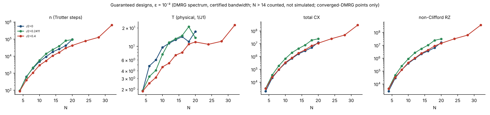
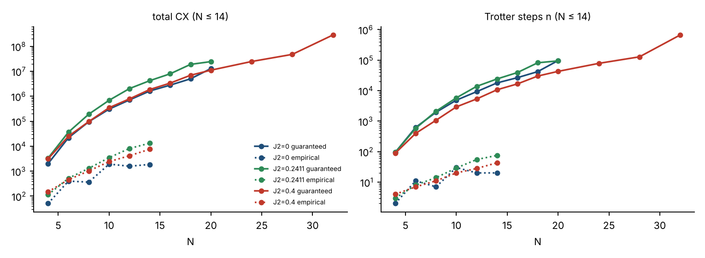
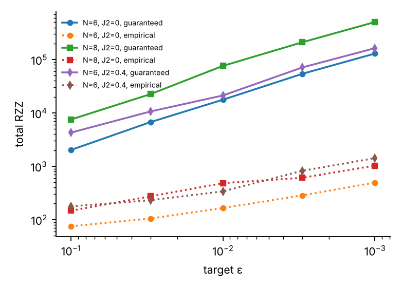

# Results: resource costs of the cosine-filter pipeline for the open J1–J2 chain

*Produced by `scripts/run_results.py` + `scripts/build_results.py` from the pipeline in this directory (`pipeline.py`, `floor.py`, `core/*`). Every number below is read from `results/data/*.json`; raw tables are in `results/tables/*.csv`.*

## 0. How to read this document

* **Pipeline.** DMRG (`get_energies`) → spectrum (`get_spectrum`) → L-layer approximate trial circuit (`mps-to-circuit`, L = 1) → filter design (`floor.py`, certified η) → snapped Trotter grid → counts. Settings are those in `pipeline.py`: first-order Lie–Trotter, ε targets as given, `SWEEP_L = 1`, `BANDWIDTH = "certified"` for the DMRG path, `SYNTH_EPS = 1e-3`.
* **Two designs per case.** *Guaranteed* = smallest n whose a-priori rigorous bound on 1−F is ≤ ε. *Empirical* = smallest n whose **measured** 1−F (against the exact ground state) is ≤ ε. The empirical design uses the exact ground state, so it is an oracle lower envelope, not something a practitioner can know in advance; it needs simulation and is therefore only available for N ≤ 14.
* **Everything uses the DMRG spectrum.** E0, E1 (orthogonality-penalty DMRG: lowest state of any symmetry orthogonal to ψ0) and E_top from DMRG; the bandwidth is the **certified** W = (c_I + Σ|c_β|) − E0, which is 1.6–1.9× larger than E_top − E0 here (XX+YY+ZZ is bounded term by term), so the scaled gap is smaller and T longer (Section 6). The DMRG gap, shift and γ are not certified: every guarantee below is a *conditional certificate* (exact only if the DMRG reference is exact; see `CERTIFICATION.tex`, Section 1 and Section 12).
* **N ≤ 14 versus N > 14.** For N ≤ 14 an exact-diagonalisation cross-check and statevector simulation of the filter are available: γ is the overlap with the ED ground state, and measured 1−F, P_succ and the state error are reported. For **N > 14 there is no ED, no statevector and no dense or sparse 2^N operator**: γ is the overlap of the DMRG MPS with the trial circuit simulated as an MPS (Aer matrix-product-state), the energy variance comes from MPO contractions, α is the same exact commutator sum as for small N (Table 1b), and circuits are **counted, not simulated** (no measured 1−F or P_succ; only the rigorous bound).
* **Time.** `T (scaled)` is the total evolution time Σtᵢ in units of 1/W; `T (phys)` = T/W in units of 1/J1 (H = Σ J S·S, J1 = 1). Pulses with kᵢ = 0 on the grid are dropped.
* **Counting.** One Trotter step of one pulse (all bonds, ancilla-controlled) is transpiled once with qiskit (`optimization_level=3`, basis cx/h/s/rz); filter counts = n × per-step + per pulse (one Rz(2φ), two H). At small n this was checked against a full transpile of the real early-abort circuit (Section 9). `RZ` counts every `rz` gate in the basis; `RZ (non-Cliff.)` only those whose angle is not a multiple of π/2 (the metric used for fault-tolerant cost; no T-count is reported because the synthesis constants are unverified). **Totals include the trial circuit.** Connectivity is all-to-all unless marked *line* (ancilla at the end of a line: pessimistic).
* **Success path.** All counts are for the all-zeros (success) path. The expected cost per accepted run is total ÷ P_succ (early abort makes it lower).

Data present: 66 (N, J2, ε) points, N from 4 to 32; 0 failed point(s).

## Summary

* **N ≤ 14, guaranteed designs, ε = 10⁻²:** 89–24,051 Trotter steps, 2,004–4,208,964 total CX, T (phys) 1.9–13.3 (1/J1).
* **Guaranteed versus empirical (oracle):** the guaranteed design uses 22–892× the steps and 21–874× the CX of the smallest n that empirically meets ε (median 153×).
* **N = 16–28 (DMRG/MPS only, counted not simulated), ε = 10⁻²:** 16,533–127,714 steps, 2.78e+06–4.74e+07 total CX, 3.63e+06–6.12e+07 non-Clifford RZ, T (phys) 7.9–20.8 (converged-DMRG points only; 0 further point(s) have an unconverged excited-state DMRG and are flagged in Section 7; 1 point(s) designed by the fallback FilterBuilder, marked † there, are excluded from these ranges and from the fits).
* **Scaling, J2 = 0:** guaranteed total CX ~ N^5.1 (R² 0.996), steps ~ N^4.0, CX per step ~ N^1.1 (fits over N = 6–20).
* **Scaling, J2 = 0.2411:** guaranteed total CX ~ N^5.5 (R² 0.998), steps ~ N^4.3, CX per step ~ N^1.2 (fits over N = 6–20).
* **Scaling, J2 = 0.4:** guaranteed total CX ~ N^5.0 (R² 0.999), steps ~ N^3.8, CX per step ~ N^1.1 (fits over N = 6–28).
* **Certified bandwidth:** W is 1.63–1.94× E_top − E0, so the scaled gap is that much smaller and T longer than with the exact bandwidth.
* **Bound violations among simulated points:** 0.

## 1. Case inputs (DMRG spectrum, certified bandwidth)

| N | J2 | E0 (DMRG) | E1 | E_top | |E0−E0(ED)| | |E1−E1(ED)| | E_top−E0 | W (certified) | W / (E_top−E0) | Δ (scaled gap) | γ (trial) | γ source | trial-circuit infidelity 1−γ | α used | Pauli terms | trial CX | trial RZ | trial RZ (non-Cliff.) | trial depth | E1 method | DMRG converged |
|---|---|---|---|---|---|---|---|---|---|---|---|---|---|---|---|---|---|---|---|---|---|
| 4 | 0 | -1.6160254038 | -0.9571067812 | 0.7500000000 | 2.3e-16 | 1.0e-15 | 2.3660 | 3.8660 | 1.63 | 0.17044 | 0.95534 | ED | 4.47e-02 | 0.1004 | 9 | 9 | 60 | 58 | 67 | local | yes |
| 6 | 0 | -2.4935771339 | -2.0019953569 | 1.2500000000 | 1.4e-15 | 1.3e-15 | 3.7436 | 6.2436 | 1.67 | 0.07873 | 0.89775 | ED | 1.02e-01 | 0.0770 | 15 | 15 | 100 | 96 | 111 | local | yes |
| 8 | 0 | -3.3749325987 | -2.9822404878 | 1.7500000000 | 1.4e-15 | 1.3e-15 | 5.1249 | 8.6249 | 1.68 | 0.04553 | 0.83631 | ED | 1.64e-01 | 0.0605 | 21 | 21 | 139 | 135 | 159 | local | yes |
| 10 | 0 | -4.2580352073 | -3.9306735895 | 2.2500000000 | 9.8e-15 | 9.3e-15 | 6.5080 | 11.0080 | 1.69 | 0.02974 | 0.77610 | ED | 2.24e-01 | 0.0495 | 27 | 27 | 179 | 173 | 203 | local | yes |
| 12 | 0 | -5.1420906328 | -4.8611479370 | 2.7500000000 | 5.1e-14 | 4.3e-14 | 7.8921 | 13.3921 | 1.70 | 0.02098 | 0.71707 | ED | 2.83e-01 | 0.0418 | 33 | 33 | 214 | 212 | 247 | local | yes |
| 14 | 0 | -6.0267246619 | -5.7804926045 | 3.2500000000 | 1.4e-13 | 9.9e-14 | 9.2767 | 15.7767 | 1.70 | 0.01561 | 0.66104 | ED | 3.39e-01 | 0.0362 | 39 | 39 | 254 | 249 | 291 | local | yes |
| 16 | 0 | -6.9117371456 | -6.6924604290 | 3.7500000000 | n/a (no ED) | n/a (no ED) | 10.6617 | 18.1617 | 1.70 | 0.01207 | 0.60837 | DMRG-MPS overlap (uncertified) | 3.92e-01 | 0.0318 | 45 | 45 | 295 | 288 | 335 | local | yes |
| 18 | 0 | -7.7970110685 | -7.5992848841 | 4.2500000000 | n/a (no ED) | n/a (no ED) | 12.0470 | 20.5470 | 1.71 | 0.00962 | 0.55222 | DMRG-MPS overlap (uncertified) | 4.48e-01 | 0.0284 | 51 | 51 | 335 | 324 | 379 | local | yes |
| 20 | 0 | -8.6824733344 | -8.5023786980 | 4.7500000000 | n/a (no ED) | n/a (no ED) | 13.4325 | 22.9325 | 1.71 | 0.00785 | 0.51390 | DMRG-MPS overlap (uncertified) | 4.86e-01 | 0.0257 | 57 | 57 | 372 | 360 | 423 | local | yes |
| 24 | 0 | -10.4537857604 | -10.3008340576 | 5.7500000000 | n/a (no ED) | n/a (no ED) | 16.2038 | 27.7038 | 1.71 | 0.00552 | 0.43330 | DMRG-MPS overlap (uncertified) | 5.67e-01 | 0.0215 | 69 | 69 | 446 | 435 | 511 | local | yes |
| 28 | 0 | -12.2254405486 | -12.0924250046 | 6.7500000000 | n/a (no ED) | n/a (no ED) | 18.9754 | 32.4754 | 1.71 | 0.00410 | 0.36470 | DMRG-MPS overlap (uncertified) | 6.35e-01 | 0.0185 | 81 | 81 | 518 | 508 | 599 | local | yes |
| 32 | 0 | -13.9973156182 | -13.8795758237 | 7.7500000000 | n/a (no ED) | n/a (no ED) | 21.7473 | 37.2473 | 1.71 | 0.00316 | 0.30812 | DMRG-MPS overlap (uncertified) | 6.92e-01 | 0.0162 | 93 | 93 | 598 | 581 | 687 | local | yes |
| 4 | 0.2411 | -1.5387409981 | -0.8776800957 | 0.8705500000 | 3.0e-17 | 3.3e-16 | 2.4093 | 4.1504 | 1.72 | 0.15928 | 0.98067 | ED | 1.93e-02 | 0.1340 | 15 | 9 | 60 | 58 | 67 | local | yes |
| 6 | 0.2411 | -2.3353474058 | -1.8475542730 | 1.4911000000 | 1.3e-15 | 4.4e-16 | 3.8264 | 6.8086 | 1.78 | 0.07164 | 0.94939 | ED | 5.06e-02 | 0.1041 | 27 | 15 | 100 | 97 | 115 | local | yes |
| 8 | 0.2411 | -3.1350011019 | -2.7491233495 | 2.1116500000 | 2.7e-15 | 4.4e-15 | 5.2467 | 9.4700 | 1.80 | 0.04075 | 0.91104 | ED | 8.90e-02 | 0.0820 | 39 | 21 | 138 | 135 | 159 | local | yes |
| 10 | 0.2411 | -3.9361281870 | -3.6170270856 | 2.7322000000 | 8.0e-15 | 9.3e-15 | 6.6683 | 12.1327 | 1.82 | 0.02630 | 0.86894 | ED | 1.31e-01 | 0.0672 | 51 | 27 | 177 | 171 | 203 | local | yes |
| 12 | 0.2411 | -4.7380770283 | -4.4660645236 | 3.3527500000 | 2.0e-14 | 7.3e-14 | 8.0908 | 14.7963 | 1.83 | 0.01838 | 0.82517 | ED | 1.75e-01 | 0.0567 | 63 | 33 | 214 | 208 | 243 | local | yes |
| 14 | 0.2411 | -5.5405306286 | -5.3034976901 | 3.9733000000 | 1.1e-13 | 1.3e-13 | 9.5138 | 17.4604 | 1.84 | 0.01358 | 0.78091 | ED | 2.19e-01 | 0.0490 | 75 | 39 | 250 | 246 | 291 | local | yes |
| 16 | 0.2411 | -6.3433164211 | -6.1332908175 | 4.5938500000 | n/a (no ED) | n/a (no ED) | 10.9372 | 20.1249 | 1.84 | 0.01044 | 0.73653 | DMRG-MPS overlap (uncertified) | 2.63e-01 | 0.0432 | 87 | 45 | 295 | 286 | 335 | local | yes |
| 18 | 0.2411 | -7.1463324487 | -6.9577882796 | 5.2144000000 | n/a (no ED) | n/a (no ED) | 12.3607 | 22.7895 | 1.84 | 0.00827 | 0.69448 | DMRG-MPS overlap (uncertified) | 3.06e-01 | 0.0385 | 99 | 51 | 328 | 319 | 379 | local | yes |
| 20 | 0.2411 | -7.9495146057 | -7.7784645690 | 5.8349500000 | n/a (no ED) | n/a (no ED) | 13.7845 | 25.4544 | 1.85 | 0.00672 | 0.65291 | DMRG-MPS overlap (uncertified) | 3.47e-01 | 0.0348 | 111 | 57 | 367 | 358 | 423 | local | yes |
| 24 | 0.2411 | -9.5562212540 | -9.4119433252 | 7.0760500000 | n/a (no ED) | n/a (no ED) | 16.6323 | 30.7844 | 1.85 | 0.00469 | 0.57540 | DMRG-MPS overlap (uncertified) | 4.25e-01 | 0.0291 | 135 | 69 | 446 | 431 | 511 | local | yes |
| 28 | 0.2411 | -11.1632298850 | -11.0384766852 | 8.3171500000 | n/a (no ED) | n/a (no ED) | 19.4804 | 36.1147 | 1.85 | 0.00345 | 0.50449 | DMRG-MPS overlap (uncertified) | 4.96e-01 | 0.0250 | 159 | 81 | 518 | 502 | 599 | local | yes |
| 32 | 0.2411 | -12.7704324927 | -12.6605489205 | 9.5582500000 | n/a (no ED) | n/a (no ED) | 22.3287 | 41.4452 | 1.86 | 0.00265 | 0.44151 | DMRG-MPS overlap (uncertified) | 5.58e-01 | 0.0220 | 183 | 93 | 601 | 581 | 687 | local | yes |
| 4 | 0.4 | -1.5067764363 | -0.8330951895 | 0.9500000000 | 1.8e-15 | 3.3e-16 | 2.4568 | 4.3568 | 1.77 | 0.15463 | 0.99594 | ED | 4.06e-03 | 0.1497 | 15 | 9 | 62 | 59 | 71 | local | yes |
| 6 | 0.4 | -2.2655348801 | -1.7633485573 | 1.6500000000 | 9.8e-15 | 1.8e-15 | 3.9155 | 7.2155 | 1.84 | 0.06960 | 0.98804 | ED | 1.20e-02 | 0.1165 | 27 | 15 | 99 | 96 | 111 | local | yes |
| 8 | 0.4 | -3.0251905645 | -2.6214818416 | 2.3500000000 | 1.1e-16 | 5.8e-15 | 5.3752 | 10.0752 | 1.87 | 0.04007 | 0.97704 | ED | 2.30e-02 | 0.0919 | 39 | 21 | 138 | 134 | 155 | local | yes |
| 10 | 0.4 | -3.7852888948 | -3.4451673343 | 3.0500000000 | 1.2e-14 | 3.9e-14 | 6.8353 | 12.9353 | 1.89 | 0.02629 | 0.96383 | ED | 3.62e-02 | 0.0752 | 51 | 27 | 180 | 173 | 203 | local | yes |
| 12 | 0.4 | -4.5456261627 | -4.2500350676 | 3.7500000000 | 1.2e-13 | 5.2e-14 | 8.2956 | 15.7956 | 1.90 | 0.01871 | 0.94883 | ED | 5.12e-02 | 0.0635 | 63 | 33 | 216 | 212 | 247 | local | yes |
| 14 | 0.4 | -5.3061027329 | -5.0435118006 | 4.4500000000 | 1.3e-13 | 9.9e-14 | 9.7561 | 18.6561 | 1.91 | 0.01408 | 0.93328 | ED | 6.67e-02 | 0.0549 | 75 | 39 | 256 | 250 | 291 | local | yes |
| 16 | 0.4 | -6.0666655720 | -5.8295569546 | 5.1500000000 | n/a (no ED) | n/a (no ED) | 11.2167 | 21.5167 | 1.92 | 0.01102 | 0.91695 | DMRG-MPS overlap (uncertified) | 8.30e-02 | 0.0483 | 87 | 45 | 292 | 285 | 335 | local | yes |
| 18 | 0.4 | -6.8272844181 | -6.6104747998 | 5.8500000000 | n/a (no ED) | n/a (no ED) | 12.6773 | 24.3773 | 1.92 | 0.00889 | 0.90005 | DMRG-MPS overlap (uncertified) | 9.99e-02 | 0.0431 | 99 | 51 | 333 | 326 | 379 | local | yes |
| 20 | 0.4 | -7.5879410154 | -7.3876995115 | 6.5500000000 | n/a (no ED) | n/a (no ED) | 14.1379 | 27.2379 | 1.93 | 0.00735 | 0.88328 | DMRG-MPS overlap (uncertified) | 1.17e-01 | 0.0389 | 111 | 57 | 366 | 353 | 423 | local | yes |
| 24 | 0.4 | -9.1093253675 | -8.9345357926 | 7.9500000000 | n/a (no ED) | n/a (no ED) | 17.0593 | 32.9593 | 1.93 | 0.00530 | 0.84910 | DMRG-MPS overlap (uncertified) | 1.51e-01 | 0.0326 | 135 | 69 | 439 | 432 | 511 | local | yes |
| 28 | 0.4 | -10.6307656965 | -10.4746379729 | 9.3500000000 | n/a (no ED) | n/a (no ED) | 19.9808 | 38.6808 | 1.94 | 0.00404 | 0.81528 | DMRG-MPS overlap (uncertified) | 1.85e-01 | 0.0280 | 159 | 81 | 519 | 504 | 598 | local | yes |
| 32 | 0.4 | -12.1522370500 | -12.0103923579 | 10.7500000000 | n/a (no ED) | n/a (no ED) | 22.9022 | 44.4022 | 1.94 | 0.00319 | 0.78233 | DMRG-MPS overlap (uncertified) | 2.18e-01 | 0.0246 | 183 | 93 | 596 | 578 | 687 | local | yes |

*Table 1.* The energies are DMRG values (10 digits); `|E0−E0(ED)|`, `|E1−E1(ED)|` are the DMRG errors against exact diagonalisation (N ≤ 14 here; N = 16–20 in Section 5; N ≥ 24 has no exact reference, see the run-to-run table in Section 5). **1−γ is not a DMRG error:** it is the infidelity of the low-depth (L = 1 brickwork) trial *circuit* with respect to the ground state, which is large by construction and is what the filter has to remove. *DMRG converged*: the ground-state, top-state and orthogonality-penalty excited-state DMRG runs each reached the sweep tolerance within 100 sweeps; a **NO** means that quantity (for the excited state, E1 and hence the gap Δ) is not converged and the design is only indicative. *E1 method*: `local` = projector penalty λ|ψ0⟩⟨ψ0| applied as a rank-1 term in every two-site local problem, giving the lowest state of any symmetry (checked against ED in Section 5). Trial circuit = L = 1 approximate brickwork circuit from the DMRG MPS. α is in scaled units: the exact commutator sum Σ_g‖[H_g, Σ_{g'>g}H_g']‖ for every N (computed on the local support of each term). W is the certified bandwidth; the scaled gap Δ = (E1−E0)/W is correspondingly 1.6–1.9× smaller than with the exact bandwidth.

**α: exact commutator sum against the triangle bound**

| N | J2 | α (exact commutator sum) | α triangle (diagnostic) | triangle / exact |
|---|---|---|---|---|
| 4 | 0 | 0.10036 | 0.10036 | 1.000 |
| 6 | 0 | 0.07696 | 0.07696 | 1.000 |
| 8 | 0 | 0.06049 | 0.06049 | 1.000 |
| 10 | 0 | 0.04951 | 0.04951 | 1.000 |
| 12 | 0 | 0.04182 | 0.04182 | 1.000 |
| 14 | 0 | 0.03616 | 0.03616 | 1.000 |
| 16 | 0 | 0.03183 | 0.03183 | 1.000 |
| 18 | 0 | 0.02842 | 0.02842 | 1.000 |
| 20 | 0 | 0.02567 | 0.02567 | 1.000 |
| 24 | 0 | 0.02150 | 0.02150 | 1.000 |
| 28 | 0 | 0.01849 | 0.01849 | 1.000 |
| 32 | 0 | 0.01622 | 0.01622 | 1.000 |
| 4 | 0.2411 | 0.13402 | 0.15006 | 1.120 |
| 6 | 0.2411 | 0.10406 | 0.12120 | 1.165 |
| 8 | 0.2411 | 0.08201 | 0.09648 | 1.177 |
| 10 | 0.2411 | 0.06715 | 0.07939 | 1.182 |
| 12 | 0.2411 | 0.05671 | 0.06724 | 1.186 |
| 14 | 0.2411 | 0.04903 | 0.05824 | 1.188 |
| 16 | 0.2411 | 0.04315 | 0.05133 | 1.189 |
| 18 | 0.2411 | 0.03852 | 0.04587 | 1.191 |
| 20 | 0.2411 | 0.03479 | 0.04145 | 1.192 |
| 24 | 0.2411 | 0.02912 | 0.03474 | 1.193 |
| 28 | 0.2411 | 0.02504 | 0.02989 | 1.194 |
| 32 | 0.2411 | 0.02196 | 0.02623 | 1.194 |
| 4 | 0.4 | 0.14971 | 0.17385 | 1.161 |
| 6 | 0.4 | 0.11653 | 0.14290 | 1.226 |
| 8 | 0.4 | 0.09190 | 0.11408 | 1.241 |
| 10 | 0.4 | 0.07524 | 0.09395 | 1.249 |
| 12 | 0.4 | 0.06353 | 0.07960 | 1.253 |
| 14 | 0.4 | 0.05491 | 0.06896 | 1.256 |
| 16 | 0.4 | 0.04833 | 0.06078 | 1.258 |
| 18 | 0.4 | 0.04314 | 0.05432 | 1.259 |
| 20 | 0.4 | 0.03895 | 0.04909 | 1.260 |
| 24 | 0.4 | 0.03260 | 0.04115 | 1.262 |
| 28 | 0.4 | 0.02803 | 0.03541 | 1.263 |
| 32 | 0.4 | 0.02458 | 0.03107 | 1.264 |

*Table 1b.* α is the exact value of Σ_g‖[H_g, Σ_{g'>g}H_g']‖ for every N (for Pauli terms it reduces to a small dense eigenvalue problem on the support of each term). The triangle-inequality value, which earlier versions used for N > 14, is shown for comparison: it is exact at J2 = 0 and up to about 1.25× larger otherwise.

## 2. Guaranteed designs, N ≤ 14, ε = 10⁻²

**Guaranteed: design and evolution time**

| N | J2 | pulses | n (steps) | kᵢ | T (scaled) | T (phys) | η cert. | ε bound | P_succ lb |
|---|---|---|---|---|---|---|---|---|---|
| 4 | 0 | 4 | 95 | [1, 15, 31, 48] | 7.37 | 1.91 | 0.287 | 9.92e-03 | 0.582 |
| 6 | 0 | 6 | 621 | [5, 38, 58, 100, 159, 261] | 29.93 | 4.79 | 0.092 | 9.99e-03 | 0.649 |
| 8 | 0 | 6 | 1,945 | [58, 100, 174, 285, 470, 858] | 51.75 | 6.00 | 0.099 | 9.46e-03 | 0.608 |
| 10 | 0 | 8 | 4,841 | [30, 87, 158, 263, 461, 825, 1188, 1829] | 105.64 | 9.60 | 0.058 | 1.00e-02 | 0.688 |
| 12 | 0 | 8 | 9,236 | [58, 163, 314, 515, 887, 1537, 2241, 3521] | 149.75 | 11.18 | 0.050 | 9.36e-03 | 0.599 |
| 14 | 0 | 8 | 17,845 | [153, 321, 576, 970, 1668, 2981, 4442, 6734] | 201.29 | 12.76 | 0.062 | 9.48e-03 | 0.593 |
| 4 | 0.2411 | 4 | 95 | [1, 15, 32, 47] | 7.89 | 1.90 | 0.313 | 9.97e-03 | 0.614 |
| 6 | 0.2411 | 4 | 578 | [44, 83, 162, 289] | 21.93 | 3.22 | 0.190 | 9.99e-03 | 0.596 |
| 8 | 0.2411 | 6 | 2,103 | [17, 18, 136, 289, 592, 1051] | 38.55 | 4.07 | 0.199 | 1.00e-02 | 0.582 |
| 10 | 0.2411 | 6 | 5,787 | [130, 262, 491, 824, 1448, 2632] | 89.59 | 7.38 | 0.113 | 1.00e-02 | 0.690 |
| 12 | 0.2411 | 8 | 13,785 | [86, 162, 323, 663, 1357, 2561, 3257, 5376] | 170.89 | 11.55 | 0.068 | 1.00e-02 | 0.761 |
| 14 | 0.2411 | 8 | 24,051 | [213, 427, 788, 1314, 2265, 4038, 5929, 9077] | 231.42 | 13.25 | 0.059 | 9.36e-03 | 0.693 |
| 4 | 0.4 | 4 | 89 | [1, 8, 35, 45] | 8.13 | 1.87 | 0.687 | 9.90e-03 | 0.995 |
| 6 | 0.4 | 4 | 396 | [20, 47, 131, 198] | 18.06 | 2.50 | 0.399 | 9.99e-03 | 0.730 |
| 8 | 0.4 | 4 | 1,062 | [68, 143, 320, 531] | 31.36 | 3.11 | 0.286 | 9.99e-03 | 0.576 |
| 10 | 0.4 | 6 | 2,921 | [24, 81, 163, 376, 816, 1461] | 59.74 | 4.62 | 0.227 | 1.00e-02 | 0.671 |
| 12 | 0.4 | 6 | 5,329 | [44, 156, 337, 719, 1408, 2665] | 83.94 | 5.31 | 0.189 | 1.00e-02 | 0.561 |
| 14 | 0.4 | 6 | 10,639 | [151, 290, 701, 1431, 2747, 5319] | 133.92 | 7.18 | 0.165 | 9.98e-03 | 0.684 |

**Guaranteed: gate counts (incl. trial circuit)**

| N | J2 | CX trial | CX filter | CX total | RZ total | RZ (non-Cliff.) | H total | depth total | E[CX]/accept | CX total (line) |
|---|---|---|---|---|---|---|---|---|---|---|
| 4 | 0 | 9 | 1,995 | 2,004 | 6,144 | 2,817 | 6,516 | 8,522 | 3,433 | 2,574 |
| 6 | 0 | 15 | 21,735 | 21,750 | 65,932 | 29,289 | 69,644 | 91,398 | 33,494 | 29,202 |
| 8 | 0 | 21 | 95,305 | 95,326 | 288,005 | 126,566 | 303,546 | 398,884 | 156,639 | 130,336 |
| 10 | 0 | 27 | 304,983 | 305,010 | 919,977 | 401,984 | 968,362 | 1,273,386 | 443,218 | 421,194 |
| 12 | 0 | 33 | 711,172 | 711,205 | 2,142,974 | 933,056 | 2,253,778 | 2,965,003 | 1,186,433 | 988,285 |
| 14 | 0 | 39 | 1,623,895 | 1,623,934 | 4,889,792 | 2,123,812 | 5,139,586 | 6,763,546 | 2,734,500 | 2,266,354 |
| 4 | 0.2411 | 9 | 3,325 | 3,334 | 10,419 | 4,527 | 10,411 | 14,032 | 5,421 | 5,456 |
| 6 | 0.2411 | 15 | 36,414 | 36,429 | 112,814 | 48,075 | 112,800 | 152,129 | 61,056 | 67,834 |
| 8 | 0.2411 | 21 | 191,373 | 191,394 | 591,087 | 250,398 | 591,069 | 797,196 | 328,003 | 344,913 |
| 10 | 0.2411 | 27 | 688,653 | 688,680 | 2,170,308 | 897,162 | 2,123,987 | 2,864,768 | 997,153 | 1,311,747 |
| 12 | 0.2411 | 33 | 2,026,395 | 2,026,428 | 6,244,827 | 2,633,151 | 6,244,797 | 8,422,878 | 2,661,630 | 3,896,593 |
| 14 | 0.2411 | 39 | 4,208,925 | 4,208,964 | 12,963,747 | 5,459,831 | 12,963,715 | 17,485,368 | 6,071,785 | 8,145,311 |
| 4 | 0.4 | 9 | 3,115 | 3,124 | 9,767 | 4,246 | 9,759 | 13,154 | 3,137 | 5,112 |
| 6 | 0.4 | 15 | 24,948 | 24,963 | 77,323 | 32,968 | 77,308 | 104,259 | 34,152 | 46,479 |
| 8 | 0.4 | 21 | 96,642 | 96,663 | 298,564 | 126,516 | 298,542 | 402,653 | 167,828 | 174,189 |
| 10 | 0.4 | 27 | 347,599 | 347,626 | 1,072,193 | 452,934 | 1,072,165 | 1,446,098 | 517,994 | 662,120 |
| 12 | 0.4 | 33 | 783,363 | 783,396 | 2,414,259 | 1,018,057 | 2,414,227 | 3,256,266 | 1,396,623 | 1,506,364 |
| 14 | 0.4 | 39 | 1,861,825 | 1,861,864 | 5,734,683 | 2,415,309 | 5,734,643 | 7,734,844 | 2,719,999 | 3,603,114 |

**Guaranteed: measured quality (noiseless)**

| N | J2 | measured 1−F | F (ED) | P_succ meas. | state err vs exact | bound holds | full-transpile CX (n ≤ 200) |
|---|---|---|---|---|---|---|---|
| 4 | 0 | 2.43e-03 | 0.99757 | 0.584 | 1.74e-04 | yes | 1,995 |
| 6 | 0 | 7.17e-04 | 0.99928 | 0.649 | 5.17e-04 | yes | – |
| 8 | 0 | 1.21e-03 | 0.99879 | 0.609 | 3.38e-04 | yes | – |
| 10 | 0 | 2.69e-04 | 0.99973 | 0.688 | 1.85e-04 | yes | – |
| 12 | 0 | 2.84e-04 | 0.99972 | 0.599 | 1.34e-04 | yes | – |
| 14 | 0 | 6.49e-04 | 0.99935 | 0.594 | 1.01e-04 | yes | – |
| 4 | 0.2411 | 6.62e-04 | 0.99934 | 0.615 | 1.22e-04 | yes | 3,325 |
| 6 | 0.2411 | 1.60e-03 | 0.99840 | 0.597 | 6.39e-04 | yes | – |
| 8 | 0.2411 | 2.91e-03 | 0.99709 | 0.584 | 3.32e-04 | yes | – |
| 10 | 0.2411 | 4.96e-04 | 0.99950 | 0.691 | 1.95e-04 | yes | – |
| 12 | 0.2411 | 2.62e-04 | 0.99974 | 0.761 | 1.89e-04 | yes | – |
| 14 | 0.2411 | 3.83e-04 | 0.99962 | 0.693 | 1.43e-04 | yes | – |
| 4 | 0.4 | 2.43e-04 | 0.99976 | 0.996 | 4.16e-03 | yes | 3,115 |
| 6 | 0.4 | 3.65e-04 | 0.99964 | 0.731 | 1.01e-03 | yes | – |
| 8 | 0.4 | 5.02e-04 | 0.99950 | 0.576 | 9.22e-04 | yes | – |
| 10 | 0.4 | 3.72e-04 | 0.99963 | 0.671 | 5.74e-04 | yes | – |
| 12 | 0.4 | 4.45e-04 | 0.99955 | 0.561 | 4.33e-04 | yes | – |
| 14 | 0.4 | 4.52e-04 | 0.99955 | 0.685 | 3.02e-04 | yes | – |

*Tables 2a–c.* Rigorous a-priori n: the bound on 1−F is ≤ ε. Measured 1−F is typically far below ε (the bound is conservative).

## 3. Empirical (oracle) designs, N ≤ 14, ε = 10⁻²

**Empirical: design and evolution time**

| N | J2 | pulses | n (steps) | kᵢ | T (scaled) | T (phys) | η cert. | ε bound | P_succ lb |
|---|---|---|---|---|---|---|---|---|---|
| 4 | 0 | 2 | 2 | [1, 1] | 7.37 | 1.91 | 1.000 | 1.00e+00 | 0.955 |
| 6 | 0 | 5 | 11 | [1, 1, 2, 3, 4] | 29.93 | 4.79 | 0.109 | 1.00e+00 | 0.440 |
| 8 | 0 | 4 | 7 | [1, 1, 2, 3] | 51.75 | 6.00 | 1.000 | 1.00e+00 | 0.836 |
| 10 | 0 | 7 | 30 | [1, 1, 2, 3, 5, 7, 11] | 105.64 | 9.60 | 1.008 | 1.00e+00 | 0.021 |
| 12 | 0 | 6 | 20 | [1, 1, 2, 3, 5, 8] | 149.75 | 11.18 | 1.009 | 1.00e+00 | 0.549 |
| 14 | 0 | 6 | 20 | [1, 1, 2, 3, 5, 8] | 201.29 | 12.76 | 1.000 | 1.00e+00 | 0.661 |
| 4 | 0.2411 | 2 | 3 | [1, 2] | 7.89 | 1.90 | 0.523 | 1.00e+00 | 0.886 |
| 6 | 0.2411 | 4 | 8 | [1, 1, 2, 4] | 21.93 | 3.22 | 0.272 | 1.00e+00 | 0.301 |
| 8 | 0.2411 | 4 | 14 | [1, 2, 4, 7] | 38.55 | 4.07 | 0.221 | 1.00e+00 | 0.635 |
| 10 | 0.2411 | 6 | 29 | [1, 1, 3, 4, 7, 13] | 89.59 | 7.38 | 0.460 | 1.00e+00 | 0.290 |
| 12 | 0.2411 | 7 | 55 | [1, 1, 3, 5, 10, 13, 22] | 170.89 | 11.55 | 0.298 | 1.00e+00 | 0.346 |
| 14 | 0.2411 | 8 | 75 | [1, 1, 2, 4, 7, 13, 19, 28] | 231.42 | 13.25 | 0.094 | 1.00e+00 | 0.664 |
| 4 | 0.4 | 2 | 4 | [2, 2] | 8.13 | 1.87 | 1.000 | 1.00e+00 | 0.996 |
| 6 | 0.4 | 3 | 7 | [1, 2, 4] | 18.06 | 2.50 | 0.399 | 1.00e+00 | 0.809 |
| 8 | 0.4 | 4 | 11 | [1, 1, 3, 6] | 31.36 | 3.11 | 0.334 | 1.00e+00 | 0.682 |
| 10 | 0.4 | 4 | 20 | [1, 3, 6, 10] | 59.74 | 4.62 | 0.451 | 1.00e+00 | 0.721 |
| 12 | 0.4 | 5 | 28 | [1, 2, 4, 7, 14] | 83.94 | 5.31 | 0.235 | 1.00e+00 | 0.618 |
| 14 | 0.4 | 6 | 43 | [1, 1, 3, 6, 11, 21] | 133.92 | 7.18 | 0.617 | 1.00e+00 | 0.288 |

**Empirical: gate counts (incl. trial circuit)**

| N | J2 | CX trial | CX filter | CX total | RZ total | RZ (non-Cliff.) | H total | depth total | E[CX]/accept | CX total (line) |
|---|---|---|---|---|---|---|---|---|---|---|
| 4 | 0 | 9 | 42 | 51 | 190 | 118 | 188 | 245 | 54 | 63 |
| 6 | 0 | 15 | 385 | 400 | 1,271 | 618 | 1,322 | 1,728 | 951 | 532 |
| 8 | 0 | 21 | 343 | 364 | 1,179 | 594 | 1,214 | 1,594 | 475 | 490 |
| 10 | 0 | 27 | 1,890 | 1,917 | 5,886 | 2,670 | 6,160 | 8,093 | 92,222 | 2,637 |
| 12 | 0 | 33 | 1,540 | 1,573 | 4,860 | 2,238 | 5,070 | 6,667 | 2,958 | 2,173 |
| 14 | 0 | 39 | 1,820 | 1,859 | 5,740 | 2,635 | 5,982 | 7,871 | 3,986 | 2,579 |
| 4 | 0.2411 | 9 | 105 | 114 | 389 | 201 | 379 | 508 | 128 | 181 |
| 6 | 0.2411 | 15 | 504 | 519 | 1,664 | 765 | 1,650 | 2,219 | 1,744 | 954 |
| 8 | 0.2411 | 21 | 1,274 | 1,295 | 4,076 | 1,805 | 4,056 | 5,465 | 2,087 | 2,317 |
| 10 | 0.2411 | 27 | 3,451 | 3,478 | 11,058 | 4,672 | 10,801 | 14,558 | 11,650 | 6,600 |
| 12 | 0.2411 | 33 | 8,085 | 8,118 | 25,136 | 10,720 | 25,105 | 33,848 | 22,467 | 15,580 |
| 14 | 0.2411 | 39 | 13,125 | 13,164 | 40,683 | 17,279 | 40,651 | 54,816 | 19,999 | 25,439 |
| 4 | 0.4 | 9 | 140 | 149 | 500 | 249 | 490 | 659 | 150 | 238 |
| 6 | 0.4 | 15 | 441 | 456 | 1,467 | 680 | 1,451 | 1,952 | 582 | 836 |
| 8 | 0.4 | 21 | 1,001 | 1,022 | 3,233 | 1,447 | 3,211 | 4,324 | 1,564 | 1,825 |
| 10 | 0.4 | 27 | 2,380 | 2,407 | 7,524 | 3,277 | 7,494 | 10,103 | 3,362 | 4,560 |
| 12 | 0.4 | 33 | 4,116 | 4,149 | 12,905 | 5,565 | 12,872 | 17,355 | 7,016 | 7,948 |
| 14 | 0.4 | 39 | 7,525 | 7,564 | 23,439 | 10,017 | 23,399 | 31,552 | 25,765 | 14,602 |

**Empirical: measured quality (noiseless)**

| N | J2 | measured 1−F | F (ED) | P_succ meas. | state err vs exact | bound holds | full-transpile CX (n ≤ 200) |
|---|---|---|---|---|---|---|---|
| 4 | 0 | 2.49e-03 | 0.99751 | 0.942 | 3.58e-02 | yes | 42 |
| 6 | 0 | 7.07e-04 | 0.99929 | 0.421 | 2.71e-02 | yes | 385 |
| 8 | 0 | 6.39e-03 | 0.99361 | 0.766 | 9.25e-02 | yes | 343 |
| 10 | 0 | 5.05e-03 | 0.99495 | 0.021 | 6.96e-02 | yes | 1,890 |
| 12 | 0 | 4.22e-03 | 0.99578 | 0.532 | 9.28e-02 | yes | 1,540 |
| 14 | 0 | 7.57e-03 | 0.99243 | 0.466 | 1.22e-01 | yes | 1,820 |
| 4 | 0.2411 | 8.52e-03 | 0.99148 | 0.888 | 5.52e-02 | yes | 105 |
| 6 | 0.2411 | 7.05e-03 | 0.99295 | 0.298 | 4.21e-02 | yes | 504 |
| 8 | 0.2411 | 7.32e-03 | 0.99268 | 0.620 | 4.83e-02 | yes | 1,274 |
| 10 | 0.2411 | 6.76e-03 | 0.99324 | 0.299 | 8.32e-02 | yes | 3,451 |
| 12 | 0.2411 | 5.75e-03 | 0.99425 | 0.361 | 7.30e-02 | yes | 8,085 |
| 14 | 0.2411 | 2.90e-03 | 0.99710 | 0.658 | 4.79e-02 | yes | 13,125 |
| 4 | 0.4 | 8.44e-03 | 0.99156 | 0.995 | 1.04e-01 | yes | 140 |
| 6 | 0.4 | 5.56e-03 | 0.99444 | 0.783 | 7.54e-02 | yes | 441 |
| 8 | 0.4 | 7.53e-03 | 0.99247 | 0.653 | 8.73e-02 | yes | 1,001 |
| 10 | 0.4 | 8.00e-03 | 0.99200 | 0.716 | 9.93e-02 | yes | 2,380 |
| 12 | 0.4 | 7.93e-03 | 0.99207 | 0.591 | 8.34e-02 | yes | 4,116 |
| 14 | 0.4 | 9.01e-03 | 0.99099 | 0.294 | 1.25e-01 | yes | 7,525 |

*Tables 3a–c.* Smallest n on the sweep whose *measured* 1−F ≤ ε; an oracle (uses the exact ground state). At very small n the first-order Trotter error can be accidentally small, so the empirical n is a lower envelope, not a design a practitioner could trust.

## 4. Cost of one Trotter step

| N | J2 | bonds | Pauli terms | CX | H | RZ | RZ (non-Cliff.) | depth | CX (line, 3-step avg) | line / a2a |
|---|---|---|---|---|---|---|---|---|---|---|
| 4 | 0 | 3 | 9 | 21 | 68 | 64 | 29 | 89 | 27.0 | 1.29 |
| 6 | 0 | 5 | 15 | 35 | 112 | 106 | 47 | 147 | 47.0 | 1.34 |
| 8 | 0 | 7 | 21 | 49 | 156 | 148 | 65 | 205 | 67.0 | 1.37 |
| 10 | 0 | 9 | 27 | 63 | 200 | 190 | 83 | 263 | 87.0 | 1.38 |
| 12 | 0 | 11 | 33 | 77 | 244 | 232 | 101 | 321 | 107.0 | 1.39 |
| 14 | 0 | 13 | 39 | 91 | 288 | 274 | 119 | 379 | 127.0 | 1.40 |
| 16 | 0 | 15 | 45 | 105 | 332 | 316 | 137 | 437 | 147.0 | 1.40 |
| 18 | 0 | 17 | 51 | 119 | 376 | 358 | 155 | 495 | 167.0 | 1.40 |
| 20 | 0 | 19 | 57 | 133 | 420 | 400 | 173 | 553 | 187.0 | 1.41 |
| 24 | 0 | 23 | 69 | 161 | 508 | 484 | 209 | 669 | 232.3 | 1.44 |
| 28 | 0 | 27 | 81 | 189 | 596 | 568 | 245 | 785 | 622.3 | 3.29 |
| 32 | 0 | 31 | 93 | 217 | 684 | 652 | 281 | 901 | 742.0 | 3.42 |
| 4 | 0.2411 | 5 | 15 | 35 | 109 | 109 | 47 | 147 | 57.3 | 1.64 |
| 6 | 0.2411 | 9 | 27 | 63 | 195 | 195 | 83 | 263 | 117.3 | 1.86 |
| 8 | 0.2411 | 13 | 39 | 91 | 281 | 281 | 119 | 379 | 164.0 | 1.80 |
| 10 | 0.2411 | 17 | 51 | 119 | 367 | 375 | 155 | 495 | 226.7 | 1.90 |
| 12 | 0.2411 | 21 | 63 | 147 | 453 | 453 | 191 | 611 | 282.7 | 1.92 |
| 14 | 0.2411 | 25 | 75 | 175 | 539 | 539 | 227 | 727 | 338.7 | 1.94 |
| 16 | 0.2411 | 29 | 87 | 203 | 625 | 625 | 263 | 843 | 394.7 | 1.94 |
| 18 | 0.2411 | 33 | 99 | 231 | 711 | 711 | 299 | 959 | 450.7 | 1.95 |
| 20 | 0.2411 | 37 | 111 | 259 | 797 | 797 | 335 | 1,075 | 506.7 | 1.96 |
| 24 | 0.2411 | 45 | 135 | 315 | 969 | 969 | 407 | 1,307 | 1230.7 | 3.91 |
| 28 | 0.2411 | 53 | 159 | 371 | 1,141 | 1,141 | 479 | 1,539 | 1999.0 | 5.39 |
| 32 | 0.2411 | 61 | 183 | 427 | 1,313 | 1,313 | 551 | 1,771 | 2540.7 | 5.95 |
| 4 | 0.4 | 5 | 15 | 35 | 109 | 109 | 47 | 147 | 57.3 | 1.64 |
| 6 | 0.4 | 9 | 27 | 63 | 195 | 195 | 83 | 263 | 117.3 | 1.86 |
| 8 | 0.4 | 13 | 39 | 91 | 281 | 281 | 119 | 379 | 164.0 | 1.80 |
| 10 | 0.4 | 17 | 51 | 119 | 367 | 367 | 155 | 495 | 226.7 | 1.90 |
| 12 | 0.4 | 21 | 63 | 147 | 453 | 453 | 191 | 611 | 282.7 | 1.92 |
| 14 | 0.4 | 25 | 75 | 175 | 539 | 539 | 227 | 727 | 338.7 | 1.94 |
| 16 | 0.4 | 29 | 87 | 203 | 625 | 639 | 263 | 843 | 394.7 | 1.94 |
| 18 | 0.4 | 33 | 99 | 231 | 711 | 711 | 299 | 959 | 450.7 | 1.95 |
| 20 | 0.4 | 37 | 111 | 259 | 797 | 797 | 335 | 1,075 | 506.7 | 1.96 |
| 24 | 0.4 | 45 | 135 | 315 | 969 | 969 | 407 | 1,307 | 1230.7 | 3.91 |
| 28 | 0.4 | 53 | 159 | 371 | 1,141 | 1,141 | 479 | 1,539 | 1999.0 | 5.39 |
| 32 | 0.4 | 61 | 183 | 427 | 1,313 | 1,313 | 551 | 1,771 | 2540.7 | 5.95 |

*Table 4.* Transpiled counts of one Trotter step of one pulse (all bonds, ancilla-controlled), all-to-all, plus the line-connectivity cost. CX per step grows linearly with the number of bonds; J2 ≠ 0 roughly doubles it (J2 = 0.2411 and 0.4 have identical circuits per step, only the angles differ). The line-connectivity figure depends on the transpiler's routing, which is not smooth in N (e.g. N = 24, J2 = 0.2411); treat it as indicative.

## 5. Accuracy of the DMRG inputs

The certificate depends on E0, E1 (through Δ), the DMRG cross-check of E_top, and γ, all of which come from DMRG (`get_energies.py`). The settings, chosen so that two-site DMRG reaches roughly machine precision on these 1D chains:

| setting | value | role |
|---|---|---|
| bond dimensions | 8, 16, 32, 64, 128, 256 (one per sweep stage) | the cutoff, not this cap, limits the bond dimension here (χ reached: 40–100 for N = 12–24) |
| SVD cutoff | 1e-14 | discarded weight per bond ≈ energy error in 1D |
| energy tolerance | 1e-12 | stop when the energy changes by less between sweeps |
| inner Lanczos tolerance | 1e-10 (retry ×100, ×1e4 if ARPACK fails) | quimb's default is 1e-3 |
| E1 (all N) | H + 1.1·bandwidth·|ψ0⟩⟨ψ0|, projector applied as a rank-1 term in each two-site local solve | lowest state of any symmetry; avoids the χ²-bond projector MPO, which ran out of memory at N ≥ 16 with these tolerances |
| max sweeps | 100 | convergence flags are recorded in Table 1 |

**DMRG against exact diagonalisation** (N ≤ 14 from the main runs; N ≥ 16 from `scripts/validate_dmrg.py ed`, exact reference used for testing only)

| N | J2 | |E0 − E0(ED)| | |E1 − E1(ED)| | |E_top − E_top(ED)| | |ΔE1| / gap | 1 − |⟨ψ0|ψ0(ED)⟩|² | E1 method | converged | max bond |
|---|---|---|---|---|---|---|---|---|---|
| 4 | 0 | 2.3e-16 | 1.0e-15 | 4.2e-17 | 1.5e-15 | 6.7e-16 | local | yes | 4 |
| 6 | 0 | 1.4e-15 | 1.3e-15 | 3.3e-15 | 2.7e-15 | -1.3e-15 | local | yes | 8 |
| 8 | 0 | 1.4e-15 | 1.3e-15 | 2.7e-15 | 3.4e-15 | -1.8e-15 | local | yes | 16 |
| 10 | 0 | 9.8e-15 | 9.3e-15 | 2.7e-15 | 2.8e-14 | -1.3e-15 | local | yes | 32 |
| 12 | 0 | 5.1e-14 | 4.3e-14 | 1.1e-14 | 1.5e-13 | 4.2e-15 | local | yes | 45 |
| 14 | 0 | 1.4e-13 | 9.9e-14 | 4.4e-15 | 4.0e-13 | 3.3e-14 | local | yes | 49 |
| 4 | 0.2411 | 3.0e-17 | 3.3e-16 | 5.6e-16 | 5.0e-16 | -4.4e-16 | local | yes | 4 |
| 6 | 0.2411 | 1.3e-15 | 4.4e-16 | 1.3e-15 | 9.1e-16 | 2.2e-16 | local | yes | 8 |
| 8 | 0.2411 | 2.7e-15 | 4.4e-15 | 1.8e-15 | 1.2e-14 | -8.9e-16 | local | yes | 16 |
| 10 | 0.2411 | 8.0e-15 | 9.3e-15 | 2.2e-15 | 2.9e-14 | -4.4e-16 | local | yes | 32 |
| 12 | 0.2411 | 2.0e-14 | 7.3e-14 | 4.9e-15 | 2.7e-13 | 5.6e-15 | local | yes | 42 |
| 14 | 0.2411 | 1.1e-13 | 1.3e-13 | 1.3e-14 | 5.6e-13 | 3.1e-14 | local | yes | 54 |
| 4 | 0.4 | 1.8e-15 | 3.3e-16 | 7.9e-16 | 4.9e-16 | 6.7e-16 | local | yes | 4 |
| 6 | 0.4 | 9.8e-15 | 1.8e-15 | 8.9e-16 | 3.5e-15 | 2.2e-16 | local | yes | 8 |
| 8 | 0.4 | 1.1e-16 | 5.8e-15 | 4.4e-15 | 1.4e-14 | 6.7e-16 | local | yes | 16 |
| 10 | 0.4 | 1.2e-14 | 3.9e-14 | 1.1e-14 | 1.1e-13 | 1.1e-15 | local | yes | 28 |
| 12 | 0.4 | 1.2e-13 | 5.2e-14 | 5.4e-15 | 1.8e-13 | 1.9e-14 | local | yes | 46 |
| 14 | 0.4 | 1.3e-13 | 9.9e-14 | 1.2e-14 | 3.8e-13 | 3.3e-14 | local | yes | 61 |
| 16 | 0 | 2.4e-13 | 2.1e-13 | 1.4e-14 | 1.5e-13 | 4.4e-14 | local | yes | 62 |
| 18 | 0 | 1.9e-13 | 2.7e-13 | 8.9e-16 | 4.1e-13 | 6.0e-14 | local | yes | 66 |
| 20 | 0 | 3.5e-13 | 3.3e-13 | 2.7e-14 | 8.9e-14 | 8.1e-14 | local | yes | 77 |
| 16 | 0.2411 | 1.6e-13 | 2.4e-13 | 6.2e-15 | 3.6e-13 | 5.1e-14 | local | yes | 65 |
| 18 | 0.2411 | 2.2e-13 | 2.6e-13 | 1.3e-13 | 2.3e-13 | 5.4e-14 | local | yes | 68 |
| 20 | 0.2411 | 2.9e-13 | 3.4e-13 | 3.6e-15 | 3.2e-13 | 6.3e-14 | local | yes | 77 |
| 16 | 0.4 | 3.0e-13 | 2.8e-13 | 8.0e-15 | 7.9e-14 | 6.8e-14 | local | yes | 70 |
| 18 | 0.4 | 3.7e-13 | 2.4e-13 | 8.9e-16 | 6.0e-13 | 7.9e-14 | local | yes | 79 |
| 20 | 0.4 | 3.7e-13 | 2.9e-13 | 5.3e-15 | 4.3e-13 | 6.8e-14 | local | yes | 86 |

*Table 5a.* Absolute errors of the DMRG energies, the relative error of the gap (|ΔE1|/gap for N ≤ 14, where the E0 error is negligible next to it), and the overlap deficit of the ground state, against exact diagonalisation.

**No exact reference: two independent runs from different random starts (N ≥ 24)**

| N | J2 | E0 | E1 | run-to-run |ΔE0| | |ΔE1| | |ΔE_top| | 1 − overlap(ψ0, ψ0′) | variance of ψ0 (a / b) | variance of ψ1 (a / b) | converged | max bond |
|---|---|---|---|---|---|---|---|---|---|---|---|
| 24 | 0 | -10.45378576 | -10.30083406 | 3.0e-14 | 3.6e-15 | 2.9e-14 | 4.7e-14 | 3.2e-12 / 2.6e-12 | 2.4e-12 / 2.4e-12 | yes | 91 |
| 28 | 0 | -12.22544055 | -12.09242500 | 1.4e-14 | 3.0e-14 | 8.8e-14 | 1.8e-14 | 3.2e-12 / 3.5e-12 | 2.9e-12 / 2.8e-12 | yes | 100 |
| 24 | 0.2411 | -9.55622125 | -9.41194333 | 7.1e-15 | 2.3e-14 | 1.5e-14 | 5.2e-14 | 2.4e-12 / 2.4e-12 | 2.4e-12 / 2.3e-12 | yes | 88 |
| 24 | 0.4 | -9.10932537 | -8.93453579 | 2.0e-14 | 2.7e-14 | 3.6e-14 | 2.3e-14 | 3.0e-12 / 2.8e-12 | 2.3e-12 / 2.6e-12 | yes | 103 |

*Table 5b.* Agreement between two independent DMRG runs and the energy variance ⟨H²⟩ − ⟨H⟩² of each state. A state with variance s² has an exact eigenvalue within s of its energy; run-to-run agreement at 1e-13 or better together with variances of order 1e-12 is strong evidence of convergence, but it is not a proof that E1 is the second-lowest level.

**The ground-state weight γ used for N > 14 against the dense value**

| N | J2 | γ, MPS contraction (no ED, no statevector) | γ, dense overlap with exact ground state | difference |
|---|---|---|---|---|
| 16 | 0 | 0.606802310650 | 0.606802312131 | -1.5e-09 |
| 18 | 0 | 0.554637097041 | 0.554637099565 | -2.5e-09 |
| 16 | 0.2411 | 0.736784131818 | 0.736784132514 | -7.0e-10 |
| 18 | 0.2411 | 0.694543127658 | 0.694543127932 | -2.7e-10 |
| 16 | 0.4 | 0.916938666774 | 0.916938666766 | +7.8e-12 |
| 18 | 0.4 | 0.900035947685 | 0.900035947967 | -2.8e-10 |

*Table 5c.* γ is the overlap of the DMRG ground state with the trial circuit. The N > 14 path computes it by MPS contraction; the dense value is for checking only.

## 6. Effect of the certified bandwidth

The certified bandwidth W = (c_I + Σ|c_β|) − E0 is a rigorous upper bound on E_top − E0 that does not rely on DMRG's E_top. It is larger than E_top − E0 (ratio in Table 1, column *W / (E_top−E0)*), which shrinks the scaled gap Δ = (E1−E0)/W, lengthens the total scaled time T ≈ xπ/Δ and multiplies the step count n ∝ α T². In physical units (1/J1) T is unchanged by the choice of W only if the filter window could use the exact bandwidth; here the window [Δ, 1] is wider than needed.

| N | J2 | W / (E_top−E0) | Δ certified | Δ with exact bandwidth | ratio |
|---|---|---|---|---|---|
| 4 | 0 | 1.63 | 0.17044 | 0.27849 | 1.63 |
| 6 | 0 | 1.67 | 0.07873 | 0.13131 | 1.67 |
| 8 | 0 | 1.68 | 0.04553 | 0.07662 | 1.68 |
| 10 | 0 | 1.69 | 0.02974 | 0.05030 | 1.69 |
| 12 | 0 | 1.70 | 0.02098 | 0.03560 | 1.70 |
| 14 | 0 | 1.70 | 0.01561 | 0.02654 | 1.70 |
| 16 | 0 | 1.70 | 0.01207 | 0.02057 | 1.70 |
| 18 | 0 | 1.71 | 0.00962 | 0.01641 | 1.71 |
| 20 | 0 | 1.71 | 0.00785 | 0.01341 | 1.71 |
| 24 | 0 | 1.71 | 0.00552 | 0.00944 | 1.71 |
| 28 | 0 | 1.71 | 0.00410 | 0.00701 | 1.71 |
| 32 | 0 | 1.71 | 0.00316 | 0.00541 | 1.71 |
| 4 | 0.2411 | 1.72 | 0.15928 | 0.27438 | 1.72 |
| 6 | 0.2411 | 1.78 | 0.07164 | 0.12748 | 1.78 |
| 8 | 0.2411 | 1.80 | 0.04075 | 0.07355 | 1.80 |
| 10 | 0.2411 | 1.82 | 0.02630 | 0.04785 | 1.82 |
| 12 | 0.2411 | 1.83 | 0.01838 | 0.03362 | 1.83 |
| 14 | 0.2411 | 1.84 | 0.01358 | 0.02491 | 1.84 |
| 16 | 0.2411 | 1.84 | 0.01044 | 0.01920 | 1.84 |
| 18 | 0.2411 | 1.84 | 0.00827 | 0.01525 | 1.84 |
| 20 | 0.2411 | 1.85 | 0.00672 | 0.01241 | 1.85 |
| 24 | 0.2411 | 1.85 | 0.00469 | 0.00867 | 1.85 |
| 28 | 0.2411 | 1.85 | 0.00345 | 0.00640 | 1.85 |
| 32 | 0.2411 | 1.86 | 0.00265 | 0.00492 | 1.86 |
| 4 | 0.4 | 1.77 | 0.15463 | 0.27421 | 1.77 |
| 6 | 0.4 | 1.84 | 0.06960 | 0.12825 | 1.84 |
| 8 | 0.4 | 1.87 | 0.04007 | 0.07511 | 1.87 |
| 10 | 0.4 | 1.89 | 0.02629 | 0.04976 | 1.89 |
| 12 | 0.4 | 1.90 | 0.01871 | 0.03563 | 1.90 |
| 14 | 0.4 | 1.91 | 0.01408 | 0.02692 | 1.91 |
| 16 | 0.4 | 1.92 | 0.01102 | 0.02114 | 1.92 |
| 18 | 0.4 | 1.92 | 0.00889 | 0.01710 | 1.92 |
| 20 | 0.4 | 1.93 | 0.00735 | 0.01416 | 1.93 |
| 24 | 0.4 | 1.93 | 0.00530 | 0.01025 | 1.93 |
| 28 | 0.4 | 1.94 | 0.00404 | 0.00781 | 1.94 |
| 32 | 0.4 | 1.94 | 0.00319 | 0.00619 | 1.94 |

*Table 5.* Certified versus exact bandwidth: the scaled gap is smaller by the factor W / (E_top−E0). Because n ∝ T² ∝ Δ⁻², using the exact bandwidth would reduce the guaranteed step count by roughly the square of that ratio (not re-run here).

## 7. Larger J1–J2 chains (N = 14–32): resource costs

N ≥ 16 is **DMRG/MPS only**: γ is the DMRG-MPS overlap of the trial circuit, the gap is DMRG's, W is certified, α is the exact commutator sum, and there is no ED, no statevector and no dense operator anywhere. The designs are therefore conditional certificates: rigorous *given* γ, the gap and the shift (see `CERTIFICATION.tex`). Circuits are **not simulated**; their counts are n × the transpiled per-step cost plus the trial circuit, validated against full transpiles at n = 48 (Section 9). N = 14 (statevector-simulated, ED cross-checked) is included for continuity.

**Guaranteed designs, ε = 0.01**

| N | J2 | γ | Δ | W | α | pulses | n (steps) | T (scaled) | T (phys) | CX trial | CX filter | CX total | RZ total | RZ (non-Cliff.) | H total | depth | P_succ lb | ε bound | CX total (line) | DMRG converged |
|---|---|---|---|---|---|---|---|---|---|---|---|---|---|---|---|---|---|---|---|---|
| 14 | 0 | 0.6610 | 0.0156 | 15.78 | 0.0362 | 8 | 17,845 | 201.3 | 12.76 | 39 | 1,623,895 | 1,623,934 | 4,889,792 | 2,123,812 | 5,139,586 | 6,763,546 | 0.593 | 9.48e-03 | 2,266,354 | yes |
| 16 | 0 | 0.6084 | 0.0121 | 18.16 | 0.0318 | 8 | 26,483 | 260.2 | 14.33 | 45 | 2,780,715 | 2,780,760 | 8,368,931 | 3,628,467 | 8,792,614 | 11,573,406 | 0.529 | 1.00e-02 | 3,893,046 | yes |
| 18 | 0 | 0.5522 | 0.0096 | 20.55 | 0.0284 | 8 | 41,841 | 244.8 | 11.92 | 51 | 4,979,079 | 4,979,130 | 14,979,421 | 6,485,687 | 15,732,506 | 20,711,674 | 0.292 | 9.99e-03 | 6,987,498 | yes |
| 20 | 0 | 0.5139 | 0.0079 | 22.93 | 0.0257 | 8 | 96,275 | 400.0 | 17.44 | 57 | 12,804,575 | 12,804,632 | 38,510,380 | 16,655,943 | 40,435,822 | 53,240,498 | 0.367 | 9.67e-03 | 18,003,482 | yes |
| 14 | 0.2411 | 0.7809 | 0.0136 | 17.46 | 0.0490 | 8 | 24,051 | 231.4 | 13.25 | 39 | 4,208,925 | 4,208,964 | 12,963,747 | 5,459,831 | 12,963,715 | 17,485,368 | 0.693 | 9.36e-03 | 8,145,311 | yes |
| 16 | 0.2411 | 0.7365 | 0.0104 | 20.12 | 0.0432 | 8 | 38,988 | 301.0 | 14.96 | 45 | 7,914,564 | 7,914,609 | 24,367,803 | 10,254,138 | 24,367,758 | 32,867,219 | 0.585 | 9.38e-03 | 15,387,309 | yes |
| 18 | 0.2411 | 0.6945 | 0.0083 | 22.79 | 0.0385 | 8 | 81,570 | 474.7 | 20.83 | 51 | 18,842,670 | 18,842,721 | 57,996,606 | 24,389,757 | 57,996,560 | 78,226,009 | 0.658 | 9.45e-03 | 36,760,931 | yes |
| 20 | 0.2411 | 0.6529 | 0.0067 | 25.45 | 0.0348 | 8 | 93,968 | 350.6 | 13.77 | 57 | 24,337,712 | 24,337,769 | 74,892,871 | 31,479,646 | 74,892,818 | 101,016,023 | 0.401 | 9.65e-03 | 47,610,510 | yes |
| 14 | 0.4 | 0.9333 | 0.0141 | 18.66 | 0.0549 | 6 | 10,639 | 133.9 | 7.18 | 39 | 1,861,825 | 1,861,864 | 5,734,683 | 2,415,309 | 5,734,643 | 7,734,844 | 0.684 | 9.98e-03 | 3,603,114 | yes |
| 16 | 0.4 | 0.9170 | 0.0110 | 21.52 | 0.0483 | 6 | 16,533 | 171.1 | 7.95 | 45 | 3,356,199 | 3,356,244 | 10,564,885 | 4,348,470 | 10,333,379 | 13,937,654 | 0.584 | 1.00e-02 | 6,525,069 | yes |
| 18 | 0.4 | 0.9001 | 0.0089 | 24.38 | 0.0431 | 8 | 29,908 | 264.9 | 10.87 | 51 | 6,908,748 | 6,908,799 | 21,264,929 | 8,942,826 | 21,264,878 | 28,682,151 | 0.594 | 9.38e-03 | 13,478,590 | yes |
| 20 | 0.4 | 0.8833 | 0.0074 | 27.24 | 0.0389 | 8 | 42,636 | 320.5 | 11.77 | 57 | 11,042,724 | 11,042,781 | 33,981,266 | 14,283,421 | 33,981,214 | 45,834,123 | 0.717 | 9.89e-03 | 21,602,297 | yes |
| 24 | 0.4 | 0.8491 | 0.0053 | 32.96 | 0.0326 | 8 | 77,984 | 355.4 | 10.78 | 69 | 24,564,960 | 24,565,029 | 75,566,943 | 31,739,928 | 75,566,882 | 101,925,599 | 0.540 | 9.64e-03 | 95,972,378 | yes |
| 28 | 0.4 | 0.8153 | 0.0040 | 38.68 | 0.0280 | 8 | 127,714 | 467.0 | 12.07 | 81 | 47,381,894 | 47,381,975 | 145,722,201 | 61,175,518 | 145,722,124 | 196,552,444 | 0.416 | 9.88e-03 | 255,300,367 | yes |
| 32 | 0.4 | 0.7823 | 0.0032 | 44.40 | 0.0246 | 9 | 664,802 † | 983.4 | 22.15 | 93 | 283,870,454 | 283,870,547 | 872,885,631 | 366,306,489 | 872,885,542 | 1,177,365,029 | 0.704 | 1.00e-02 | 1,689,040,374 | yes |

† The floor solver (≤ 8 pulses, t_max = T/2) found no feasible filter for this γ and ε, so the design fell back to the generic minimax FilterBuilder (up to 15 pulses, x not optimized). It is a valid certified design but far from the trend; do not read scaling from it.

**Guaranteed designs, ε = 0.1**

| N | J2 | γ | Δ | W | α | pulses | n (steps) | T (scaled) | T (phys) | CX trial | CX filter | CX total | RZ total | RZ (non-Cliff.) | H total | depth | P_succ lb | ε bound | CX total (line) | DMRG converged |
|---|---|---|---|---|---|---|---|---|---|---|---|---|---|---|---|---|---|---|---|---|
| 16 | 0 | 0.6084 | 0.0121 | 18.16 | 0.0318 | 6 | 3,201 | 156.1 | 8.60 | 45 | 336,105 | 336,150 | 1,011,817 | 438,831 | 1,062,986 | 1,399,172 | 0.469 | 9.98e-02 | 470,592 | yes |
| 18 | 0 | 0.5522 | 0.0096 | 20.55 | 0.0284 | 6 | 5,037 | 195.9 | 9.53 | 51 | 599,403 | 599,454 | 1,803,587 | 781,065 | 1,894,198 | 2,493,694 | 0.374 | 9.99e-02 | 841,230 | yes |
| 20 | 0 | 0.5139 | 0.0079 | 22.93 | 0.0257 | 6 | 7,499 | 200.0 | 8.72 | 57 | 997,367 | 997,424 | 2,999,978 | 1,297,693 | 3,149,898 | 4,147,370 | 0.330 | 9.99e-02 | 1,402,370 | yes |
| 24 | 0 | 0.4333 | 0.0055 | 27.70 | 0.0215 | 8 | 19,634 | 426.8 | 15.40 | 69 | 3,161,074 | 3,161,143 | 9,503,310 | 4,103,949 | 9,974,458 | 13,135,657 | 0.348 | 9.51e-02 | 4,561,702 | yes |
| 28 | 0 | 0.3647 | 0.0041 | 32.48 | 0.0185 | 8 | 35,577 | 460.2 | 14.17 | 81 | 6,724,053 | 6,724,134 | 20,208,262 | 8,716,881 | 21,204,342 | 27,928,544 | 0.234 | 9.64e-02 | 22,140,834 | yes |
| 32 | 0 | 0.3081 | 0.0032 | 37.25 | 0.0162 | 8 | 83,352 | 745.4 | 20.01 | 93 | 18,087,384 | 18,087,477 | 54,346,110 | 23,422,501 | 57,013,282 | 75,100,839 | 0.230 | 9.74e-02 | 61,847,277 | yes |
| 16 | 0.2411 | 0.7365 | 0.0104 | 20.12 | 0.0432 | 6 | 3,779 | 120.4 | 5.98 | 45 | 767,137 | 767,182 | 2,362,176 | 994,169 | 2,362,129 | 3,186,032 | 0.479 | 9.98e-02 | 1,491,490 | yes |
| 18 | 0.2411 | 0.6945 | 0.0083 | 22.79 | 0.0385 | 6 | 5,812 | 189.9 | 8.33 | 51 | 1,342,572 | 1,342,623 | 4,132,666 | 1,738,113 | 4,132,618 | 5,574,087 | 0.456 | 9.98e-02 | 2,619,326 | yes |
| 20 | 0.2411 | 0.6529 | 0.0067 | 25.45 | 0.0348 | 8 | 8,664 | 233.8 | 9.18 | 57 | 2,243,976 | 2,244,033 | 6,905,583 | 2,902,806 | 6,905,530 | 9,314,223 | 0.384 | 1.00e-01 | 4,389,817 | yes |
| 24 | 0.2411 | 0.5754 | 0.0047 | 30.78 | 0.0291 | 8 | 20,748 | 402.2 | 13.06 | 69 | 6,535,620 | 6,535,689 | 20,105,266 | 8,444,875 | 20,105,198 | 27,118,147 | 0.412 | 9.99e-02 | 25,533,941 | yes |
| 28 | 0.2411 | 0.5045 | 0.0035 | 36.11 | 0.0250 | 8 | 40,671 | 454.7 | 12.59 | 81 | 15,088,941 | 15,089,022 | 46,406,137 | 19,481,919 | 46,406,061 | 62,593,268 | 0.314 | 9.64e-02 | 81,301,410 | yes |
| 32 | 0.2411 | 0.4415 | 0.0027 | 41.45 | 0.0220 | 8 | 80,024 | 711.0 | 17.15 | 93 | 34,170,248 | 34,170,341 | 105,072,121 | 44,093,813 | 105,072,026 | 141,723,191 | 0.341 | 9.98e-02 | 203,314,402 | yes |
| 16 | 0.4 | 0.9170 | 0.0110 | 21.52 | 0.0483 | 6 | 2,036 | 114.0 | 5.30 | 45 | 413,308 | 413,353 | 1,301,302 | 535,759 | 1,272,754 | 1,716,683 | 0.757 | 9.99e-02 | 803,586 | yes |
| 18 | 0.4 | 0.9001 | 0.0089 | 24.38 | 0.0431 | 6 | 2,929 | 141.3 | 5.80 | 51 | 676,599 | 676,650 | 2,082,858 | 876,103 | 2,082,805 | 2,809,290 | 0.688 | 9.98e-02 | 1,320,054 | yes |
| 20 | 0.4 | 0.8833 | 0.0074 | 27.24 | 0.0389 | 6 | 4,037 | 170.9 | 6.28 | 57 | 1,045,583 | 1,045,640 | 3,217,861 | 1,352,754 | 3,217,807 | 4,340,198 | 0.633 | 9.98e-02 | 2,045,470 | yes |
| 24 | 0.4 | 0.8491 | 0.0053 | 32.96 | 0.0326 | 6 | 6,968 | 237.0 | 7.19 | 69 | 2,194,920 | 2,194,989 | 6,752,437 | 2,836,414 | 6,752,374 | 9,107,687 | 0.550 | 1.00e-01 | 8,575,354 | yes |
| 28 | 0.4 | 0.8153 | 0.0040 | 38.68 | 0.0280 | 8 | 11,058 | 311.3 | 8.05 | 81 | 4,102,518 | 4,102,599 | 12,617,705 | 5,297,294 | 12,617,628 | 17,018,860 | 0.482 | 1.00e-01 | 22,105,023 | yes |
| 32 | 0.4 | 0.7823 | 0.0032 | 44.40 | 0.0246 | 8 | 21,461 | 393.4 | 8.86 | 93 | 9,163,847 | 9,163,940 | 28,178,897 | 11,825,597 | 28,178,807 | 38,008,118 | 0.554 | 9.98e-02 | 54,525,340 | yes |

**Pulse structure of the guaranteed designs (ε = 10⁻²)**

| N | J2 | kᵢ (guaranteed) | largest block kmax | CX in largest block |
|---|---|---|---|---|
| 14 | 0 | [153, 321, 576, 970, 1668, 2981, 4442, 6734] | 6734 | 612,794 |
| 16 | 0 | [236, 448, 884, 1460, 2541, 4449, 6451, 10014] | 10014 | 1,051,470 |
| 18 | 0 | [261, 517, 1091, 2161, 4237, 6865, 8756, 17953] | 17953 | 2,136,407 |
| 20 | 0 | [3177, 3688, 4926, 7418, 9925, 12732, 19810, 34599] | 34599 | 4,601,667 |
| 14 | 0.2411 | [213, 427, 788, 1314, 2265, 4038, 5929, 9077] | 9077 | 1,588,475 |
| 16 | 0.2411 | [368, 979, 1629, 1872, 3743, 6066, 8403, 15928] | 15928 | 3,233,384 |
| 18 | 0.2411 | [1042, 1550, 2016, 4071, 8188, 14591, 19146, 30966] | 30966 | 7,153,146 |
| 20 | 0.2411 | [587, 1178, 1978, 5259, 10074, 12954, 20650, 41288] | 41288 | 10,693,592 |
| 14 | 0.4 | [151, 290, 701, 1431, 2747, 5319] | 5319 | 930,825 |
| 16 | 0.4 | [242, 550, 1066, 2131, 4277, 8267] | 8267 | 1,678,201 |
| 18 | 0.4 | [187, 433, 784, 1510, 2561, 4126, 7275, 13032] | 13032 | 3,010,392 |
| 20 | 0.4 | [267, 316, 861, 1859, 3580, 5990, 10702, 19061] | 19061 | 4,936,799 |
| 24 | 0.4 | [487, 487, 1016, 2591, 5102, 9906, 19403, 38992] | 38992 | 12,282,480 |
| 28 | 0.4 | [798, 1232, 2470, 5245, 10307, 21685, 37671, 48306] | 48306 | 17,921,526 |
| 32 | 0.4 | [108631, 103502, 27828, 46939, 12805, 112355, 30093, 221601, 1048] | 221601 | 94,623,627 |

**Measured (statevector-simulated) points, N = 12 and 14**

| N | J2 | design | n | pulses | T (phys) | CX total | RZ (non-Cliff.) | measured 1−F | P_succ | ε bound (rigorous) |
|---|---|---|---|---|---|---|---|---|---|---|
| 12 | 0 | guaranteed | 9,236 | 8 | 11.18 | 711,205 | 933,056 | 2.84e-04 | 0.599 | 9.36e-03 |
| 12 | 0 | empirical | 20 | 6 | 11.18 | 1,573 | 2,238 | 4.22e-03 | 0.532 | 1.00e+00 |
| 14 | 0 | guaranteed | 17,845 | 8 | 12.76 | 1,623,934 | 2,123,812 | 6.49e-04 | 0.594 | 9.48e-03 |
| 14 | 0 | empirical | 20 | 6 | 12.76 | 1,859 | 2,635 | 7.57e-03 | 0.466 | 1.00e+00 |
| 12 | 0.2411 | guaranteed | 13,785 | 8 | 11.55 | 2,026,428 | 2,633,151 | 2.62e-04 | 0.761 | 1.00e-02 |
| 12 | 0.2411 | empirical | 55 | 7 | 11.55 | 8,118 | 10,720 | 5.75e-03 | 0.361 | 1.00e+00 |
| 14 | 0.2411 | guaranteed | 24,051 | 8 | 13.25 | 4,208,964 | 5,459,831 | 3.83e-04 | 0.693 | 9.36e-03 |
| 14 | 0.2411 | empirical | 75 | 8 | 13.25 | 13,164 | 17,279 | 2.90e-03 | 0.658 | 1.00e+00 |
| 12 | 0.4 | guaranteed | 5,329 | 6 | 5.31 | 783,396 | 1,018,057 | 4.45e-04 | 0.561 | 1.00e-02 |
| 12 | 0.4 | empirical | 28 | 5 | 5.31 | 4,149 | 5,565 | 7.93e-03 | 0.591 | 1.00e+00 |
| 14 | 0.4 | guaranteed | 10,639 | 6 | 7.18 | 1,861,864 | 2,415,309 | 4.52e-04 | 0.685 | 9.98e-03 |
| 14 | 0.4 | empirical | 43 | 6 | 7.18 | 7,564 | 10,017 | 9.01e-03 | 0.294 | 1.00e+00 |

*Empirical* rows are the oracle lower envelope; *guaranteed* rows show how far below ε the measured error sits.

### Scaling with N

| quantity | J2 | source | N range | p in y ~ N^p | R² | points |
|---|---|---|---|---|---|---|
| n (steps) | 0 | dmrg | 6–20 | 3.99 | 0.994 | 8 |
| T (scaled) | 0 | dmrg | 6–20 | 2.09 | 0.978 | 8 |
| CX per step | 0 | dmrg | 6–20 | 1.11 | 1.000 | 8 |
| CX total | 0 | dmrg | 6–20 | 5.10 | 0.996 | 8 |
| RZ non-Cliff. total | 0 | dmrg | 6–20 | 5.07 | 0.996 | 8 |
| depth total | 0 | dmrg | 6–20 | 5.09 | 0.996 | 8 |
| n (steps) | 0.2411 | dmrg | 6–20 | 4.31 | 0.997 | 8 |
| T (scaled) | 0.2411 | dmrg | 6–20 | 2.61 | 0.965 | 8 |
| CX per step | 0.2411 | dmrg | 6–20 | 1.17 | 0.999 | 8 |
| CX total | 0.2411 | dmrg | 6–20 | 5.48 | 0.998 | 8 |
| RZ non-Cliff. total | 0.2411 | dmrg | 6–20 | 5.46 | 0.998 | 8 |
| depth total | 0.2411 | dmrg | 6–20 | 5.47 | 0.998 | 8 |
| n (steps) | 0.4 | dmrg | 6–28 | 3.83 | 0.998 | 10 |
| T (scaled) | 0.4 | dmrg | 6–28 | 2.22 | 0.985 | 10 |
| CX per step | 0.4 | dmrg | 6–28 | 1.14 | 0.999 | 10 |
| CX total | 0.4 | dmrg | 6–28 | 4.98 | 0.999 | 10 |
| RZ non-Cliff. total | 0.4 | dmrg | 6–28 | 4.96 | 0.999 | 10 |
| depth total | 0.4 | dmrg | 6–28 | 4.97 | 0.999 | 10 |

*Table 7.* Power-law fits of guaranteed-design quantities (ε = 10⁻²) over points with converged DMRG and a certified design from the floor solver (fallback-builder points, marked † in Section 7, are excluded). Few points: indicative, not asymptotic.

## 8. Dependence on the target ε

**N = 6, J2 = 0**

| ε | design | n | pulses | T (phys) | CX total | RZ (non-Cliff.) | depth | measured 1−F | ε bound | P_succ |
|---|---|---|---|---|---|---|---|---|---|---|
| 1e-01 | guaranteed | 67 | 4 | 2.56 | 2,360 | 3,249 | 9,960 | 7.66e-03 | 9.85e-02 | 0.703 |
| 1e-01 | empirical | 2 | 2 | 2.56 | 85 | 192 | 405 | 4.35e-02 | 1.00e+00 | 0.864 |
| 3e-02 | guaranteed | 208 | 4 | 2.56 | 7,295 | 9,876 | 30,687 | 7.28e-03 | 2.88e-02 | 0.579 |
| 3e-02 | empirical | 3 | 2 | 2.56 | 120 | 239 | 552 | 1.56e-02 | 1.00e+00 | 0.881 |
| 1e-02 | guaranteed | 621 | 6 | 4.79 | 21,750 | 29,289 | 91,398 | 7.17e-04 | 9.99e-03 | 0.649 |
| 1e-02 | empirical | 11 | 5 | 4.79 | 400 | 618 | 1,728 | 7.07e-04 | 1.00e+00 | 0.421 |
| 3e-03 | guaranteed | 1,835 | 6 | 6.39 | 64,240 | 86,347 | 269,856 | 5.15e-05 | 3.00e-03 | 0.782 |
| 3e-03 | empirical | 14 | 6 | 6.39 | 505 | 760 | 2,169 | 9.52e-04 | 1.00e+00 | 0.147 |
| 1e-03 | guaranteed | 4,301 | 6 | 6.39 | 150,550 | 202,249 | 632,358 | 6.07e-05 | 9.47e-04 | 0.711 |
| 1e-03 | empirical | 14 | 6 | 6.39 | 505 | 760 | 2,169 | 4.31e-04 | 1.00e+00 | 0.214 |

**N = 8, J2 = 0**

| ε | design | n | pulses | T (phys) | CX total | RZ (non-Cliff.) | depth | measured 1−F | ε bound | P_succ |
|---|---|---|---|---|---|---|---|---|---|---|
| 1e-01 | guaranteed | 189 | 4 | 3.20 | 9,282 | 12,424 | 38,904 | 1.37e-02 | 9.37e-02 | 0.538 |
| 1e-01 | empirical | 4 | 3 | 3.20 | 217 | 398 | 979 | 5.50e-02 | 1.00e+00 | 0.355 |
| 3e-02 | guaranteed | 814 | 6 | 6.00 | 39,907 | 53,051 | 167,029 | 1.62e-03 | 3.00e-02 | 0.696 |
| 3e-02 | empirical | 17 | 5 | 6.00 | 854 | 1,245 | 3,644 | 1.34e-02 | 1.00e+00 | 0.463 |
| 1e-02 | guaranteed | 1,945 | 6 | 6.00 | 95,326 | 126,566 | 398,884 | 1.21e-03 | 9.46e-03 | 0.609 |
| 1e-02 | empirical | 7 | 4 | 6.00 | 364 | 594 | 1,594 | 6.39e-03 | 1.00e+00 | 0.766 |
| 3e-03 | guaranteed | 5,744 | 6 | 8.00 | 281,477 | 373,501 | 1,177,679 | 7.06e-05 | 2.84e-03 | 0.735 |
| 3e-03 | empirical | 23 | 6 | 8.00 | 1,148 | 1,636 | 4,874 | 1.40e-03 | 1.00e+00 | 0.643 |
| 1e-03 | guaranteed | 12,125 | 8 | 10.00 | 594,146 | 788,268 | 2,485,784 | 5.42e-05 | 1.00e-03 | 0.726 |
| 1e-03 | empirical | 29 | 7 | 10.00 | 1,442 | 2,027 | 6,104 | 9.64e-04 | 1.00e+00 | 0.549 |

**N = 6, J2 = 0.4**

| ε | design | n | pulses | T (phys) | CX total | RZ (non-Cliff.) | depth | measured 1−F | ε bound | P_succ |
|---|---|---|---|---|---|---|---|---|---|---|
| 1e-01 | guaranteed | 79 | 4 | 2.50 | 4,992 | 6,657 | 20,888 | 1.19e-03 | 9.80e-02 | 0.976 |
| 1e-01 | empirical | 3 | 2 | 2.50 | 204 | 347 | 900 | 5.12e-02 | 1.00e+00 | 0.922 |
| 3e-02 | guaranteed | 197 | 4 | 2.50 | 12,426 | 16,451 | 51,922 | 1.75e-03 | 2.99e-02 | 0.990 |
| 3e-02 | empirical | 4 | 2 | 2.50 | 267 | 430 | 1,163 | 2.71e-02 | 1.00e+00 | 0.942 |
| 1e-02 | guaranteed | 396 | 4 | 2.50 | 24,963 | 32,968 | 104,259 | 3.65e-04 | 9.99e-03 | 0.731 |
| 1e-02 | empirical | 7 | 3 | 2.50 | 456 | 680 | 1,952 | 5.56e-03 | 1.00e+00 | 0.783 |
| 3e-03 | guaranteed | 1,162 | 4 | 3.13 | 73,221 | 96,546 | 305,717 | 2.90e-04 | 3.00e-03 | 0.690 |
| 3e-03 | empirical | 14 | 4 | 3.13 | 897 | 1,262 | 3,793 | 2.74e-03 | 1.00e+00 | 0.676 |
| 1e-03 | guaranteed | 3,895 | 6 | 4.69 | 245,400 | 323,387 | 1,024,496 | 7.74e-05 | 9.35e-04 | 0.681 |
| 1e-03 | empirical | 26 | 5 | 4.69 | 1,653 | 2,259 | 6,949 | 7.32e-04 | 1.00e+00 | 0.513 |

## 9. Checks and classical compute cost

**Per-step × n estimate against a full transpile of the real circuit (n = 48)**

| source | N | J2 | n | estimate CX (per-step × n) | full-transpile CX | CX error | estimate depth | full-transpile depth |
|---|---|---|---|---|---|---|---|---|
| dmrg | 4 | 0 | 48 | 1,008 | 1,008 | +0.0% | 4,272 | 4,191 |
| dmrg | 4 | 0.2411 | 48 | 1,680 | 1,680 | +0.0% | 7,056 | 6,980 |
| dmrg | 4 | 0.4 | 48 | 1,680 | 1,680 | +0.0% | 7,056 | 6,980 |
| dmrg | 6 | 0 | 48 | 1,680 | 1,680 | +0.0% | 7,056 | 6,985 |
| dmrg | 6 | 0.2411 | 48 | 3,024 | 3,024 | +0.0% | 12,624 | 12,548 |
| dmrg | 6 | 0.4 | 48 | 3,024 | 3,024 | +0.0% | 12,624 | 12,548 |
| dmrg | 8 | 0 | 48 | 2,352 | 2,352 | +0.0% | 9,840 | 9,774 |
| dmrg | 8 | 0.2411 | 48 | 4,368 | 4,368 | +0.0% | 18,192 | 18,116 |
| dmrg | 8 | 0.4 | 48 | 4,368 | 4,368 | +0.0% | 18,192 | 18,116 |
| dmrg | 10 | 0 | 48 | 3,024 | 3,024 | +0.0% | 12,624 | 12,563 |
| dmrg | 10 | 0.2411 | 48 | 5,712 | 5,712 | +0.0% | 23,760 | 23,694 |
| dmrg | 10 | 0.4 | 48 | 5,712 | 5,712 | +0.0% | 23,760 | 23,689 |
| dmrg | 12 | 0 | 48 | 3,696 | 3,696 | +0.0% | 15,408 | 15,347 |
| dmrg | 12 | 0.2411 | 48 | 7,056 | 7,056 | +0.0% | 29,328 | 29,267 |
| dmrg | 12 | 0.4 | 48 | 7,056 | 7,056 | +0.0% | 29,328 | 29,257 |
| dmrg | 14 | 0 | 48 | 4,368 | 4,368 | +0.0% | 18,192 | 18,131 |
| dmrg | 14 | 0.2411 | 48 | 8,400 | 8,400 | +0.0% | 34,896 | 34,835 |
| dmrg | 14 | 0.4 | 48 | 8,400 | 8,400 | +0.0% | 34,896 | 34,830 |
| dmrg | 16 | 0 | 48 | 5,040 | 5,040 | +0.0% | 20,976 | 20,915 |
| dmrg | 16 | 0.2411 | 48 | 9,744 | 9,744 | +0.0% | 40,464 | 40,403 |
| dmrg | 16 | 0.4 | 48 | 9,744 | 9,744 | +0.0% | 40,464 | 40,398 |
| dmrg | 18 | 0 | 48 | 5,712 | 5,712 | +0.0% | 23,760 | 23,699 |
| dmrg | 18 | 0.2411 | 48 | 11,088 | 11,088 | +0.0% | 46,032 | 45,976 |
| dmrg | 18 | 0.4 | 48 | 11,088 | 11,088 | +0.0% | 46,032 | 45,971 |
| dmrg | 20 | 0 | 48 | 6,384 | 6,384 | +0.0% | 26,544 | 26,488 |
| dmrg | 20 | 0.2411 | 48 | 12,432 | 12,432 | +0.0% | 51,600 | 51,539 |
| dmrg | 20 | 0.4 | 48 | 12,432 | 12,432 | +0.0% | 51,600 | 51,534 |
| dmrg | 24 | 0 | 48 | 7,728 | 7,728 | +0.0% | 32,112 | 32,051 |
| dmrg | 24 | 0.2411 | 48 | 15,120 | 15,120 | +0.0% | 62,736 | 62,675 |
| dmrg | 24 | 0.4 | 48 | 15,120 | 15,120 | +0.0% | 62,736 | 62,670 |
| dmrg | 28 | 0 | 48 | 9,072 | 9,072 | +0.0% | 37,680 | 37,619 |
| dmrg | 28 | 0.2411 | 48 | 17,808 | 17,808 | +0.0% | 73,872 | 73,811 |
| dmrg | 28 | 0.4 | 48 | 17,808 | 17,808 | +0.0% | 73,872 | 73,811 |
| dmrg | 32 | 0 | 48 | 10,416 | 10,416 | +0.0% | 43,248 | 43,187 |
| dmrg | 32 | 0.2411 | 48 | 20,496 | 20,496 | +0.0% | 85,008 | 84,947 |
| dmrg | 32 | 0.4 | 48 | 20,496 | 20,496 | +0.0% | 85,008 | 84,952 |

**Classical compute (single core)**

| source | N | J2 | ε | context build (DMRG+ED+trial+per-step) s | filter design s | guaranteed search s | empirical search s |
|---|---|---|---|---|---|---|---|
| dmrg | 4 | 0 | 1e-02 | 0 | 49 | 1 | 0 |
| dmrg | 4 | 0.2411 | 1e-02 | 0 | 43 | 1 | 1 |
| dmrg | 4 | 0.4 | 1e-02 | 0 | 17 | 1 | 1 |
| dmrg | 6 | 0 | 1e-01 | 0 | 41 | 1 | 1 |
| dmrg | 6 | 0 | 3e-02 | 0 | 68 | 0 | 1 |
| dmrg | 6 | 0 | 1e-02 | 0 | 92 | 0 | 1 |
| dmrg | 6 | 0 | 3e-03 | 0 | 122 | 1 | 2 |
| dmrg | 6 | 0 | 1e-03 | 0 | 134 | 1 | 2 |
| dmrg | 6 | 0.2411 | 1e-02 | 0 | 78 | 0 | 1 |
| dmrg | 6 | 0.4 | 1e-01 | 0 | 13 | 2 | 1 |
| dmrg | 6 | 0.4 | 3e-02 | 0 | 27 | 5 | 1 |
| dmrg | 6 | 0.4 | 1e-02 | 0 | 47 | 0 | 1 |
| dmrg | 6 | 0.4 | 3e-03 | 0 | 73 | 1 | 2 |
| dmrg | 6 | 0.4 | 1e-03 | 0 | 98 | 2 | 4 |
| dmrg | 8 | 0 | 1e-01 | 1 | 68 | 3 | 1 |
| dmrg | 8 | 0 | 3e-02 | 1 | 100 | 1 | 3 |
| dmrg | 8 | 0 | 1e-02 | 1 | 122 | 1 | 2 |
| dmrg | 8 | 0 | 3e-03 | 1 | 143 | 2 | 4 |
| dmrg | 8 | 0 | 1e-03 | 1 | 135 | 4 | 6 |
| dmrg | 8 | 0.2411 | 1e-02 | 1 | 109 | 1 | 3 |
| dmrg | 8 | 0.4 | 1e-02 | 1 | 74 | 1 | 2 |
| dmrg | 10 | 0 | 1e-02 | 8 | 152 | 4 | 8 |
| dmrg | 10 | 0.2411 | 1e-02 | 9 | 150 | 7 | 10 |
| dmrg | 10 | 0.4 | 1e-02 | 6 | 111 | 3 | 5 |
| dmrg | 12 | 0 | 1e-02 | 349 | 139 | 20 | 7 |
| dmrg | 12 | 0.2411 | 1e-02 | 334 | 148 | 61 | 39 |
| dmrg | 12 | 0.4 | 1e-02 | 339 | 128 | 24 | 14 |
| dmrg | 14 | 0 | 1e-02 | 6 | 132 | 186 | 19 |
| dmrg | 14 | 0.2411 | 1e-02 | 8 | 151 | 472 | 139 |
| dmrg | 14 | 0.4 | 1e-02 | 8 | 155 | 210 | 100 |
| dmrg | 16 | 0 | 1e-01 | 10 | 162 | 0 | – |
| dmrg | 16 | 0 | 1e-02 | 10 | 132 | 0 | – |
| dmrg | 16 | 0.2411 | 1e-01 | 15 | 169 | 0 | – |
| dmrg | 16 | 0.2411 | 1e-02 | 15 | 133 | 1 | – |
| dmrg | 16 | 0.4 | 1e-01 | 10 | 102 | 0 | – |
| dmrg | 16 | 0.4 | 1e-02 | 10 | 164 | 0 | – |
| dmrg | 18 | 0 | 1e-01 | 8 | 161 | 1 | – |
| dmrg | 18 | 0 | 1e-02 | 8 | 86 | 1 | – |
| dmrg | 18 | 0.2411 | 1e-01 | 20 | 168 | 0 | – |
| dmrg | 18 | 0.2411 | 1e-02 | 20 | 111 | 1 | – |
| dmrg | 18 | 0.4 | 1e-01 | 24 | 124 | 0 | – |
| dmrg | 18 | 0.4 | 1e-02 | 24 | 167 | 1 | – |
| dmrg | 20 | 0 | 1e-01 | 13 | 158 | 0 | – |
| dmrg | 20 | 0 | 1e-02 | 13 | 65 | 2 | – |
| dmrg | 20 | 0.2411 | 1e-01 | 18 | 175 | 1 | – |
| dmrg | 20 | 0.2411 | 1e-02 | 18 | 90 | 1 | – |
| dmrg | 20 | 0.4 | 1e-01 | 25 | 138 | 0 | – |
| dmrg | 20 | 0.4 | 1e-02 | 25 | 136 | 0 | – |
| dmrg | 24 | 0 | 1e-01 | 24 | 126 | 1 | – |
| dmrg | 24 | 0 | 1e-02 | 24 | 126 | – | – |
| dmrg | 24 | 0.2411 | 1e-01 | 51 | 145 | 0 | – |
| dmrg | 24 | 0.2411 | 1e-02 | 51 | 139 | – | – |
| dmrg | 24 | 0.4 | 1e-01 | 45 | 171 | 0 | – |
| dmrg | 24 | 0.4 | 1e-02 | 45 | 112 | 1 | – |
| dmrg | 28 | 0 | 1e-01 | 33 | 103 | 1 | – |
| dmrg | 28 | 0 | 1e-02 | 33 | 136 | – | – |
| dmrg | 28 | 0.2411 | 1e-01 | 72 | 138 | 1 | – |
| dmrg | 28 | 0.2411 | 1e-02 | 72 | 144 | – | – |
| dmrg | 28 | 0.4 | 1e-01 | 87 | 177 | 0 | – |
| dmrg | 28 | 0.4 | 1e-02 | 87 | 96 | 0 | – |
| dmrg | 32 | 0 | 1e-01 | 70 | 85 | 1 | – |
| dmrg | 32 | 0 | 1e-02 | 70 | 143 | – | – |
| dmrg | 32 | 0.2411 | 1e-01 | 101 | 102 | 1 | – |
| dmrg | 32 | 0.2411 | 1e-02 | 101 | 152 | – | – |
| dmrg | 32 | 0.4 | 1e-01 | 148 | 183 | 0 | – |
| dmrg | 32 | 0.4 | 1e-02 | 148 | 161 | 0 | – |

Bound violations among simulated points: **0**.

**Points without a result**

* dmrg N=24 J2=0.2411 ε=0.01 guaranteed: not achievable (leakage alone exceeds the budget / not reached in sweep) [design source: builder; the floor solver (<= 8 pulses, t_max_frac 0.5) found no feasible filter for gamma = 0.575]
* dmrg N=24 J2=0 ε=0.01 guaranteed: not achievable (leakage alone exceeds the budget / not reached in sweep) [design source: builder; the floor solver (<= 8 pulses, t_max_frac 0.5) found no feasible filter for gamma = 0.433]
* dmrg N=28 J2=0.2411 ε=0.01 guaranteed: not achievable (leakage alone exceeds the budget / not reached in sweep) [design source: builder; the floor solver (<= 8 pulses, t_max_frac 0.5) found no feasible filter for gamma = 0.504]
* dmrg N=28 J2=0 ε=0.01 guaranteed: not achievable (leakage alone exceeds the budget / not reached in sweep) [design source: builder; the floor solver (<= 8 pulses, t_max_frac 0.5) found no feasible filter for gamma = 0.365]
* dmrg N=32 J2=0.2411 ε=0.01 guaranteed: not achievable (leakage alone exceeds the budget / not reached in sweep) [design source: builder; the floor solver (<= 8 pulses, t_max_frac 0.5) found no feasible filter for gamma = 0.442]
* dmrg N=32 J2=0 ε=0.01 guaranteed: not achievable (leakage alone exceeds the budget / not reached in sweep) [design source: builder; the floor solver (<= 8 pulses, t_max_frac 0.5) found no feasible filter for gamma = 0.308]

## Figures







## Reproducing

```
export OMP_NUM_THREADS=1
for i in 0 1 2 3; do python scripts/run_results.py --worker $i --of 4 & done; wait   # resumable
python scripts/build_results.py
```

Environment: Python 3.12, qiskit, qiskit-aer, quimb, mps-to-circuit, scipy, numpy, matplotlib (see `results/data/*.json` for the exact settings of each point: order, bandwidth, trial layers, seed).