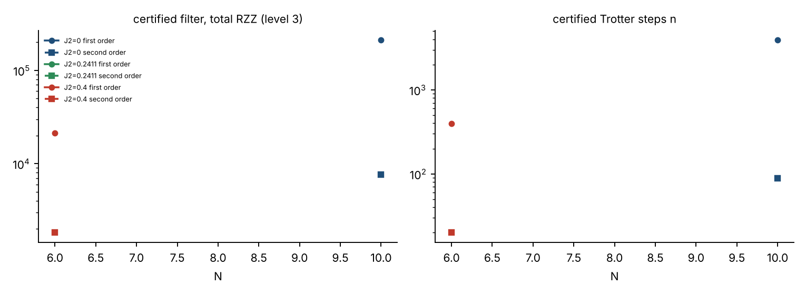

# Results: resource costs of the cosine-filter pipeline for the open J1–J2 chain

*Produced by `scripts/run_results.py` + `scripts/build_results.py` from the pipeline in this directory (`pipeline.py`, `floor.py`, `core/*`). Every number below is read from `results/data/*.json`; raw tables are in `results/tables/*.csv`.*

## 0. How to read this document

* **Pipeline.** DMRG (`get_energies`) → spectrum (`get_spectrum`) → L-layer approximate trial circuit (`mps-to-circuit`, L = 1) → filter design (`floor.py`, certified η) → snapped Trotter grid → counts. Settings are those in `pipeline.py`: first-order Lie–Trotter, ε targets as given, `SWEEP_L = 1`, `BANDWIDTH = "certified"` for the DMRG path, `SYNTH_EPS = 1e-3`.
* **Two designs per case.** *Guaranteed* = smallest n whose a-priori rigorous bound on 1−F is ≤ ε. *Empirical* = smallest n whose **measured** 1−F (against the exact ground state) is ≤ ε. The empirical design uses the exact ground state, so it is an oracle lower envelope, not something a practitioner can know in advance; it needs simulation and is therefore only available for N ≤ 14.
* **Everything uses the DMRG spectrum.** E0, E1 (orthogonality-penalty DMRG: lowest state of any symmetry orthogonal to ψ0) and E_top from DMRG; the bandwidth is the **certified** W = Σ_bonds λmax(bond) − E0 (Weyl's inequality: λmax of a sum ≤ sum of λmax; a bond J S·S has λmax = J/4), which equals E_top − E0 for J1, J2 ≥ 0 because the fully polarized state attains it (Section 6). The DMRG gap, shift and γ are not certified: every guarantee below is a *conditional certificate* (exact only if the DMRG reference is exact; see `CERTIFICATION.tex`, Section 1 and Section 12).
* **N ≤ 14 versus N > 14.** For N ≤ 14 an exact-diagonalisation cross-check and statevector simulation of the filter are available: γ is the overlap with the ED ground state, and measured 1−F, P_succ and the state error are reported. For **N > 14 there is no ED, no statevector and no dense or sparse 2^N operator**: γ is the overlap of the DMRG MPS with the trial circuit simulated as an MPS (Aer matrix-product-state), the energy variance comes from MPO contractions, α is the same exact commutator sum as for small N (Table 1b), and circuits are **counted, not simulated** (no measured 1−F or P_succ; only the rigorous bound).
* **Time.** `T (scaled)` is the total evolution time Σtᵢ in units of 1/W; `T (phys)` = T/W in units of 1/J1 (H = Σ J S·S, J1 = 1). Pulses with kᵢ = 0 on the grid are dropped.
* **Gate basis and counting.** The two-qubit gate is **RZZ(θ) = exp(−iθ ZZ/2)**; CX is *not* in the basis (qiskit basis `rzz, rz, sx, x`; RZZ(π/2) is Clifford). One Trotter step of one pulse (every Pauli term of H, controlled by the ancilla) is transpiled once and multiplied by n; per pulse one Rz(2φ) is added. Two compilations of the same circuit are reported: **direct** (qiskit `optimization_level=1`: every Pauli rotation exp(−iθ P⊗P⊗Z) becomes a ladder of four Clifford RZZ(π/2) around one non-Clifford Rz): RZZ = 4 × (#Pauli terms) per step, non-Clifford rotations = #Pauli terms + 1 per step; **level 3** (block re-synthesis): two RZZ per Pauli term, one of them a non-Clifford RZZ(θ), plus extra non-Clifford single-qubit Rz, i.e. half the RZZ of the direct compilation but more non-Clifford rotations. `Non-Cliff. rot.` = Rz gates plus RZZ gates whose angle is not a multiple of π/2 (the cost metric for fault-tolerant hardware; no T-count is reported). Clifford single-qubit gates (Hadamards, sx, x) are not tracked. Per-step × n was checked against a full transpile of a 48-step circuit in the RZZ basis (Section 9). **Level-3 totals include the trial circuit** (L = 1 brickwork, N−1 two-qubit gates, 3 non-Clifford RZZ each); direct counts are for the filter only. Connectivity is all-to-all unless marked *line* (ancilla at the end of a line: pessimistic). Counts in the previous CX basis are kept in the data files and compared in Section 4b.
* **Success path.** All counts are for the all-zeros (success) path. The expected cost per accepted run is total ÷ P_succ (early abort makes it lower).

Data present: 66 (N, J2, ε) points, N from 4 to 32; 0 failed point(s).

## Summary

* **N ≤ 14, guaranteed designs, ε = 10⁻²:** 76–24,027 Trotter steps, 1,539–3,604,089 total RZZ, T (phys) 1.9–13.3 (1/J1).
* **Guaranteed versus empirical (oracle):** the guaranteed design uses 15–586× the steps and 14–582× the RZZ of the smallest n that empirically meets ε (median 190×).
* **N = 16–32 (DMRG/MPS only, counted not simulated), ε = 10⁻²:** 16,485–314,923 steps, 2.39e+06–1.00e+08 total RZZ (level 3; direct compilation 4.78e+06–2.00e+08), 1.22e+06–5.04e+07 non-Clifford rotations (direct; level 3: 2.07e+06–8.44e+07), T (phys) 7.9–20.5 (converged-DMRG points only; 0 further point(s) have an unconverged excited-state DMRG and are flagged in Section 7; 0 point(s) designed by the fallback FilterBuilder, marked † there, are excluded from these ranges and from the fits).
* **Scaling, J2 = 0:** guaranteed total RZZ ~ N^5.1 (R² 0.999), steps ~ N^4.0, RZZ per step ~ N^1.1 (fits over N = 6–24).
* **Scaling, J2 = 0.2411:** guaranteed total RZZ ~ N^5.2 (R² 0.998), steps ~ N^4.0, RZZ per step ~ N^1.1 (fits over N = 6–28).
* **Scaling, J2 = 0.4:** guaranteed total RZZ ~ N^4.9 (R² 0.998), steps ~ N^3.7, RZZ per step ~ N^1.1 (fits over N = 6–32).
* **Certified bandwidth:** the Weyl bound W = Σ_bonds λmax − E0 equals E_top − E0 (ratio 1.000–1.000); W cancels in n and in T (phys), see Section 6.
* **Bound violations among simulated points:** 0.
* **First versus second order (Section 10, N = 6–12, ε = 10⁻², full transpiles of both circuits):** a second-order step costs 1.60–1.69× a first-order step, but the certified step count is 20–44× smaller: the certified second-order circuit uses 0.036–0.086× the first-order RZZ (level 3) and 0.037–0.080× the depth.

## 1. Case inputs (DMRG spectrum, certified bandwidth)

| N | J2 | E0 (DMRG) | E1 | E_top | \|E0−E0(ED)\| | \|E1−E1(ED)\| | E_top−E0 | W (certified) | W / (E_top−E0) | Δ (scaled gap) | γ (trial) | γ source | trial-circuit infidelity 1−γ | α used | Pauli terms | trial RZZ | trial Rz | trial non-Cliff. rot. | trial depth | E1 method | DMRG converged |
|---|---|---|---|---|---|---|---|---|---|---|---|---|---|---|---|---|---|---|---|---|---|
| 4 | 0 | -1.6160254038 | -0.9571067812 | 0.7500000000 | 1.1e-15 | 8.9e-16 | 2.3660 | 2.3660 | 1.00 | 0.27849 | 0.95534 | ED | 4.47e-02 | 0.2679 | 9 | 9 | 36 | 39 | 38 | local | yes |
| 6 | 0 | -2.4935771339 | -2.0019953569 | 1.2500000000 | 3.1e-15 | 1.3e-15 | 3.7436 | 3.7436 | 1.00 | 0.13131 | 0.89813 | ED | 1.02e-01 | 0.2141 | 15 | 15 | 58 | 63 | 60 | local | yes |
| 8 | 0 | -3.3749325987 | -2.9822404878 | 1.7500000000 | 2.1e-15 | 1.3e-15 | 5.1249 | 5.1249 | 1.00 | 0.07662 | 0.83709 | ED | 1.63e-01 | 0.1713 | 21 | 21 | 80 | 87 | 82 | local | yes |
| 10 | 0 | -4.2580352073 | -3.9306735895 | 2.2500000000 | 7.1e-15 | 6.7e-15 | 6.5080 | 6.5080 | 1.00 | 0.05030 | 0.77383 | ED | 2.26e-01 | 0.1417 | 27 | 27 | 102 | 111 | 104 | local | yes |
| 12 | 0 | -5.1420906328 | -4.8611479370 | 2.7500000000 | 2.0e-14 | 5.4e-14 | 7.8921 | 7.8921 | 1.00 | 0.03560 | 0.71698 | ED | 2.83e-01 | 0.1204 | 33 | 33 | 124 | 135 | 126 | local | yes |
| 14 | 0 | -6.0267246619 | -5.7804926045 | 3.2500000000 | 1.3e-13 | 1.6e-13 | 9.2767 | 9.2767 | 1.00 | 0.02654 | 0.66103 | ED | 3.39e-01 | 0.1046 | 39 | 38 | 144 | 158 | 145 | local | yes |
| 16 | 0 | -6.9117371456 | -6.6924604290 | 3.7500000000 | n/a (no ED) | n/a (no ED) | 10.6617 | 10.6617 | 1.00 | 0.02057 | 0.60558 | DMRG-MPS overlap (uncertified) | 3.94e-01 | 0.0924 | 45 | 45 | 168 | 183 | 170 | local | yes |
| 18 | 0 | -7.7970110685 | -7.5992848841 | 4.2500000000 | n/a (no ED) | n/a (no ED) | 12.0470 | 12.0470 | 1.00 | 0.01641 | 0.55677 | DMRG-MPS overlap (uncertified) | 4.43e-01 | 0.0827 | 51 | 51 | 190 | 207 | 192 | local | yes |
| 20 | 0 | -8.6824733344 | -8.5023786980 | 4.7500000000 | n/a (no ED) | n/a (no ED) | 13.4325 | 13.4325 | 1.00 | 0.01341 | 0.51393 | DMRG-MPS overlap (uncertified) | 4.86e-01 | 0.0748 | 57 | 57 | 211 | 230 | 214 | local | yes |
| 24 | 0 | -10.4537857604 | -10.3008340576 | 5.7500000000 | n/a (no ED) | n/a (no ED) | 16.2038 | 16.2038 | 1.00 | 0.00944 | 0.43191 | DMRG-MPS overlap (uncertified) | 5.68e-01 | 0.0628 | 69 | 69 | 255 | 278 | 258 | local | yes |
| 28 | 0 | -12.2254405486 | -12.0924250046 | 6.7500000000 | n/a (no ED) | n/a (no ED) | 18.9754 | 18.9754 | 1.00 | 0.00701 | 0.36531 | DMRG-MPS overlap (uncertified) | 6.35e-01 | 0.0542 | 81 | 81 | 295 | 321 | 302 | local | yes |
| 32 | 0 | -13.9973156182 | -13.8795758237 | 7.7500000000 | n/a (no ED) | n/a (no ED) | 21.7473 | 21.7473 | 1.00 | 0.00541 | 0.30801 | DMRG-MPS overlap (uncertified) | 6.92e-01 | 0.0476 | 93 | 93 | 338 | 369 | 346 | local | yes |
| 4 | 0.2411 | -1.5387409981 | -0.8776800957 | 0.8705500000 | 1.6e-15 | 1.1e-16 | 2.4093 | 2.4093 | 1.00 | 0.27438 | 0.98067 | ED | 1.93e-02 | 0.3977 | 15 | 9 | 36 | 39 | 38 | local | yes |
| 6 | 0.2411 | -2.3353474058 | -1.8475542730 | 1.4911000000 | 1.8e-15 | 8.9e-16 | 3.8264 | 3.8264 | 1.00 | 0.12748 | 0.94917 | ED | 5.08e-02 | 0.3295 | 27 | 15 | 58 | 63 | 60 | local | yes |
| 8 | 0.2411 | -3.1350011019 | -2.7491233495 | 2.1116500000 | 4.7e-16 | 4.0e-15 | 5.2467 | 5.2467 | 1.00 | 0.07355 | 0.91107 | ED | 8.89e-02 | 0.2672 | 39 | 21 | 80 | 87 | 82 | local | yes |
| 10 | 0.2411 | -3.9361281870 | -3.6170270856 | 2.7322000000 | 9.8e-15 | 3.7e-14 | 6.6683 | 6.6683 | 1.00 | 0.04785 | 0.86898 | ED | 1.31e-01 | 0.2223 | 51 | 27 | 100 | 109 | 104 | local | yes |
| 12 | 0.2411 | -4.7380770283 | -4.4660645236 | 3.3527500000 | 2.1e-14 | 5.3e-14 | 8.0908 | 8.0908 | 1.00 | 0.03362 | 0.82516 | ED | 1.75e-01 | 0.1897 | 63 | 33 | 123 | 134 | 126 | local | yes |
| 14 | 0.2411 | -5.5405306286 | -5.3034976901 | 3.9733000000 | 1.0e-13 | 9.6e-14 | 9.5138 | 9.5138 | 1.00 | 0.02491 | 0.78097 | ED | 2.19e-01 | 0.1651 | 75 | 39 | 144 | 157 | 148 | local | yes |
| 16 | 0.2411 | -6.3433164211 | -6.1332908175 | 4.5938500000 | n/a (no ED) | n/a (no ED) | 10.9372 | 10.9372 | 1.00 | 0.01920 | 0.73662 | DMRG-MPS overlap (uncertified) | 2.63e-01 | 0.1461 | 87 | 45 | 167 | 182 | 170 | local | yes |
| 18 | 0.2411 | -7.1463324487 | -6.9577882796 | 5.2144000000 | n/a (no ED) | n/a (no ED) | 12.3607 | 12.3607 | 1.00 | 0.01525 | 0.69402 | DMRG-MPS overlap (uncertified) | 3.06e-01 | 0.1310 | 99 | 51 | 186 | 203 | 192 | local | yes |
| 20 | 0.2411 | -7.9495146057 | -7.7784645690 | 5.8349500000 | n/a (no ED) | n/a (no ED) | 13.7845 | 13.7845 | 1.00 | 0.01241 | 0.65257 | DMRG-MPS overlap (uncertified) | 3.47e-01 | 0.1186 | 111 | 57 | 206 | 224 | 214 | local | yes |
| 24 | 0.2411 | -9.5562212540 | -9.4119433252 | 7.0760500000 | n/a (no ED) | n/a (no ED) | 16.6323 | 16.6323 | 1.00 | 0.00867 | 0.57572 | DMRG-MPS overlap (uncertified) | 4.24e-01 | 0.0998 | 135 | 69 | 248 | 271 | 258 | local | yes |
| 28 | 0.2411 | -11.1632298850 | -11.0384766852 | 8.3171500000 | n/a (no ED) | n/a (no ED) | 19.4804 | 19.4804 | 1.00 | 0.00640 | 0.50503 | DMRG-MPS overlap (uncertified) | 4.95e-01 | 0.0861 | 159 | 81 | 292 | 314 | 302 | local | yes |
| 32 | 0.2411 | -12.7704324927 | -12.6605489205 | 9.5582500000 | n/a (no ED) | n/a (no ED) | 22.3287 | 22.3287 | 1.00 | 0.00492 | 0.44171 | DMRG-MPS overlap (uncertified) | 5.58e-01 | 0.0757 | 183 | 93 | 337 | 364 | 346 | local | yes |
| 4 | 0.4 | -1.5067764363 | -0.8330951895 | 0.9500000000 | 9.0e-16 | 1.1e-16 | 2.4568 | 2.4568 | 1.00 | 0.27421 | 0.99594 | ED | 4.06e-03 | 0.4708 | 15 | 9 | 36 | 39 | 38 | local | yes |
| 6 | 0.4 | -2.2655348801 | -1.7633485573 | 1.6500000000 | 8.4e-15 | 4.4e-16 | 3.9155 | 3.9155 | 1.00 | 0.12825 | 0.98804 | ED | 1.20e-02 | 0.3957 | 27 | 15 | 58 | 63 | 60 | local | yes |
| 8 | 0.4 | -3.0251905645 | -2.6214818416 | 2.3500000000 | 4.0e-15 | 3.9e-14 | 5.3752 | 5.3752 | 1.00 | 0.07511 | 0.97703 | ED | 2.30e-02 | 0.3229 | 39 | 21 | 80 | 87 | 82 | local | yes |
| 10 | 0.4 | -3.7852888948 | -3.4451673343 | 3.0500000000 | 4.7e-16 | 4.3e-14 | 6.8353 | 6.8353 | 1.00 | 0.04976 | 0.96383 | ED | 3.62e-02 | 0.2695 | 51 | 27 | 102 | 111 | 104 | local | yes |
| 12 | 0.4 | -4.5456261627 | -4.2500350676 | 3.7500000000 | 1.1e-13 | 4.7e-14 | 8.2956 | 8.2956 | 1.00 | 0.03563 | 0.94902 | ED | 5.10e-02 | 0.2303 | 63 | 33 | 124 | 135 | 126 | local | yes |
| 14 | 0.4 | -5.3061027329 | -5.0435118006 | 4.4500000000 | 1.0e-13 | 1.3e-13 | 9.7561 | 9.7561 | 1.00 | 0.02692 | 0.93327 | ED | 6.67e-02 | 0.2008 | 75 | 39 | 146 | 159 | 148 | local | yes |
| 16 | 0.4 | -6.0666655720 | -5.8295569546 | 5.1500000000 | n/a (no ED) | n/a (no ED) | 11.2167 | 11.2167 | 1.00 | 0.02114 | 0.91698 | DMRG-MPS overlap (uncertified) | 8.30e-02 | 0.1778 | 87 | 45 | 167 | 182 | 170 | local | yes |
| 18 | 0.4 | -6.8272844181 | -6.6104747998 | 5.8500000000 | n/a (no ED) | n/a (no ED) | 12.6773 | 12.6773 | 1.00 | 0.01710 | 0.90004 | DMRG-MPS overlap (uncertified) | 1.00e-01 | 0.1595 | 99 | 51 | 188 | 205 | 192 | local | yes |
| 20 | 0.4 | -7.5879410154 | -7.3876995115 | 6.5500000000 | n/a (no ED) | n/a (no ED) | 14.1379 | 14.1379 | 1.00 | 0.01416 | 0.88328 | DMRG-MPS overlap (uncertified) | 1.17e-01 | 0.1446 | 111 | 57 | 207 | 223 | 214 | local | yes |
| 24 | 0.4 | -9.1093253675 | -8.9345357926 | 7.9500000000 | n/a (no ED) | n/a (no ED) | 17.0593 | 17.0593 | 1.00 | 0.01025 | 0.84903 | DMRG-MPS overlap (uncertified) | 1.51e-01 | 0.1217 | 135 | 69 | 252 | 274 | 258 | local | yes |
| 28 | 0.4 | -10.6307656965 | -10.4746379729 | 9.3500000000 | n/a (no ED) | n/a (no ED) | 19.9808 | 19.9808 | 1.00 | 0.00781 | 0.81533 | DMRG-MPS overlap (uncertified) | 1.85e-01 | 0.1051 | 159 | 81 | 291 | 317 | 302 | local | yes |
| 32 | 0.4 | -12.1522370500 | -12.0103923579 | 10.7500000000 | n/a (no ED) | n/a (no ED) | 22.9022 | 22.9022 | 1.00 | 0.00619 | 0.78232 | DMRG-MPS overlap (uncertified) | 2.18e-01 | 0.0924 | 183 | 93 | 336 | 364 | 346 | local | yes |

*Table 1.* The energies are DMRG values (10 digits); `|E0−E0(ED)|`, `|E1−E1(ED)|` are the DMRG errors against exact diagonalisation (N ≤ 14 here; N = 16–20 in Section 5; N ≥ 24 has no exact reference, see the run-to-run table in Section 5). **1−γ is not a DMRG error:** it is the infidelity of the low-depth (L = 1 brickwork) trial *circuit* with respect to the ground state, which is large by construction and is what the filter has to remove. *DMRG converged*: the ground-state, top-state and orthogonality-penalty excited-state DMRG runs each reached the sweep tolerance within 100 sweeps; a **NO** means that quantity (for the excited state, E1 and hence the gap Δ) is not converged and the design is only indicative. *E1 method*: `local` = projector penalty λ|ψ0⟩⟨ψ0| applied as a rank-1 term in every two-site local problem, giving the lowest state of any symmetry (checked against ED in Section 5). Trial circuit = L = 1 approximate brickwork circuit from the DMRG MPS. α is in scaled units: the exact commutator sum Σ_g‖[H_g, Σ_{g'>g}H_g']‖ for every N (computed on the local support of each term). W is the certified (Weyl) bandwidth, which coincides with E_top − E0 here, so Δ = (E1−E0)/W is the exact scaled gap.

**α: exact commutator sum against the triangle bound**

| N | J2 | α (exact commutator sum) | α triangle (diagnostic) | triangle / exact |
|---|---|---|---|---|
| 4 | 0 | 0.26795 | 0.26795 | 1.000 |
| 6 | 0 | 0.21407 | 0.21407 | 1.000 |
| 8 | 0 | 0.17133 | 0.17133 | 1.000 |
| 10 | 0 | 0.14166 | 0.14166 | 1.000 |
| 12 | 0 | 0.12041 | 0.12041 | 1.000 |
| 14 | 0 | 0.10458 | 0.10458 | 1.000 |
| 16 | 0 | 0.09237 | 0.09237 | 1.000 |
| 18 | 0 | 0.08268 | 0.08268 | 1.000 |
| 20 | 0 | 0.07482 | 0.07482 | 1.000 |
| 24 | 0 | 0.06284 | 0.06284 | 1.000 |
| 28 | 0 | 0.05416 | 0.05416 | 1.000 |
| 32 | 0 | 0.04757 | 0.04757 | 1.000 |
| 4 | 0.2411 | 0.39773 | 0.44532 | 1.120 |
| 6 | 0.2411 | 0.32946 | 0.38375 | 1.165 |
| 8 | 0.2411 | 0.26717 | 0.31433 | 1.177 |
| 10 | 0.2411 | 0.22230 | 0.26281 | 1.182 |
| 12 | 0.2411 | 0.18967 | 0.22487 | 1.186 |
| 14 | 0.2411 | 0.16513 | 0.19615 | 1.188 |
| 16 | 0.2411 | 0.14610 | 0.17378 | 1.189 |
| 18 | 0.2411 | 0.13095 | 0.15591 | 1.191 |
| 20 | 0.2411 | 0.11862 | 0.14134 | 1.192 |
| 24 | 0.2411 | 0.09977 | 0.11901 | 1.193 |
| 28 | 0.2411 | 0.08607 | 0.10275 | 1.194 |
| 32 | 0.2411 | 0.07566 | 0.09037 | 1.194 |
| 4 | 0.4 | 0.47080 | 0.54674 | 1.161 |
| 6 | 0.4 | 0.39573 | 0.48528 | 1.226 |
| 8 | 0.4 | 0.32286 | 0.40079 | 1.241 |
| 10 | 0.4 | 0.26946 | 0.33646 | 1.249 |
| 12 | 0.4 | 0.23033 | 0.28859 | 1.253 |
| 14 | 0.4 | 0.20080 | 0.25215 | 1.256 |
| 16 | 0.4 | 0.17783 | 0.22366 | 1.258 |
| 18 | 0.4 | 0.15951 | 0.20085 | 1.259 |
| 20 | 0.4 | 0.14457 | 0.18221 | 1.260 |
| 24 | 0.4 | 0.12170 | 0.15360 | 1.262 |
| 28 | 0.4 | 0.10505 | 0.13271 | 1.263 |
| 32 | 0.4 | 0.09240 | 0.11679 | 1.264 |

*Table 1b.* α is the exact value of Σ_g‖[H_g, Σ_{g'>g}H_g']‖ for every N (for Pauli terms it reduces to a small dense eigenvalue problem on the support of each term). The triangle-inequality value, which earlier versions used for N > 14, is shown for comparison: it is exact at J2 = 0 and up to about 1.25× larger otherwise.

## 2. Guaranteed designs, N ≤ 14, ε = 10⁻²

**Guaranteed: design and evolution time**

| N | J2 | pulses | n (steps) | kᵢ | T (scaled) | T (phys) | η cert. | ε bound | P_succ lb |
|---|---|---|---|---|---|---|---|---|---|
| 4 | 0 | 4 | 85 | [1, 16, 25, 43] | 5.64 | 2.38 | 0.143 | 9.91e-03 | 0.535 |
| 6 | 0 | 4 | 590 | [64, 104, 161, 261] | 17.94 | 4.79 | 0.092 | 9.99e-03 | 0.718 |
| 8 | 0 | 6 | 1,817 | [15, 107, 167, 282, 464, 782] | 30.75 | 6.00 | 0.100 | 1.00e-02 | 0.632 |
| 10 | 0 | 6 | 3,917 | [135, 215, 366, 669, 1014, 1518] | 46.84 | 7.20 | 0.081 | 1.00e-02 | 0.500 |
| 12 | 0 | 8 | 8,797 | [55, 167, 294, 493, 869, 1465, 2117, 3337] | 88.25 | 11.18 | 0.050 | 9.99e-03 | 0.600 |
| 14 | 0 | 8 | 17,822 | [111, 322, 570, 963, 1687, 3035, 4408, 6726] | 118.36 | 12.76 | 0.062 | 9.47e-03 | 0.595 |
| 4 | 0.2411 | 4 | 94 | [1, 10, 36, 47] | 4.58 | 1.90 | 0.313 | 9.93e-03 | 0.631 |
| 6 | 0.2411 | 4 | 578 | [44, 83, 162, 289] | 12.32 | 3.22 | 0.190 | 1.00e-02 | 0.594 |
| 8 | 0.2411 | 6 | 2,398 | [20, 141, 221, 373, 612, 1031] | 32.04 | 6.11 | 0.099 | 1.00e-02 | 0.687 |
| 10 | 0.2411 | 6 | 5,777 | [127, 284, 494, 839, 1469, 2564] | 49.24 | 7.38 | 0.113 | 1.00e-02 | 0.691 |
| 12 | 0.2411 | 6 | 10,960 | [418, 756, 881, 1650, 2733, 4522] | 70.08 | 8.66 | 0.095 | 1.00e-02 | 0.574 |
| 14 | 0.2411 | 8 | 24,027 | [150, 432, 807, 1322, 2273, 4021, 5895, 9127] | 126.09 | 13.25 | 0.059 | 9.36e-03 | 0.694 |
| 4 | 0.4 | 4 | 76 | [1, 4, 33, 38] | 4.58 | 1.87 | 0.486 | 9.98e-03 | 0.891 |
| 6 | 0.4 | 4 | 394 | [5, 56, 136, 197] | 9.80 | 2.50 | 0.399 | 9.98e-03 | 0.739 |
| 8 | 0.4 | 4 | 1,059 | [58, 145, 326, 530] | 16.73 | 3.11 | 0.286 | 9.98e-03 | 0.579 |
| 10 | 0.4 | 4 | 2,890 | [173, 357, 915, 1445] | 25.25 | 3.69 | 0.321 | 1.00e-02 | 0.613 |
| 12 | 0.4 | 6 | 5,318 | [44, 156, 334, 718, 1407, 2659] | 44.08 | 5.31 | 0.189 | 1.00e-02 | 0.562 |
| 14 | 0.4 | 6 | 10,575 | [88, 306, 707, 1430, 2757, 5287] | 70.03 | 7.18 | 0.164 | 1.00e-02 | 0.689 |

**Guaranteed: gate counts (level-3 columns include the trial circuit; direct columns are filter only)**

| N | J2 | RZZ trial | RZZ filter | RZZ total | RZZ filter (direct) | Non-Cliff. rot. (level 3) | Non-Cliff. rot. (direct) | depth total | E[RZZ]/accept | RZZ total (line) |
|---|---|---|---|---|---|---|---|---|---|---|
| 4 | 0 | 9 | 1,530 | 1,539 | 3,060 | 1,573 | 854 | 4,458 | 2,876 | 1,936 |
| 6 | 0 | 15 | 17,700 | 17,715 | 35,400 | 11,867 | 9,444 | 47,850 | 24,643 | 24,008 |
| 8 | 0 | 21 | 76,314 | 76,335 | 152,628 | 69,139 | 39,980 | 212,671 | 120,670 | 106,618 |
| 10 | 0 | 27 | 211,518 | 211,545 | 423,036 | 188,133 | 109,682 | 583,737 | 422,811 | 300,330 |
| 12 | 0 | 33 | 580,602 | 580,635 | 1,161,204 | 510,369 | 299,106 | 1,583,586 | 967,740 | 832,816 |
| 14 | 0 | 38 | 1,390,116 | 1,390,154 | 2,780,232 | 1,212,062 | 712,888 | 3,778,409 | 2,335,781 | 2,007,983 |
| 4 | 0.2411 | 9 | 2,820 | 2,829 | 5,640 | 2,675 | 1,508 | 7,934 | 4,474 | 4,615 |
| 6 | 0.2411 | 15 | 31,212 | 31,227 | 62,424 | 27,811 | 16,188 | 90,228 | 52,478 | 60,705 |
| 8 | 0.2411 | 21 | 187,044 | 187,065 | 374,088 | 163,157 | 95,926 | 551,622 | 272,308 | 354,126 |
| 10 | 0.2411 | 27 | 589,254 | 589,281 | 1,178,508 | 508,491 | 300,410 | 1,733,204 | 852,793 | 1,192,015 |
| 12 | 0.2411 | 33 | 1,380,960 | 1,380,993 | 2,761,920 | 1,183,820 | 701,446 | 4,055,326 | 2,403,340 | 2,831,366 |
| 14 | 0.2411 | 39 | 3,604,050 | 3,604,089 | 7,208,100 | 3,075,621 | 1,826,060 | 10,620,082 | 5,190,564 | 7,456,418 |
| 4 | 0.4 | 9 | 2,280 | 2,289 | 4,560 | 2,171 | 1,220 | 7,030 | 2,567 | 3,733 |
| 6 | 0.4 | 15 | 21,276 | 21,291 | 42,552 | 18,979 | 11,036 | 58,372 | 28,786 | 41,385 |
| 8 | 0.4 | 21 | 82,602 | 82,623 | 165,204 | 72,103 | 42,364 | 237,298 | 142,638 | 156,400 |
| 10 | 0.4 | 27 | 294,780 | 294,807 | 589,560 | 254,435 | 150,284 | 797,744 | 480,264 | 596,330 |
| 12 | 0.4 | 33 | 670,068 | 670,101 | 1,340,136 | 574,485 | 340,358 | 1,914,606 | 1,191,702 | 1,373,850 |
| 14 | 0.4 | 39 | 1,586,250 | 1,586,289 | 3,172,500 | 1,353,765 | 803,706 | 4,399,348 | 2,302,554 | 3,281,814 |

**Guaranteed: measured quality (noiseless)**

| N | J2 | measured 1−F | F (ED) | P_succ meas. | state err vs exact | bound holds | full-transpile RZZ (n ≤ 200) |
|---|---|---|---|---|---|---|---|
| 4 | 0 | 2.87e-04 | 0.99971 | 0.535 | 1.48e-04 | yes | 1,530 |
| 6 | 0 | 7.73e-04 | 0.99923 | 0.719 | 5.14e-04 | yes | – |
| 8 | 0 | 1.29e-03 | 0.99871 | 0.633 | 3.85e-04 | yes | – |
| 10 | 0 | 1.19e-03 | 0.99881 | 0.500 | 3.10e-04 | yes | – |
| 12 | 0 | 3.18e-04 | 0.99968 | 0.600 | 1.43e-04 | yes | – |
| 14 | 0 | 6.35e-04 | 0.99936 | 0.595 | 1.01e-04 | yes | – |
| 4 | 0.2411 | 9.78e-04 | 0.99902 | 0.632 | 1.63e-04 | yes | 2,820 |
| 6 | 0.2411 | 1.57e-03 | 0.99843 | 0.595 | 6.38e-04 | yes | – |
| 8 | 0.2411 | 2.42e-04 | 0.99976 | 0.687 | 3.52e-04 | yes | – |
| 10 | 0.2411 | 5.03e-04 | 0.99950 | 0.691 | 2.00e-04 | yes | – |
| 12 | 0.2411 | 4.09e-04 | 0.99959 | 0.575 | 1.59e-04 | yes | – |
| 14 | 0.2411 | 3.83e-04 | 0.99962 | 0.694 | 1.41e-04 | yes | – |
| 4 | 0.4 | 1.64e-04 | 0.99984 | 0.892 | 3.60e-03 | yes | 2,280 |
| 6 | 0.4 | 4.13e-04 | 0.99959 | 0.740 | 9.72e-04 | yes | – |
| 8 | 0.4 | 4.89e-04 | 0.99951 | 0.579 | 9.31e-04 | yes | – |
| 10 | 0.4 | 7.61e-04 | 0.99924 | 0.614 | 5.27e-04 | yes | – |
| 12 | 0.4 | 4.85e-04 | 0.99951 | 0.562 | 4.34e-04 | yes | – |
| 14 | 0.4 | 4.56e-04 | 0.99954 | 0.689 | 3.04e-04 | yes | – |

*Tables 2a–c.* Rigorous a-priori n: the bound on 1−F is ≤ ε. Measured 1−F is typically far below ε (the bound is conservative).

## 3. Empirical (oracle) designs, N ≤ 14, ε = 10⁻²

**Empirical: design and evolution time**

| N | J2 | pulses | n (steps) | kᵢ | T (scaled) | T (phys) | η cert. | ε bound | P_succ lb |
|---|---|---|---|---|---|---|---|---|---|
| 4 | 0 | 2 | 2 | [1, 1] | 5.64 | 2.38 | 0.764 | 1.00e+00 | 0.857 |
| 6 | 0 | 4 | 5 | [1, 1, 1, 2] | 17.94 | 4.79 | 1.000 | 1.00e+00 | 0.898 |
| 8 | 0 | 4 | 11 | [1, 2, 3, 5] | 30.75 | 6.00 | 0.209 | 1.00e+00 | 0.684 |
| 10 | 0 | 4 | 10 | [1, 2, 3, 4] | 46.84 | 7.20 | 1.002 | 1.00e+00 | 0.771 |
| 12 | 0 | 6 | 29 | [1, 2, 3, 5, 7, 11] | 88.25 | 11.18 | 0.176 | 1.00e+00 | 0.248 |
| 14 | 0 | 7 | 39 | [1, 1, 2, 4, 6, 10, 15] | 118.36 | 12.76 | 0.091 | 1.00e+00 | 0.306 |
| 4 | 0.2411 | 2 | 3 | [1, 2] | 4.58 | 1.90 | 0.313 | 1.00e+00 | 0.820 |
| 6 | 0.2411 | 3 | 6 | [1, 2, 3] | 12.32 | 3.22 | 0.268 | 1.00e+00 | 0.719 |
| 8 | 0.2411 | 4 | 11 | [1, 2, 3, 5] | 32.04 | 6.11 | 0.267 | 1.00e+00 | 0.661 |
| 10 | 0.2411 | 5 | 17 | [1, 1, 3, 4, 8] | 49.24 | 7.38 | 0.163 | 1.00e+00 | 0.318 |
| 12 | 0.2411 | 6 | 25 | [1, 2, 2, 4, 6, 10] | 70.08 | 8.66 | 0.096 | 1.00e+00 | 0.565 |
| 14 | 0.2411 | 7 | 41 | [1, 1, 2, 4, 7, 10, 16] | 126.09 | 13.25 | 0.208 | 1.00e+00 | 0.396 |
| 4 | 0.4 | 2 | 5 | [2, 3] | 4.58 | 1.87 | 0.486 | 1.00e+00 | 0.945 |
| 6 | 0.4 | 3 | 6 | [1, 2, 3] | 9.80 | 2.50 | 0.399 | 1.00e+00 | 0.738 |
| 8 | 0.4 | 4 | 11 | [1, 2, 3, 5] | 16.73 | 3.11 | 0.286 | 1.00e+00 | 0.503 |
| 10 | 0.4 | 4 | 16 | [1, 2, 5, 8] | 25.25 | 3.69 | 0.321 | 1.00e+00 | 0.613 |
| 12 | 0.4 | 5 | 26 | [1, 2, 3, 7, 13] | 44.08 | 5.31 | 0.189 | 1.00e+00 | 0.537 |
| 14 | 0.4 | 5 | 38 | [1, 3, 5, 10, 19] | 70.03 | 7.18 | 0.189 | 1.00e+00 | 0.644 |

**Empirical: gate counts (level-3 columns include the trial circuit; direct columns are filter only)**

| N | J2 | RZZ trial | RZZ filter | RZZ total | RZZ filter (direct) | Non-Cliff. rot. (level 3) | Non-Cliff. rot. (direct) | depth total | E[RZZ]/accept | RZZ total (line) |
|---|---|---|---|---|---|---|---|---|---|---|
| 4 | 0 | 9 | 36 | 45 | 72 | 77 | 22 | 142 | 51 | 54 |
| 6 | 0 | 15 | 150 | 165 | 300 | 167 | 84 | 465 | 194 | 218 |
| 8 | 0 | 21 | 462 | 483 | 924 | 509 | 246 | 1,369 | 731 | 666 |
| 10 | 0 | 27 | 540 | 567 | 1,080 | 595 | 284 | 1,594 | 850 | 794 |
| 12 | 0 | 33 | 1,914 | 1,947 | 3,828 | 1,823 | 992 | 5,346 | 8,098 | 2,778 |
| 14 | 0 | 38 | 3,042 | 3,080 | 6,084 | 2,817 | 1,567 | 8,413 | 11,187 | 4,432 |
| 4 | 0.2411 | 9 | 90 | 99 | 180 | 125 | 50 | 290 | 124 | 156 |
| 6 | 0.2411 | 15 | 324 | 339 | 648 | 354 | 171 | 996 | 492 | 645 |
| 8 | 0.2411 | 21 | 858 | 879 | 1,716 | 839 | 444 | 2,612 | 1,381 | 1,645 |
| 10 | 0.2411 | 27 | 1,734 | 1,761 | 3,468 | 1,610 | 889 | 5,204 | 6,160 | 3,535 |
| 12 | 0.2411 | 33 | 3,150 | 3,183 | 6,300 | 2,840 | 1,606 | 9,376 | 6,626 | 6,491 |
| 14 | 0.2411 | 39 | 6,150 | 6,189 | 12,300 | 5,412 | 3,123 | 18,270 | 16,008 | 12,763 |
| 4 | 0.4 | 9 | 150 | 159 | 300 | 181 | 82 | 498 | 170 | 254 |
| 6 | 0.4 | 15 | 324 | 339 | 648 | 354 | 171 | 948 | 486 | 645 |
| 8 | 0.4 | 21 | 858 | 879 | 1,716 | 839 | 444 | 2,546 | 1,846 | 1,645 |
| 10 | 0.4 | 27 | 1,632 | 1,659 | 3,264 | 1,523 | 836 | 4,520 | 2,822 | 3,328 |
| 12 | 0.4 | 33 | 3,276 | 3,309 | 6,552 | 2,948 | 1,669 | 9,486 | 6,595 | 6,750 |
| 14 | 0.4 | 39 | 5,700 | 5,739 | 11,400 | 5,028 | 2,893 | 15,956 | 9,414 | 11,832 |

**Empirical: measured quality (noiseless)**

| N | J2 | measured 1−F | F (ED) | P_succ meas. | state err vs exact | bound holds | full-transpile RZZ (n ≤ 200) |
|---|---|---|---|---|---|---|---|
| 4 | 0 | 6.83e-03 | 0.99317 | 0.888 | 5.93e-02 | yes | 36 |
| 6 | 0 | 6.51e-03 | 0.99349 | 0.851 | 7.98e-02 | yes | 150 |
| 8 | 0 | 5.35e-03 | 0.99465 | 0.661 | 7.64e-02 | yes | 462 |
| 10 | 0 | 7.86e-03 | 0.99214 | 0.667 | 1.03e-01 | yes | 540 |
| 12 | 0 | 5.75e-03 | 0.99425 | 0.240 | 6.27e-02 | yes | 1,914 |
| 14 | 0 | 3.45e-03 | 0.99655 | 0.275 | 6.12e-02 | yes | 3,042 |
| 4 | 0.2411 | 5.78e-03 | 0.99422 | 0.798 | 4.34e-02 | yes | 90 |
| 6 | 0.2411 | 9.52e-03 | 0.99048 | 0.689 | 6.13e-02 | yes | 324 |
| 8 | 0.2411 | 7.74e-03 | 0.99226 | 0.636 | 8.08e-02 | yes | 858 |
| 10 | 0.2411 | 7.05e-03 | 0.99295 | 0.286 | 7.54e-02 | yes | 1,734 |
| 12 | 0.2411 | 7.80e-03 | 0.99220 | 0.480 | 8.48e-02 | yes | 3,150 |
| 14 | 0.2411 | 7.83e-03 | 0.99217 | 0.387 | 9.72e-02 | yes | 6,150 |
| 4 | 0.4 | 3.54e-03 | 0.99646 | 0.938 | 6.24e-02 | yes | 150 |
| 6 | 0.4 | 6.01e-03 | 0.99399 | 0.697 | 7.98e-02 | yes | 324 |
| 8 | 0.4 | 8.67e-03 | 0.99133 | 0.476 | 9.39e-02 | yes | 858 |
| 10 | 0.4 | 9.47e-03 | 0.99053 | 0.588 | 9.52e-02 | yes | 1,632 |
| 12 | 0.4 | 9.35e-03 | 0.99065 | 0.502 | 8.95e-02 | yes | 3,276 |
| 14 | 0.4 | 9.75e-03 | 0.99025 | 0.610 | 8.73e-02 | yes | 5,700 |

*Tables 3a–c.* Smallest n on the sweep whose *measured* 1−F ≤ ε; an oracle (uses the exact ground state). At very small n the first-order Trotter error can be accidentally small, so the empirical n is a lower envelope, not a design a practitioner could trust.

## 4. Cost of one Trotter step

| N | J2 | bonds | Pauli terms | RZZ (level 3) | of which non-Cliff. | Non-Cliff. rot. (level 3) | RZZ (direct) | Non-Cliff. rot. (direct) | depth (level 3) | RZZ (line, 3-step avg) | line / a2a |
|---|---|---|---|---|---|---|---|---|---|---|---|
| 4 | 0 | 3 | 9 | 18 | 9 | 18 | 36 | 10 | 52 | 22.7 | 1.26 |
| 6 | 0 | 5 | 15 | 30 | 15 | 20 | 60 | 16 | 81 | 40.7 | 1.36 |
| 8 | 0 | 7 | 21 | 42 | 21 | 38 | 84 | 22 | 117 | 58.7 | 1.40 |
| 10 | 0 | 9 | 27 | 54 | 27 | 48 | 108 | 28 | 149 | 76.7 | 1.42 |
| 12 | 0 | 11 | 33 | 66 | 33 | 58 | 132 | 34 | 180 | 94.7 | 1.43 |
| 14 | 0 | 13 | 39 | 78 | 39 | 68 | 156 | 40 | 212 | 112.7 | 1.44 |
| 16 | 0 | 15 | 45 | 90 | 45 | 78 | 180 | 46 | 244 | 130.7 | 1.45 |
| 18 | 0 | 17 | 51 | 102 | 51 | 88 | 204 | 52 | 276 | 148.7 | 1.46 |
| 20 | 0 | 19 | 57 | 114 | 57 | 98 | 228 | 58 | 308 | 166.7 | 1.46 |
| 24 | 0 | 23 | 69 | 138 | 69 | 118 | 276 | 70 | 372 | 208.0 | 1.51 |
| 28 | 0 | 27 | 81 | 162 | 81 | 138 | 324 | 82 | 436 | 594.0 | 3.67 |
| 32 | 0 | 31 | 93 | 186 | 93 | 158 | 372 | 94 | 500 | 709.7 | 3.82 |
| 4 | 0.2411 | 5 | 15 | 30 | 15 | 28 | 60 | 16 | 84 | 49.0 | 1.63 |
| 6 | 0.2411 | 9 | 27 | 54 | 27 | 48 | 108 | 28 | 156 | 105.0 | 1.94 |
| 8 | 0.2411 | 13 | 39 | 78 | 39 | 68 | 156 | 40 | 230 | 147.7 | 1.89 |
| 10 | 0.2411 | 17 | 51 | 102 | 51 | 88 | 204 | 52 | 300 | 206.3 | 2.02 |
| 12 | 0.2411 | 21 | 63 | 126 | 63 | 108 | 252 | 64 | 370 | 258.3 | 2.05 |
| 14 | 0.2411 | 25 | 75 | 150 | 75 | 128 | 300 | 76 | 442 | 310.3 | 2.07 |
| 16 | 0.2411 | 29 | 87 | 174 | 87 | 148 | 348 | 88 | 497 | 362.3 | 2.08 |
| 18 | 0.2411 | 33 | 99 | 198 | 99 | 168 | 396 | 100 | 548 | 414.3 | 2.09 |
| 20 | 0.2411 | 37 | 111 | 222 | 111 | 188 | 444 | 112 | 650 | 466.3 | 2.10 |
| 24 | 0.2411 | 45 | 135 | 270 | 135 | 228 | 540 | 136 | 746 | 1180.3 | 4.37 |
| 28 | 0.2411 | 53 | 159 | 318 | 159 | 268 | 636 | 160 | 852 | 1942.0 | 6.11 |
| 32 | 0.2411 | 61 | 183 | 366 | 183 | 308 | 732 | 184 | 1,041 | 2472.3 | 6.76 |
| 4 | 0.4 | 5 | 15 | 30 | 15 | 28 | 60 | 16 | 92 | 49.0 | 1.63 |
| 6 | 0.4 | 9 | 27 | 54 | 27 | 48 | 108 | 28 | 148 | 105.0 | 1.94 |
| 8 | 0.4 | 13 | 39 | 78 | 39 | 68 | 156 | 40 | 224 | 147.7 | 1.89 |
| 10 | 0.4 | 17 | 51 | 102 | 51 | 88 | 204 | 52 | 276 | 206.3 | 2.02 |
| 12 | 0.4 | 21 | 63 | 126 | 63 | 108 | 252 | 64 | 360 | 258.3 | 2.05 |
| 14 | 0.4 | 25 | 75 | 150 | 75 | 128 | 300 | 76 | 416 | 310.3 | 2.07 |
| 16 | 0.4 | 29 | 87 | 174 | 87 | 148 | 348 | 88 | 497 | 362.3 | 2.08 |
| 18 | 0.4 | 33 | 99 | 198 | 99 | 168 | 396 | 100 | 532 | 414.3 | 2.09 |
| 20 | 0.4 | 37 | 111 | 222 | 111 | 188 | 444 | 112 | 596 | 466.3 | 2.10 |
| 24 | 0.4 | 45 | 135 | 270 | 135 | 228 | 540 | 136 | 724 | 1180.3 | 4.37 |
| 28 | 0.4 | 53 | 159 | 318 | 159 | 268 | 636 | 160 | 904 | 1942.0 | 6.11 |
| 32 | 0.4 | 61 | 183 | 366 | 183 | 308 | 732 | 184 | 1,040 | 2472.3 | 6.76 |

*Table 4.* Transpiled counts of one Trotter step of one pulse (all bonds, ancilla-controlled), all-to-all, plus the line-connectivity cost. RZZ per step grows linearly with the number of bonds; J2 ≠ 0 roughly doubles it (J2 = 0.2411 and 0.4 have identical circuits per step, only the angles differ). The line-connectivity figure depends on the transpiler's routing, which is not smooth in N (e.g. N = 24, J2 = 0.2411); treat it as indicative.

### 4b. Previous CX basis versus the RZZ basis (guaranteed designs, ε = 10⁻², totals including the trial circuit for level 3)

| N | J2 | n (steps) | CX total (level 3) | RZZ total (level 3) | RZZ / CX (level 3) | CX filter (direct) | RZZ filter (direct) | RZZ / CX (direct) | Rz non-Cliff. (level 3, CX basis) | Non-Cliff. rot. (level 3, RZZ basis) |
|---|---|---|---|---|---|---|---|---|---|---|
| 4 | 0 | 85 | 1,794 | 1,539 | 0.86 | 3,060 | 3,060 | 1.00 | 2,528 | 1,573 |
| 6 | 0 | 590 | 20,665 | 17,715 | 0.86 | 35,400 | 35,400 | 1.00 | 27,830 | 11,867 |
| 8 | 0 | 1,817 | 89,054 | 76,335 | 0.86 | 152,628 | 152,628 | 1.00 | 118,245 | 69,139 |
| 10 | 0 | 3,917 | 246,798 | 211,545 | 0.86 | 423,036 | 423,036 | 1.00 | 325,289 | 188,133 |
| 12 | 0 | 8,797 | 677,402 | 580,635 | 0.86 | 1,161,204 | 1,161,204 | 1.00 | 888,715 | 510,369 |
| 14 | 0 | 17,822 | 1,621,841 | 1,390,154 | 0.86 | 2,780,232 | 2,780,232 | 1.00 | 2,121,074 | 1,212,062 |
| 16 | 0 | 26,548 | 2,787,585 | 2,389,365 | 0.86 | 4,778,640 | 4,778,640 | 1.00 | 3,637,372 | 2,070,935 |
| 18 | 0 | 41,741 | 4,967,230 | 4,257,633 | 0.86 | 8,515,164 | 8,515,164 | 1.00 | 6,470,188 | 3,673,423 |
| 20 | 0 | 60,863 | 8,094,836 | 6,938,439 | 0.86 | 13,876,764 | 13,876,764 | 1.00 | 10,529,667 | 5,964,812 |
| 24 | 0 | 166,848 | 26,862,597 | 23,025,093 | 0.86 | 46,050,048 | 46,050,048 | 1.00 | 34,871,674 | 19,688,350 |
| 4 | 0.2411 | 94 | 3,299 | 2,829 | 0.86 | 5,640 | 5,640 | 1.00 | 4,480 | 2,675 |
| 6 | 0.2411 | 578 | 36,429 | 31,227 | 0.86 | 62,424 | 62,424 | 1.00 | 48,075 | 27,811 |
| 8 | 0.2411 | 2,398 | 218,239 | 187,065 | 0.86 | 374,088 | 374,088 | 1.00 | 285,502 | 163,157 |
| 10 | 0.2411 | 5,777 | 687,490 | 589,281 | 0.86 | 1,178,508 | 1,178,508 | 1.00 | 895,612 | 508,491 |
| 12 | 0.2411 | 10,960 | 1,611,153 | 1,380,993 | 0.86 | 2,761,920 | 2,761,920 | 1.00 | 2,093,574 | 1,183,820 |
| 14 | 0.2411 | 24,027 | 4,204,764 | 3,604,089 | 0.86 | 7,208,100 | 7,208,100 | 1.00 | 5,454,381 | 3,075,621 |
| 16 | 0.2411 | 37,590 | 7,630,815 | 6,540,705 | 0.86 | 13,081,320 | 13,081,320 | 1.00 | 9,886,463 | 5,563,510 |
| 18 | 0.2411 | 53,835 | 12,435,936 | 10,659,381 | 0.86 | 21,318,660 | 21,318,660 | 1.00 | 16,096,995 | 9,044,491 |
| 20 | 0.2411 | 89,057 | 23,065,820 | 19,770,711 | 0.86 | 39,541,308 | 39,541,308 | 1.00 | 29,834,460 | 16,742,948 |
| 24 | 0.2411 | 184,272 | 58,045,749 | 49,753,509 | 0.86 | 99,506,880 | 99,506,880 | 1.00 | 74,999,145 | 42,014,295 |
| 28 | 0.2411 | 314,923 | 116,836,514 | 100,145,595 | 0.86 | 200,291,028 | 200,291,028 | 1.00 | 150,848,627 | 84,399,686 |
| 4 | 0.4 | 76 | 2,669 | 2,289 | 0.86 | 4,560 | 4,560 | 1.00 | 3,634 | 2,171 |
| 6 | 0.4 | 394 | 24,837 | 21,291 | 0.86 | 42,552 | 42,552 | 1.00 | 32,803 | 18,979 |
| 8 | 0.4 | 1,059 | 96,390 | 82,623 | 0.86 | 165,204 | 165,204 | 1.00 | 126,160 | 72,103 |
| 10 | 0.4 | 2,890 | 343,937 | 294,807 | 0.86 | 589,560 | 589,560 | 1.00 | 448,127 | 254,435 |
| 12 | 0.4 | 5,318 | 781,779 | 670,101 | 0.86 | 1,340,136 | 1,340,136 | 1.00 | 1,015,956 | 574,485 |
| 14 | 0.4 | 10,575 | 1,850,664 | 1,586,289 | 0.86 | 3,172,500 | 3,172,500 | 1.00 | 2,400,780 | 1,353,765 |
| 16 | 0.4 | 16,485 | 3,346,500 | 2,868,435 | 0.86 | 5,736,780 | 5,736,780 | 1.00 | 4,335,848 | 2,439,968 |
| 18 | 0.4 | 28,336 | 6,545,667 | 5,610,579 | 0.86 | 11,221,056 | 11,221,056 | 1.00 | 8,472,794 | 4,760,661 |
| 20 | 0.4 | 42,215 | 10,933,742 | 9,371,787 | 0.86 | 18,743,460 | 18,743,460 | 1.00 | 14,142,388 | 7,936,651 |
| 24 | 0.4 | 76,658 | 24,147,339 | 20,697,729 | 0.86 | 41,395,320 | 41,395,320 | 1.00 | 31,200,250 | 17,478,306 |
| 28 | 0.4 | 115,904 | 43,000,465 | 36,857,553 | 0.86 | 73,714,944 | 73,714,944 | 1.00 | 55,518,532 | 31,062,597 |
| 32 | 0.4 | 175,176 | 74,800,245 | 64,114,509 | 0.86 | 128,228,832 | 128,228,832 | 1.00 | 96,522,564 | 53,954,580 |

*Table 4b.* The direct compilation maps each CX one-to-one onto a Clifford RZZ(π/2) (ratio 1.00). At level 3 qiskit had already re-synthesised the CX circuit to about 2.3 CX per ancilla-controlled Pauli rotation; in the RZZ basis each such rotation costs exactly two RZZ (one Clifford, one non-Clifford RZZ(θ)), so the RZZ count is about 0.86× the level-3 CX count (and half of the direct count). In the RZZ basis the non-Clifford count includes the RZZ(θ) rotations, so `Non-Cliff. rot.` is not directly comparable with the Rz-only count of the CX basis.

## 5. Accuracy of the DMRG inputs

The certificate depends on E0, E1 (through Δ), the DMRG cross-check of E_top, and γ, all of which come from DMRG (`get_energies.py`). The settings, chosen so that two-site DMRG reaches roughly machine precision on these 1D chains:

| setting | value | role |
|---|---|---|
| bond dimensions | 8, 16, 32, 64, 128, 256 (one per sweep stage) | the cutoff, not this cap, limits the bond dimension here (χ reached: 40–100 for N = 12–24) |
| SVD cutoff | 1e-14 | discarded weight per bond ≈ energy error in 1D |
| energy tolerance | 1e-12 | stop when the energy changes by less between sweeps |
| inner Lanczos tolerance | 1e-10 (retry ×100, ×1e4 if ARPACK fails) | quimb's default is 1e-3 |
| E1 (all N) | H + 1.1·bandwidth·\|ψ0⟩⟨ψ0\|, projector applied as a rank-1 term in each two-site local solve | lowest state of any symmetry; avoids the χ²-bond projector MPO, which ran out of memory at N ≥ 16 with these tolerances |
| max sweeps | 100 | convergence flags are recorded in Table 1 |

**DMRG against exact diagonalisation** (N ≤ 14 from the main runs; N ≥ 16 from `scripts/validate_dmrg.py ed`, exact reference used for testing only)

| N | J2 | \|E0 − E0(ED)\| | \|E1 − E1(ED)\| | \|E_top − E_top(ED)\| | \|ΔE1\| / gap | 1 − \|⟨ψ0\|ψ0(ED)⟩\|² | E1 method | converged | max bond |
|---|---|---|---|---|---|---|---|---|---|
| 4 | 0 | 1.1e-15 | 8.9e-16 | 7.8e-16 | 1.3e-15 | 4.4e-16 | local | yes | 4 |
| 6 | 0 | 3.1e-15 | 1.3e-15 | 1.3e-15 | 2.7e-15 | -1.3e-15 | local | yes | 8 |
| 8 | 0 | 2.1e-15 | 1.3e-15 | 2.6e-15 | 3.4e-15 | -1.3e-15 | local | yes | 16 |
| 10 | 0 | 7.1e-15 | 6.7e-15 | 7.1e-15 | 2.0e-14 | -1.3e-15 | local | yes | 32 |
| 12 | 0 | 2.0e-14 | 5.4e-14 | 5.8e-15 | 1.9e-13 | 4.4e-15 | local | yes | 45 |
| 14 | 0 | 1.3e-13 | 1.6e-13 | 2.7e-15 | 6.7e-13 | 3.2e-14 | local | yes | 48 |
| 4 | 0.2411 | 1.6e-15 | 1.1e-16 | 3.4e-16 | 1.7e-16 | -4.4e-16 | local | yes | 4 |
| 6 | 0.2411 | 1.8e-15 | 8.9e-16 | 1.3e-15 | 1.8e-15 | 2.2e-16 | local | yes | 8 |
| 8 | 0.2411 | 4.7e-16 | 4.0e-15 | 9.6e-16 | 1.0e-14 | -1.8e-15 | local | yes | 16 |
| 10 | 0.2411 | 9.8e-15 | 3.7e-14 | 1.8e-15 | 1.2e-13 | -4.4e-16 | local | yes | 32 |
| 12 | 0.2411 | 2.1e-14 | 5.3e-14 | 8.9e-16 | 2.0e-13 | 6.4e-15 | local | yes | 43 |
| 14 | 0.2411 | 1.0e-13 | 9.6e-14 | 5.3e-15 | 4.0e-13 | 2.9e-14 | local | yes | 52 |
| 4 | 0.4 | 9.0e-16 | 1.1e-16 | 8.1e-16 | 1.6e-16 | 2.2e-16 | local | yes | 4 |
| 6 | 0.4 | 8.4e-15 | 4.4e-16 | 1.8e-15 | 8.8e-16 | 0.0e+00 | local | yes | 8 |
| 8 | 0.4 | 4.0e-15 | 3.9e-14 | 8.0e-15 | 9.7e-14 | 8.9e-16 | local | yes | 16 |
| 10 | 0.4 | 4.7e-16 | 4.3e-14 | 1.2e-14 | 1.3e-13 | 1.1e-15 | local | yes | 29 |
| 12 | 0.4 | 1.1e-13 | 4.7e-14 | 1.3e-14 | 1.6e-13 | 2.0e-14 | local | yes | 46 |
| 14 | 0.4 | 1.0e-13 | 1.3e-13 | 8.0e-15 | 4.8e-13 | 3.5e-14 | local | yes | 59 |
| 16 | 0 | 2.4e-13 | 2.1e-13 | 1.4e-14 | 1.5e-13 | 4.4e-14 | local | yes | 62 |
| 18 | 0 | 1.9e-13 | 2.7e-13 | 8.9e-16 | 4.1e-13 | 6.0e-14 | local | yes | 66 |
| 20 | 0 | 3.5e-13 | 3.3e-13 | 2.7e-14 | 8.9e-14 | 8.1e-14 | local | yes | 77 |
| 16 | 0.2411 | 1.6e-13 | 2.4e-13 | 6.2e-15 | 3.6e-13 | 5.1e-14 | local | yes | 65 |
| 18 | 0.2411 | 2.2e-13 | 2.6e-13 | 1.3e-13 | 2.3e-13 | 5.4e-14 | local | yes | 68 |
| 20 | 0.2411 | 2.9e-13 | 3.4e-13 | 3.6e-15 | 3.2e-13 | 6.3e-14 | local | yes | 77 |
| 16 | 0.4 | 3.0e-13 | 2.8e-13 | 8.0e-15 | 7.9e-14 | 6.8e-14 | local | yes | 70 |
| 18 | 0.4 | 3.7e-13 | 2.4e-13 | 8.9e-16 | 6.0e-13 | 7.9e-14 | local | yes | 79 |
| 20 | 0.4 | 3.7e-13 | 2.9e-13 | 5.3e-15 | 4.3e-13 | 6.8e-14 | local | yes | 86 |

*Table 5a.* Absolute errors of the DMRG energies, the relative error of the gap (|ΔE1|/gap for N ≤ 14, where the E0 error is negligible next to it), and the overlap deficit of the ground state, against exact diagonalisation.

**No exact reference: two independent runs from different random starts (N ≥ 24)**

| N | J2 | E0 | E1 | run-to-run \|ΔE0\| | \|ΔE1\| | \|ΔE_top\| | 1 − overlap(ψ0, ψ0′) | variance of ψ0 (a / b) | variance of ψ1 (a / b) | converged | max bond |
|---|---|---|---|---|---|---|---|---|---|---|---|
| 24 | 0 | -10.45378576 | -10.30083406 | 3.0e-14 | 3.6e-15 | 2.9e-14 | 4.7e-14 | 3.2e-12 / 2.6e-12 | 2.4e-12 / 2.4e-12 | yes | 91 |
| 28 | 0 | -12.22544055 | -12.09242500 | 1.4e-14 | 3.0e-14 | 8.8e-14 | 1.8e-14 | 3.2e-12 / 3.5e-12 | 2.9e-12 / 2.8e-12 | yes | 100 |
| 32 | 0 | -13.99731562 | -13.87957582 | 3.2e-14 | 1.6e-14 | 1.2e-13 | 2.4e-14 | 6.3e-12 / 5.6e-12 | 3.4e-12 / 3.7e-12 | yes | 115 |
| 24 | 0.2411 | -9.55622125 | -9.41194333 | 7.1e-15 | 2.3e-14 | 1.5e-14 | 5.2e-14 | 2.4e-12 / 2.4e-12 | 2.4e-12 / 2.3e-12 | yes | 88 |
| 28 | 0.2411 | -11.16322989 | -11.03847669 | 2.5e-14 | 4.4e-14 | 2.8e-14 | 3.5e-14 | 2.2e-12 / 2.6e-12 | 3.3e-12 / 3.8e-12 | yes | 101 |
| 32 | 0.2411 | -12.77043249 | -12.66054892 | 4.6e-14 | 1.8e-14 | 7.3e-14 | 3.0e-14 | 5.2e-12 / 4.1e-12 | 3.6e-12 / 2.9e-12 | yes | 117 |
| 24 | 0.4 | -9.10932537 | -8.93453579 | 2.0e-14 | 2.7e-14 | 3.6e-14 | 2.3e-14 | 3.0e-12 / 2.8e-12 | 2.3e-12 / 2.6e-12 | yes | 103 |
| 28 | 0.4 | -10.63076570 | -10.47463797 | 2.0e-14 | 7.1e-15 | 6.2e-14 | 4.3e-14 | 4.0e-12 / 3.4e-12 | 3.0e-12 / 2.9e-12 | yes | 113 |
| 32 | 0.4 | -12.15223705 | -12.01039236 | 5.7e-14 | 7.1e-15 | 9.2e-14 | 5.2e-14 | 5.5e-12 / 4.3e-12 | 3.3e-12 / 3.2e-12 | yes | 128 |

*Table 5b.* Agreement between two independent DMRG runs and the energy variance ⟨H²⟩ − ⟨H⟩² of each state. A state with variance s² has an exact eigenvalue within s of its energy; run-to-run agreement at 1e-13 or better together with variances of order 1e-12 is strong evidence of convergence, but it is not a proof that E1 is the second-lowest level.

**The ground-state weight γ used for N > 14 against the dense value**

| N | J2 | γ, MPS contraction (no ED, no statevector) | γ, dense overlap with exact ground state | difference |
|---|---|---|---|---|
| 16 | 0 | 0.606802310650 | 0.606802312131 | -1.5e-09 |
| 18 | 0 | 0.554637097041 | 0.554637099565 | -2.5e-09 |
| 16 | 0.2411 | 0.736784131818 | 0.736784132514 | -7.0e-10 |
| 18 | 0.2411 | 0.694543127658 | 0.694543127932 | -2.7e-10 |
| 16 | 0.4 | 0.916938666774 | 0.916938666766 | +7.8e-12 |
| 18 | 0.4 | 0.900035947685 | 0.900035947967 | -2.8e-10 |

*Table 5c.* γ is the overlap of the DMRG ground state with the trial circuit. The N > 14 path computes it by MPS contraction; the dense value is for checking only.

## 6. The certified bandwidth

The scaling H_s = (H − E0)/W needs W ≥ E_top − E0 so that the spectrum stays inside [0, 1]. A certified W must not rely on DMRG's E_top (DMRG on −H is variational, so E_top(DMRG) ≤ E_top and W(DMRG) ≤ W_exact: the unsafe direction). Weyl's inequality gives λmax(Σ_b h_b) ≤ Σ_b λmax(h_b); a bond J S·S has λmax = J/4 (J ≥ 0), so E_top ≤ (N−1)J1/4 + (N−2)J2/4, and the fully polarized state attains it. Hence W = (N−1)J1/4 + (N−2)J2/4 − E0 equals E_top − E0 (to rounding) with no DMRG input for E_top. An earlier version used the looser Pauli bound W = Σ|c_β| − E0 = 3(Σ_b λmax) − E0, which is 1.6–1.9× larger; Table 5 compares them.

| N | J2 | W (Weyl) = E_top − E0 | \|W − (E_top−E0)_DMRG\| | W (Pauli-ℓ1, earlier) | ℓ1 / Weyl |
|---|---|---|---|---|---|
| 4 | 0 | 2.366025 | 0.0e+00 | 3.8660 | 1.63 |
| 6 | 0 | 3.743577 | 0.0e+00 | 6.2436 | 1.67 |
| 8 | 0 | 5.124933 | 8.9e-16 | 8.6249 | 1.68 |
| 10 | 0 | 6.508035 | 4.4e-15 | 11.0080 | 1.69 |
| 12 | 0 | 7.892091 | 3.6e-15 | 13.3921 | 1.70 |
| 14 | 0 | 9.276725 | 0.0e+00 | 15.7767 | 1.70 |
| 16 | 0 | 10.661737 | 1.8e-15 | 18.1617 | 1.70 |
| 18 | 0 | 12.047011 | 7.1e-15 | 20.5470 | 1.71 |
| 20 | 0 | 13.432473 | 4.3e-14 | 22.9325 | 1.71 |
| 24 | 0 | 16.203786 | 1.8e-14 | 27.7038 | 1.71 |
| 28 | 0 | 18.975441 | 9.6e-14 | 32.4754 | 1.71 |
| 32 | 0 | 21.747316 | 2.4e-13 | 37.2473 | 1.71 |
| 4 | 0.2411 | 2.409291 | 0.0e+00 | 4.1504 | 1.72 |
| 6 | 0.2411 | 3.826447 | 0.0e+00 | 6.8086 | 1.78 |
| 8 | 0.2411 | 5.246651 | 0.0e+00 | 9.4700 | 1.80 |
| 10 | 0.2411 | 6.668328 | 8.9e-16 | 12.1327 | 1.82 |
| 12 | 0.2411 | 8.090827 | 0.0e+00 | 14.7963 | 1.83 |
| 14 | 0.2411 | 9.513831 | 0.0e+00 | 17.4604 | 1.84 |
| 16 | 0.2411 | 10.937166 | 0.0e+00 | 20.1249 | 1.84 |
| 18 | 0.2411 | 12.360732 | 0.0e+00 | 22.7895 | 1.84 |
| 20 | 0.2411 | 13.784465 | 2.8e-14 | 25.4544 | 1.85 |
| 24 | 0.2411 | 16.632271 | 0.0e+00 | 30.7844 | 1.85 |
| 28 | 0.2411 | 19.480380 | 8.5e-14 | 36.1147 | 1.85 |
| 32 | 0.2411 | 22.328682 | 2.6e-13 | 41.4452 | 1.86 |
| 4 | 0.4 | 2.456776 | 0.0e+00 | 4.3568 | 1.77 |
| 6 | 0.4 | 3.915535 | 0.0e+00 | 7.2155 | 1.84 |
| 8 | 0.4 | 5.375191 | 5.3e-15 | 10.0752 | 1.87 |
| 10 | 0.4 | 6.835289 | 0.0e+00 | 12.9353 | 1.89 |
| 12 | 0.4 | 8.295626 | 7.1e-15 | 15.7956 | 1.90 |
| 14 | 0.4 | 9.756103 | 0.0e+00 | 18.6561 | 1.91 |
| 16 | 0.4 | 11.216666 | 0.0e+00 | 21.5167 | 1.92 |
| 18 | 0.4 | 12.677284 | 0.0e+00 | 24.3773 | 1.92 |
| 20 | 0.4 | 14.137941 | 0.0e+00 | 27.2379 | 1.93 |
| 24 | 0.4 | 17.059325 | 0.0e+00 | 32.9593 | 1.93 |
| 28 | 0.4 | 19.980766 | 0.0e+00 | 38.6808 | 1.94 |
| 32 | 0.4 | 22.902237 | 2.9e-13 | 44.4022 | 1.94 |

*Table 5.* The Weyl bandwidth agrees with the DMRG E_top − E0 to rounding (≤ 1e-13), because E_top is the all-up energy. **W cancels in the step count:** α_scaled = α/W² and T_scaled = xπW/g (g the unscaled gap), so n ∝ α_scaled T² ∝ α/g² and T (phys) = T_scaled/W = xπ/g do not depend on W. W only changes the *window*: [Δ, 1] is wider than the occupied spectrum when W is loose, which can make the certified η slightly larger.

Measured effect of switching from the Pauli-ℓ1 bandwidth to the Weyl bandwidth, over 59 matching (N, J2, ε) guaranteed designs: n changed by a factor 0.63–1.14 (median 0.99), T (phys) by 0.67–1.50.

## 7. Larger J1–J2 chains (N = 14–32): resource costs

N ≥ 16 is **DMRG/MPS only**: γ is the DMRG-MPS overlap of the trial circuit, the gap is DMRG's, W is certified, α is the exact commutator sum, and there is no ED, no statevector and no dense operator anywhere. The designs are therefore conditional certificates: rigorous *given* γ, the gap and the shift (see `CERTIFICATION.tex`). Circuits are **not simulated**; their counts are n × the transpiled per-step cost plus the trial circuit, validated against full transpiles at n = 48 (Section 9). N = 14 (statevector-simulated, ED cross-checked) is included for continuity.

**Guaranteed designs, ε = 0.01**

| N | J2 | γ | Δ | W | α | pulses | n (steps) | T (scaled) | T (phys) | RZZ trial | RZZ filter | RZZ total | RZZ filter (direct) | Non-Cliff. rot. (level 3) | Non-Cliff. rot. (direct) | depth | P_succ lb | ε bound | RZZ total (line) | DMRG converged |
|---|---|---|---|---|---|---|---|---|---|---|---|---|---|---|---|---|---|---|---|---|
| 14 | 0 | 0.6610 | 0.0265 | 9.28 | 0.1046 | 8 | 17,822 | 118.4 | 12.76 | 38 | 1,390,116 | 1,390,154 | 2,780,232 | 1,212,062 | 712,888 | 3,778,409 | 0.595 | 9.47e-03 | 2,007,983 | yes |
| 16 | 0 | 0.6056 | 0.0206 | 10.66 | 0.0924 | 8 | 26,548 | 152.8 | 14.33 | 45 | 2,389,320 | 2,389,365 | 4,778,640 | 2,070,935 | 1,221,216 | 6,477,882 | 0.527 | 1.00e-02 | 3,468,984 | yes |
| 18 | 0 | 0.5568 | 0.0164 | 12.05 | 0.0827 | 8 | 41,741 | 191.4 | 15.89 | 51 | 4,257,582 | 4,257,633 | 8,515,164 | 3,673,423 | 2,170,540 | 11,520,708 | 0.464 | 9.48e-03 | 6,205,546 | yes |
| 20 | 0 | 0.5139 | 0.0134 | 13.43 | 0.0748 | 8 | 60,863 | 234.3 | 17.44 | 57 | 6,938,382 | 6,938,439 | 13,876,764 | 5,964,812 | 3,530,062 | 18,746,018 | 0.402 | 9.54e-03 | 10,143,890 | yes |
| 24 | 0 | 0.4319 | 0.0094 | 16.20 | 0.0628 | 8 | 166,848 | 332.8 | 20.54 | 69 | 23,025,024 | 23,025,093 | 46,050,048 | 19,688,350 | 11,679,368 | 62,067,714 | 0.337 | 9.64e-03 | 34,704,453 | yes |
| 14 | 0.2411 | 0.7810 | 0.0249 | 9.51 | 0.1651 | 8 | 24,027 | 126.1 | 13.25 | 39 | 3,604,050 | 3,604,089 | 7,208,100 | 3,075,621 | 1,826,060 | 10,620,082 | 0.694 | 9.36e-03 | 7,456,418 | yes |
| 16 | 0.2411 | 0.7366 | 0.0192 | 10.94 | 0.1461 | 8 | 37,590 | 163.6 | 14.96 | 45 | 6,540,660 | 6,540,705 | 13,081,320 | 5,563,510 | 3,307,928 | 18,682,400 | 0.629 | 9.35e-03 | 13,620,155 | yes |
| 18 | 0.2411 | 0.6940 | 0.0153 | 12.36 | 0.1310 | 8 | 53,835 | 206.0 | 16.66 | 51 | 10,659,330 | 10,659,381 | 21,318,660 | 9,044,491 | 5,383,508 | 29,501,772 | 0.562 | 1.00e-02 | 22,305,686 | yes |
| 20 | 0.2411 | 0.6526 | 0.0124 | 13.78 | 0.1186 | 8 | 89,057 | 253.2 | 18.37 | 57 | 19,770,654 | 19,770,711 | 39,541,308 | 16,742,948 | 9,974,392 | 57,887,264 | 0.583 | 1.00e-02 | 41,530,305 | yes |
| 24 | 0.2411 | 0.5757 | 0.0087 | 16.63 | 0.0998 | 8 | 184,272 | 271.6 | 16.33 | 69 | 49,753,440 | 49,753,509 | 99,506,880 | 42,014,295 | 25,061,000 | 137,467,170 | 0.310 | 9.65e-03 | 217,502,453 | yes |
| 28 | 0.2411 | 0.5050 | 0.0064 | 19.48 | 0.0861 | 8 | 314,923 | 367.9 | 18.89 | 81 | 100,145,514 | 100,145,595 | 200,291,028 | 84,399,686 | 50,387,688 | 268,314,698 | 0.241 | 1.00e-02 | 611,580,547 | yes |
| 14 | 0.4 | 0.9333 | 0.0269 | 9.76 | 0.2008 | 6 | 10,575 | 70.0 | 7.18 | 39 | 1,586,250 | 1,586,289 | 3,172,500 | 1,353,765 | 803,706 | 4,399,348 | 0.689 | 1.00e-02 | 3,281,814 | yes |
| 16 | 0.4 | 0.9170 | 0.0211 | 11.22 | 0.1778 | 6 | 16,485 | 89.2 | 7.95 | 45 | 2,868,390 | 2,868,435 | 5,736,780 | 2,439,968 | 1,450,686 | 8,193,215 | 0.585 | 1.00e-02 | 5,973,110 | yes |
| 18 | 0.4 | 0.9000 | 0.0171 | 12.68 | 0.1595 | 8 | 28,336 | 137.8 | 10.87 | 51 | 5,610,528 | 5,610,579 | 11,221,056 | 4,760,661 | 2,833,608 | 15,074,944 | 0.602 | 1.00e-02 | 11,740,600 | yes |
| 20 | 0.4 | 0.8833 | 0.0142 | 14.14 | 0.1446 | 8 | 42,215 | 166.4 | 11.77 | 57 | 9,371,730 | 9,371,787 | 18,743,460 | 7,936,651 | 4,728,088 | 25,160,354 | 0.717 | 9.99e-03 | 19,686,319 | yes |
| 24 | 0.4 | 0.8490 | 0.0102 | 17.06 | 0.1217 | 8 | 76,658 | 230.0 | 13.48 | 69 | 20,697,660 | 20,697,729 | 41,395,320 | 17,478,306 | 10,425,496 | 55,500,650 | 0.621 | 9.48e-03 | 90,482,062 | yes |
| 28 | 0.4 | 0.8153 | 0.0078 | 19.98 | 0.1051 | 8 | 115,904 | 301.5 | 15.09 | 81 | 36,857,472 | 36,857,553 | 73,714,944 | 31,062,597 | 18,544,648 | 104,777,518 | 0.544 | 9.99e-03 | 225,085,649 | yes |
| 32 | 0.4 | 0.7823 | 0.0062 | 22.90 | 0.0924 | 8 | 175,176 | 380.4 | 16.61 | 93 | 64,114,416 | 64,114,509 | 128,228,832 | 53,954,580 | 32,232,392 | 182,183,386 | 0.470 | 9.94e-03 | 433,093,557 | yes |

**Guaranteed designs, ε = 0.1**

| N | J2 | γ | Δ | W | α | pulses | n (steps) | T (scaled) | T (phys) | RZZ trial | RZZ filter | RZZ total | RZZ filter (direct) | Non-Cliff. rot. (level 3) | Non-Cliff. rot. (direct) | depth | P_succ lb | ε bound | RZZ total (line) | DMRG converged |
|---|---|---|---|---|---|---|---|---|---|---|---|---|---|---|---|---|---|---|---|---|
| 16 | 0 | 0.6056 | 0.0206 | 10.66 | 0.0924 | 6 | 3,207 | 91.7 | 8.60 | 45 | 288,630 | 288,675 | 577,260 | 250,335 | 147,528 | 782,678 | 0.466 | 1.00e-01 | 419,093 | yes |
| 18 | 0 | 0.5568 | 0.0164 | 12.05 | 0.0827 | 6 | 4,924 | 114.8 | 9.53 | 51 | 502,248 | 502,299 | 1,004,496 | 433,525 | 256,054 | 1,359,216 | 0.391 | 9.99e-02 | 732,086 | yes |
| 20 | 0 | 0.5139 | 0.0134 | 13.43 | 0.0748 | 6 | 7,478 | 117.2 | 8.72 | 57 | 852,492 | 852,549 | 1,704,984 | 733,080 | 433,730 | 2,303,438 | 0.330 | 9.99e-02 | 1,246,390 | yes |
| 24 | 0 | 0.4319 | 0.0094 | 16.20 | 0.0628 | 8 | 18,706 | 249.6 | 15.40 | 69 | 2,581,428 | 2,581,497 | 5,162,856 | 2,207,594 | 1,309,428 | 6,958,890 | 0.353 | 9.96e-02 | 3,890,917 | yes |
| 28 | 0 | 0.3653 | 0.0070 | 18.98 | 0.0542 | 8 | 34,852 | 336.1 | 17.71 | 81 | 5,646,024 | 5,646,105 | 11,292,048 | 4,809,905 | 2,857,872 | 15,195,774 | 0.271 | 9.49e-02 | 20,702,169 | yes |
| 32 | 0 | 0.3080 | 0.0054 | 21.75 | 0.0476 | 8 | 75,502 | 435.2 | 20.01 | 93 | 14,043,372 | 14,043,465 | 28,086,744 | 11,929,693 | 7,097,196 | 37,751,346 | 0.263 | 9.82e-02 | 53,581,346 | yes |
| 16 | 0.2411 | 0.7366 | 0.0192 | 10.94 | 0.1461 | 6 | 3,768 | 65.4 | 5.98 | 45 | 655,632 | 655,677 | 1,311,264 | 557,852 | 331,590 | 1,872,866 | 0.479 | 1.00e-01 | 1,365,317 | yes |
| 18 | 0.2411 | 0.6940 | 0.0153 | 12.36 | 0.1310 | 6 | 5,806 | 103.0 | 8.33 | 51 | 1,149,588 | 1,149,639 | 2,299,176 | 975,617 | 580,606 | 3,181,880 | 0.455 | 9.99e-02 | 2,405,670 | yes |
| 20 | 0.2411 | 0.6526 | 0.0124 | 13.78 | 0.1186 | 6 | 8,597 | 126.6 | 9.18 | 57 | 1,908,534 | 1,908,591 | 3,817,068 | 1,616,466 | 962,870 | 5,588,264 | 0.390 | 9.99e-02 | 4,009,125 | yes |
| 24 | 0.2411 | 0.5757 | 0.0087 | 16.63 | 0.0998 | 8 | 20,721 | 217.3 | 13.06 | 69 | 5,594,670 | 5,594,739 | 11,189,340 | 4,724,667 | 2,818,064 | 15,458,124 | 0.413 | 9.99e-02 | 24,457,756 | yes |
| 28 | 0.2411 | 0.5050 | 0.0064 | 19.48 | 0.0861 | 8 | 38,728 | 245.3 | 12.59 | 81 | 12,315,504 | 12,315,585 | 24,631,008 | 10,379,426 | 6,196,488 | 32,996,558 | 0.315 | 9.98e-02 | 75,209,857 | yes |
| 32 | 0.2411 | 0.4417 | 0.0049 | 22.33 | 0.0757 | 8 | 82,601 | 478.8 | 21.44 | 93 | 30,231,966 | 30,232,059 | 60,463,932 | 25,441,480 | 15,198,592 | 85,987,987 | 0.360 | 9.88e-02 | 204,217,299 | yes |
| 16 | 0.4 | 0.9170 | 0.0211 | 11.22 | 0.1778 | 4 | 2,135 | 59.4 | 5.30 | 45 | 371,490 | 371,535 | 742,980 | 316,166 | 187,884 | 1,061,265 | 0.759 | 9.46e-02 | 773,627 | yes |
| 18 | 0.4 | 0.9000 | 0.0171 | 12.68 | 0.1595 | 6 | 2,925 | 73.5 | 5.80 | 51 | 579,150 | 579,201 | 1,158,300 | 491,611 | 292,506 | 1,556,292 | 0.688 | 1.00e-01 | 1,211,976 | yes |
| 20 | 0.4 | 0.8833 | 0.0142 | 14.14 | 0.1446 | 6 | 4,030 | 88.7 | 6.28 | 57 | 894,660 | 894,717 | 1,789,320 | 757,869 | 451,366 | 2,402,094 | 0.633 | 1.00e-01 | 1,879,380 | yes |
| 24 | 0.4 | 0.8490 | 0.0102 | 17.06 | 0.1217 | 6 | 6,964 | 122.6 | 7.19 | 69 | 1,880,280 | 1,880,349 | 3,760,560 | 1,588,072 | 947,110 | 5,042,194 | 0.550 | 9.99e-02 | 8,219,910 | yes |
| 28 | 0.4 | 0.8153 | 0.0078 | 19.98 | 0.1051 | 6 | 11,076 | 160.8 | 8.05 | 81 | 3,522,168 | 3,522,249 | 7,044,336 | 2,968,691 | 1,772,166 | 10,013,006 | 0.484 | 9.94e-02 | 21,509,673 | yes |
| 32 | 0.4 | 0.7823 | 0.0062 | 22.90 | 0.0924 | 6 | 21,419 | 202.9 | 8.86 | 93 | 7,839,354 | 7,839,447 | 15,678,708 | 6,597,422 | 3,941,102 | 22,276,106 | 0.555 | 9.98e-02 | 52,955,001 | yes |

**Pulse structure of the guaranteed designs (ε = 10⁻²)**

| N | J2 | kᵢ (guaranteed) | largest block kmax | RZZ in largest block |
|---|---|---|---|---|
| 14 | 0 | [111, 322, 570, 963, 1687, 3035, 4408, 6726] | 6726 | 524,628 |
| 16 | 0 | [166, 446, 894, 1476, 2577, 4475, 6452, 10062] | 10062 | 905,580 |
| 18 | 0 | [366, 723, 1412, 2332, 4043, 6911, 10097, 15857] | 15857 | 1,617,414 |
| 20 | 0 | [569, 1493, 2537, 3112, 6200, 9694, 15048, 22210] | 22210 | 2,531,940 |
| 24 | 0 | [1281, 6018, 9436, 11928, 14705, 23404, 37217, 62859] | 62859 | 8,674,542 |
| 14 | 0.2411 | [150, 432, 807, 1322, 2273, 4021, 5895, 9127] | 9127 | 1,369,050 |
| 16 | 0.2411 | [304, 609, 1266, 2091, 3664, 6309, 9092, 14255] | 14255 | 2,480,370 |
| 18 | 0.2411 | [507, 970, 1817, 2981, 5184, 8877, 13014, 20485] | 20485 | 4,056,030 |
| 20 | 0.2411 | [775, 1602, 2891, 4844, 8326, 14904, 22103, 33612] | 33612 | 7,461,864 |
| 24 | 0.2411 | [1509, 3802, 7707, 9721, 16630, 27357, 42162, 75384] | 75384 | 20,353,680 |
| 28 | 0.2411 | [1968, 4057, 8266, 16120, 32328, 48712, 66449, 137023] | 137023 | 43,573,314 |
| 14 | 0.4 | [88, 306, 707, 1430, 2757, 5287] | 5287 | 793,050 |
| 16 | 0.4 | [309, 668, 1352, 2391, 4303, 7462] | 7462 | 1,298,388 |
| 18 | 0.4 | [177, 486, 889, 1491, 2504, 4488, 7329, 10972] | 10972 | 2,172,456 |
| 20 | 0.4 | [264, 314, 852, 1841, 3541, 5936, 10588, 18879] | 18879 | 4,191,138 |
| 24 | 0.4 | [479, 788, 1977, 3751, 6593, 11122, 18607, 33341] | 33341 | 9,002,070 |
| 28 | 0.4 | [724, 1136, 2439, 5583, 10271, 20724, 32554, 42473] | 42473 | 13,506,414 |
| 32 | 0.4 | [1224, 2252, 2620, 9835, 18915, 23904, 38059, 78367] | 78367 | 28,682,322 |

**Measured (statevector-simulated) points, N = 12 and 14**

| N | J2 | design | n | pulses | T (phys) | RZZ total | Non-Cliff. rot. (direct) | measured 1−F | P_succ | ε bound (rigorous) |
|---|---|---|---|---|---|---|---|---|---|---|
| 12 | 0 | guaranteed | 8,797 | 8 | 11.18 | 580,635 | 299,106 | 3.18e-04 | 0.600 | 9.99e-03 |
| 12 | 0 | empirical | 29 | 6 | 11.18 | 1,947 | 992 | 5.75e-03 | 0.240 | 1.00e+00 |
| 14 | 0 | guaranteed | 17,822 | 8 | 12.76 | 1,390,154 | 712,888 | 6.35e-04 | 0.595 | 9.47e-03 |
| 14 | 0 | empirical | 39 | 7 | 12.76 | 3,080 | 1,567 | 3.45e-03 | 0.275 | 1.00e+00 |
| 12 | 0.2411 | guaranteed | 10,960 | 6 | 8.66 | 1,380,993 | 701,446 | 4.09e-04 | 0.575 | 1.00e-02 |
| 12 | 0.2411 | empirical | 25 | 6 | 8.66 | 3,183 | 1,606 | 7.80e-03 | 0.480 | 1.00e+00 |
| 14 | 0.2411 | guaranteed | 24,027 | 8 | 13.25 | 3,604,089 | 1,826,060 | 3.83e-04 | 0.694 | 9.36e-03 |
| 14 | 0.2411 | empirical | 41 | 7 | 13.25 | 6,189 | 3,123 | 7.83e-03 | 0.387 | 1.00e+00 |
| 12 | 0.4 | guaranteed | 5,318 | 6 | 5.31 | 670,101 | 340,358 | 4.85e-04 | 0.562 | 1.00e-02 |
| 12 | 0.4 | empirical | 26 | 5 | 5.31 | 3,309 | 1,669 | 9.35e-03 | 0.502 | 1.00e+00 |
| 14 | 0.4 | guaranteed | 10,575 | 6 | 7.18 | 1,586,289 | 803,706 | 4.56e-04 | 0.689 | 1.00e-02 |
| 14 | 0.4 | empirical | 38 | 5 | 7.18 | 5,739 | 2,893 | 9.75e-03 | 0.610 | 1.00e+00 |

*Empirical* rows are the oracle lower envelope; *guaranteed* rows show how far below ε the measured error sits.

### Scaling with N

| quantity | J2 | source | N range | p in y ~ N^p | R² | points |
|---|---|---|---|---|---|---|
| n (steps) | 0 | dmrg | 6–24 | 3.99 | 0.997 | 9 |
| T (scaled) | 0 | dmrg | 6–24 | 2.17 | 0.994 | 9 |
| RZZ per step | 0 | dmrg | 6–24 | 1.10 | 1.000 | 9 |
| RZZ total | 0 | dmrg | 6–24 | 5.08 | 0.999 | 9 |
| RZZ (direct) | 0 | dmrg | 6–24 | 5.08 | 0.999 | 9 |
| Non-Cliff. rot. (level 3) | 0 | dmrg | 6–24 | 5.18 | 0.998 | 9 |
| Non-Cliff. rot. (direct) | 0 | dmrg | 6–24 | 5.05 | 0.998 | 9 |
| depth total | 0 | dmrg | 6–24 | 5.07 | 0.999 | 9 |
| n (steps) | 0.2411 | dmrg | 6–28 | 4.04 | 0.998 | 10 |
| T (scaled) | 0.2411 | dmrg | 6–28 | 2.20 | 0.973 | 10 |
| RZZ per step | 0.2411 | dmrg | 6–28 | 1.14 | 0.999 | 10 |
| RZZ total | 0.2411 | dmrg | 6–28 | 5.18 | 0.998 | 10 |
| RZZ (direct) | 0.2411 | dmrg | 6–28 | 5.18 | 0.998 | 10 |
| Non-Cliff. rot. (level 3) | 0.2411 | dmrg | 6–28 | 5.15 | 0.998 | 10 |
| Non-Cliff. rot. (direct) | 0.2411 | dmrg | 6–28 | 5.16 | 0.998 | 10 |
| depth total | 0.2411 | dmrg | 6–28 | 5.13 | 0.997 | 10 |
| n (steps) | 0.4 | dmrg | 6–32 | 3.72 | 0.997 | 11 |
| T (scaled) | 0.4 | dmrg | 6–32 | 2.30 | 0.992 | 11 |
| RZZ per step | 0.4 | dmrg | 6–32 | 1.13 | 0.999 | 11 |
| RZZ total | 0.4 | dmrg | 6–32 | 4.86 | 0.998 | 11 |
| RZZ (direct) | 0.4 | dmrg | 6–32 | 4.86 | 0.998 | 11 |
| Non-Cliff. rot. (level 3) | 0.4 | dmrg | 6–32 | 4.83 | 0.998 | 11 |
| Non-Cliff. rot. (direct) | 0.4 | dmrg | 6–32 | 4.84 | 0.998 | 11 |
| depth total | 0.4 | dmrg | 6–32 | 4.86 | 0.998 | 11 |

*Table 7.* Power-law fits of guaranteed-design quantities (ε = 10⁻²) over points with converged DMRG and a certified design from the floor solver (fallback-builder points, marked † in Section 7, are excluded). Few points: indicative, not asymptotic.

## 8. Dependence on the target ε

**N = 6, J2 = 0**

| ε | design | n | pulses | T (phys) | RZZ total | Non-Cliff. rot. (direct) | depth | measured 1−F | ε bound | P_succ |
|---|---|---|---|---|---|---|---|---|---|---|
| 1e-01 | guaranteed | 67 | 4 | 2.56 | 2,025 | 1,076 | 5,487 | 7.93e-03 | 9.84e-02 | 0.704 |
| 1e-01 | empirical | 2 | 2 | 2.56 | 75 | 34 | 222 | 4.11e-02 | 1.00e+00 | 0.856 |
| 3e-02 | guaranteed | 224 | 4 | 3.83 | 6,735 | 3,588 | 18,204 | 5.78e-04 | 2.99e-02 | 0.681 |
| 3e-02 | empirical | 3 | 2 | 3.83 | 105 | 50 | 303 | 2.59e-02 | 1.00e+00 | 0.780 |
| 1e-02 | guaranteed | 590 | 4 | 4.79 | 17,715 | 9,444 | 47,850 | 7.73e-04 | 9.99e-03 | 0.719 |
| 1e-02 | empirical | 5 | 4 | 4.79 | 165 | 84 | 465 | 6.51e-03 | 1.00e+00 | 0.851 |
| 3e-03 | guaranteed | 1,807 | 6 | 6.39 | 54,225 | 28,918 | 146,427 | 1.02e-04 | 3.00e-03 | 0.806 |
| 3e-03 | empirical | 9 | 5 | 6.39 | 285 | 149 | 789 | 3.17e-04 | 1.00e+00 | 0.395 |
| 1e-03 | guaranteed | 4,328 | 6 | 7.99 | 129,855 | 69,254 | 350,628 | 2.76e-05 | 1.00e-03 | 0.803 |
| 1e-03 | empirical | 16 | 6 | 7.99 | 495 | 262 | 1,356 | 6.01e-04 | 1.00e+00 | 0.640 |

**N = 8, J2 = 0**

| ε | design | n | pulses | T (phys) | RZZ total | Non-Cliff. rot. (direct) | depth | measured 1−F | ε bound | P_succ |
|---|---|---|---|---|---|---|---|---|---|---|
| 1e-01 | guaranteed | 179 | 4 | 3.20 | 7,539 | 3,942 | 21,025 | 1.25e-02 | 9.91e-02 | 0.541 |
| 1e-01 | empirical | 3 | 2 | 3.20 | 147 | 68 | 433 | 2.79e-02 | 1.00e+00 | 0.749 |
| 3e-02 | guaranteed | 536 | 4 | 4.00 | 22,533 | 11,796 | 62,794 | 1.50e-03 | 3.00e-02 | 0.478 |
| 3e-02 | empirical | 6 | 3 | 4.00 | 273 | 135 | 784 | 4.99e-03 | 1.00e+00 | 0.814 |
| 1e-02 | guaranteed | 1,817 | 6 | 6.00 | 76,335 | 39,980 | 212,671 | 1.29e-03 | 1.00e-02 | 0.633 |
| 1e-02 | empirical | 11 | 4 | 6.00 | 483 | 246 | 1,369 | 5.35e-03 | 1.00e+00 | 0.661 |
| 3e-03 | guaranteed | 5,038 | 6 | 8.00 | 211,617 | 110,842 | 589,528 | 9.61e-05 | 2.80e-03 | 0.632 |
| 3e-03 | empirical | 14 | 6 | 8.00 | 609 | 314 | 1,720 | 2.91e-03 | 1.00e+00 | 0.087 |
| 1e-03 | guaranteed | 12,061 | 8 | 10.00 | 506,583 | 265,350 | 1,411,219 | 5.88e-05 | 1.00e-03 | 0.733 |
| 1e-03 | empirical | 24 | 7 | 10.00 | 1,029 | 535 | 2,890 | 9.21e-04 | 1.00e+00 | 0.654 |

**N = 6, J2 = 0.4**

| ε | design | n | pulses | T (phys) | RZZ total | Non-Cliff. rot. (direct) | depth | measured 1−F | ε bound | P_succ |
|---|---|---|---|---|---|---|---|---|---|---|
| 1e-01 | guaranteed | 79 | 4 | 2.50 | 4,281 | 2,216 | 11,752 | 1.19e-03 | 9.80e-02 | 0.976 |
| 1e-01 | empirical | 3 | 2 | 2.50 | 177 | 86 | 504 | 5.15e-02 | 1.00e+00 | 0.930 |
| 3e-02 | guaranteed | 197 | 4 | 2.50 | 10,653 | 5,520 | 29,216 | 1.75e-03 | 2.99e-02 | 0.990 |
| 3e-02 | empirical | 4 | 2 | 2.50 | 231 | 114 | 652 | 2.75e-02 | 1.00e+00 | 0.948 |
| 1e-02 | guaranteed | 394 | 4 | 2.50 | 21,291 | 11,036 | 58,372 | 4.13e-04 | 9.98e-03 | 0.740 |
| 1e-02 | empirical | 6 | 3 | 2.50 | 339 | 171 | 948 | 6.01e-03 | 1.00e+00 | 0.697 |
| 3e-03 | guaranteed | 1,322 | 4 | 3.75 | 71,403 | 37,020 | 195,716 | 1.99e-04 | 3.00e-03 | 0.733 |
| 3e-03 | empirical | 15 | 4 | 3.75 | 825 | 424 | 2,280 | 2.76e-03 | 1.00e+00 | 0.710 |
| 1e-03 | guaranteed | 3,033 | 4 | 3.75 | 163,797 | 84,928 | 448,944 | 1.39e-04 | 1.00e-03 | 0.630 |
| 1e-03 | empirical | 26 | 4 | 3.75 | 1,419 | 732 | 3,908 | 9.63e-04 | 1.00e+00 | 0.617 |

## 9. Checks and classical compute cost

**Per-step × n estimate against a full transpile of the real circuit in the RZZ basis (4 pulses × 12 steps = 48 steps, all-to-all)**

| source | N | J2 | n | compilation | estimate RZZ (per-step × n) | full-transpile RZZ | estimate non-Cliff. rot. | full-transpile non-Cliff. rot. | estimate depth | full-transpile depth |
|---|---|---|---|---|---|---|---|---|---|---|
| dmrg | 4 | 0 | 48 | level 3 | 864 | 864 | 868 | 728 | 2,496 | 2,332 |
| dmrg | 4 | 0 | 48 | direct | 1,728 | 1,728 | 484 | 484 | 7,008 | 6,796 |
| dmrg | 4 | 0.2411 | 48 | level 3 | 1,440 | 1,440 | 1,348 | 1,208 | 4,032 | 4,336 |
| dmrg | 4 | 0.2411 | 48 | direct | 2,880 | 2,880 | 772 | 772 | 11,520 | 11,308 |
| dmrg | 4 | 0.4 | 48 | level 3 | 1,440 | 1,440 | 1,348 | 1,208 | 4,416 | 4,570 |
| dmrg | 4 | 0.4 | 48 | direct | 2,880 | 2,880 | 772 | 772 | 11,520 | 11,308 |
| dmrg | 6 | 0 | 48 | level 3 | 1,440 | 1,440 | 964 | 1,208 | 3,888 | 4,568 |
| dmrg | 6 | 0 | 48 | direct | 2,880 | 2,880 | 772 | 772 | 11,520 | 11,308 |
| dmrg | 6 | 0.2411 | 48 | level 3 | 2,592 | 2,592 | 2,308 | 2,168 | 7,488 | 7,976 |
| dmrg | 6 | 0.2411 | 48 | direct | 5,184 | 5,184 | 1,348 | 1,348 | 20,544 | 20,332 |
| dmrg | 6 | 0.4 | 48 | level 3 | 2,592 | 2,592 | 2,308 | 2,168 | 7,104 | 7,787 |
| dmrg | 6 | 0.4 | 48 | direct | 5,184 | 5,184 | 1,348 | 1,348 | 20,544 | 20,332 |
| dmrg | 8 | 0 | 48 | level 3 | 2,016 | 2,016 | 1,828 | 1,688 | 5,616 | 6,370 |
| dmrg | 8 | 0 | 48 | direct | 4,032 | 4,032 | 1,060 | 1,060 | 16,032 | 15,820 |
| dmrg | 8 | 0.2411 | 48 | level 3 | 3,744 | 3,744 | 3,268 | 3,128 | 11,040 | 11,229 |
| dmrg | 8 | 0.2411 | 48 | direct | 7,488 | 7,488 | 1,924 | 1,924 | 29,568 | 29,356 |
| dmrg | 8 | 0.4 | 48 | level 3 | 3,744 | 3,744 | 3,268 | 3,128 | 10,752 | 11,012 |
| dmrg | 8 | 0.4 | 48 | direct | 7,488 | 7,488 | 1,924 | 1,924 | 29,568 | 29,356 |
| dmrg | 10 | 0 | 48 | level 3 | 2,592 | 2,592 | 2,308 | 2,168 | 7,152 | 7,762 |
| dmrg | 10 | 0 | 48 | direct | 5,184 | 5,184 | 1,348 | 1,348 | 20,544 | 20,332 |
| dmrg | 10 | 0.2411 | 48 | level 3 | 4,896 | 4,896 | 4,228 | 4,088 | 14,400 | 14,693 |
| dmrg | 10 | 0.2411 | 48 | direct | 9,792 | 9,792 | 2,500 | 2,500 | 38,592 | 38,380 |
| dmrg | 10 | 0.4 | 48 | level 3 | 4,896 | 4,896 | 4,228 | 4,088 | 13,248 | 15,483 |
| dmrg | 10 | 0.4 | 48 | direct | 9,792 | 9,792 | 2,500 | 2,500 | 38,592 | 38,380 |
| dmrg | 12 | 0 | 48 | level 3 | 3,168 | 3,168 | 2,788 | 2,648 | 8,640 | 8,475 |
| dmrg | 12 | 0 | 48 | direct | 6,336 | 6,336 | 1,636 | 1,636 | 25,056 | 24,844 |
| dmrg | 12 | 0.2411 | 48 | level 3 | 6,048 | 6,048 | 5,188 | 5,048 | 17,760 | 17,092 |
| dmrg | 12 | 0.2411 | 48 | direct | 12,096 | 12,096 | 3,076 | 3,076 | 47,616 | 47,404 |
| dmrg | 12 | 0.4 | 48 | level 3 | 6,048 | 6,048 | 5,188 | 5,048 | 17,280 | 17,205 |
| dmrg | 12 | 0.4 | 48 | direct | 12,096 | 12,096 | 3,076 | 3,076 | 47,616 | 47,404 |
| dmrg | 14 | 0 | 48 | level 3 | 3,744 | 3,744 | 3,268 | 3,128 | 10,176 | 10,009 |
| dmrg | 14 | 0 | 48 | direct | 7,488 | 7,488 | 1,924 | 1,924 | 29,568 | 29,356 |
| dmrg | 14 | 0.2411 | 48 | level 3 | 7,200 | 7,200 | 6,148 | 6,008 | 21,216 | 22,161 |
| dmrg | 14 | 0.2411 | 48 | direct | 14,400 | 14,400 | 3,652 | 3,652 | 56,640 | 56,428 |
| dmrg | 14 | 0.4 | 48 | level 3 | 7,200 | 7,200 | 6,148 | 6,008 | 19,968 | 22,199 |
| dmrg | 14 | 0.4 | 48 | direct | 14,400 | 14,400 | 3,652 | 3,652 | 56,640 | 56,428 |
| dmrg | 16 | 0 | 48 | level 3 | 4,320 | 4,320 | 3,748 | 3,608 | 11,712 | 11,574 |
| dmrg | 16 | 0 | 48 | direct | 8,640 | 8,640 | 2,212 | 2,212 | 34,080 | 33,868 |
| dmrg | 16 | 0.2411 | 48 | level 3 | 8,352 | 8,352 | 7,108 | 6,968 | 23,856 | 22,324 |
| dmrg | 16 | 0.2411 | 48 | direct | 16,704 | 16,704 | 4,228 | 4,228 | 65,664 | 65,452 |
| dmrg | 16 | 0.4 | 48 | level 3 | 8,352 | 8,352 | 7,108 | 6,968 | 23,856 | 25,768 |
| dmrg | 16 | 0.4 | 48 | direct | 16,704 | 16,704 | 4,228 | 4,228 | 65,664 | 65,452 |
| dmrg | 18 | 0 | 48 | level 3 | 4,896 | 4,896 | 4,228 | 4,088 | 13,248 | 14,677 |
| dmrg | 18 | 0 | 48 | direct | 9,792 | 9,792 | 2,500 | 2,500 | 38,592 | 38,380 |
| dmrg | 18 | 0.2411 | 48 | level 3 | 9,504 | 9,504 | 8,068 | 7,928 | 26,304 | 27,780 |
| dmrg | 18 | 0.2411 | 48 | direct | 19,008 | 19,008 | 4,804 | 4,804 | 74,688 | 74,476 |
| dmrg | 18 | 0.4 | 48 | level 3 | 9,504 | 9,504 | 8,068 | 7,928 | 25,536 | 27,657 |
| dmrg | 18 | 0.4 | 48 | direct | 19,008 | 19,008 | 4,804 | 4,804 | 74,688 | 74,476 |
| dmrg | 20 | 0 | 48 | level 3 | 5,472 | 5,472 | 4,708 | 4,568 | 14,784 | 17,259 |
| dmrg | 20 | 0 | 48 | direct | 10,944 | 10,944 | 2,788 | 2,788 | 43,104 | 42,892 |
| dmrg | 20 | 0.2411 | 48 | level 3 | 10,656 | 10,656 | 9,028 | 8,888 | 31,200 | 31,953 |
| dmrg | 20 | 0.2411 | 48 | direct | 21,312 | 21,312 | 5,380 | 5,380 | 83,712 | 83,500 |
| dmrg | 20 | 0.4 | 48 | level 3 | 10,656 | 10,656 | 9,028 | 8,888 | 28,608 | 32,829 |
| dmrg | 20 | 0.4 | 48 | direct | 21,312 | 21,312 | 5,380 | 5,380 | 83,712 | 83,500 |
| dmrg | 24 | 0 | 48 | level 3 | 6,624 | 6,624 | 5,668 | 5,528 | 17,856 | 19,847 |
| dmrg | 24 | 0 | 48 | direct | 13,248 | 13,248 | 3,364 | 3,364 | 52,128 | 51,916 |
| dmrg | 24 | 0.2411 | 48 | level 3 | 12,960 | 12,960 | 10,948 | 10,808 | 35,808 | 34,585 |
| dmrg | 24 | 0.2411 | 48 | direct | 25,920 | 25,920 | 6,532 | 6,532 | 101,760 | 101,548 |
| dmrg | 24 | 0.4 | 48 | level 3 | 12,960 | 12,960 | 10,948 | 10,808 | 34,752 | 37,686 |
| dmrg | 24 | 0.4 | 48 | direct | 25,920 | 25,920 | 6,532 | 6,532 | 101,760 | 101,548 |
| dmrg | 28 | 0 | 48 | level 3 | 7,776 | 7,776 | 6,628 | 6,488 | 20,928 | 23,243 |
| dmrg | 28 | 0 | 48 | direct | 15,552 | 15,552 | 3,940 | 3,940 | 61,152 | 60,940 |
| dmrg | 28 | 0.2411 | 48 | level 3 | 15,264 | 15,264 | 12,868 | 12,728 | 40,896 | 40,728 |
| dmrg | 28 | 0.2411 | 48 | direct | 30,528 | 30,528 | 7,684 | 7,684 | 119,808 | 119,596 |
| dmrg | 28 | 0.4 | 48 | level 3 | 15,264 | 15,264 | 12,868 | 12,728 | 43,392 | 46,985 |
| dmrg | 28 | 0.4 | 48 | direct | 30,528 | 30,528 | 7,684 | 7,684 | 119,808 | 119,596 |
| dmrg | 32 | 0 | 48 | level 3 | 8,928 | 8,928 | 7,588 | 7,448 | 24,000 | 23,834 |
| dmrg | 32 | 0 | 48 | direct | 17,856 | 17,856 | 4,516 | 4,516 | 70,176 | 69,964 |
| dmrg | 32 | 0.2411 | 48 | level 3 | 17,568 | 17,568 | 14,788 | 14,648 | 49,968 | 46,932 |
| dmrg | 32 | 0.2411 | 48 | direct | 35,136 | 35,136 | 8,836 | 8,836 | 137,856 | 137,644 |
| dmrg | 32 | 0.4 | 48 | level 3 | 17,568 | 17,568 | 14,788 | 14,648 | 49,920 | 54,092 |
| dmrg | 32 | 0.4 | 48 | direct | 35,136 | 35,136 | 8,836 | 8,836 | 137,856 | 137,644 |

*Summary (66 cases):* maximum |estimate − full transpile| = 0 RZZ (level 3) and 0 RZZ (direct); direct non-Clifford rotations differ by at most 0; the level-3 non-Clifford-rotation estimate is off by -20% to +19% (not conservative: block re-synthesis in a full circuit differs from the single-step transpile, so treat level-3 non-Clifford counts as ±20% estimates; the direct counts are exact), and per-step depth × n is off by -15% to +7%.

**Classical compute (single core)**

| source | N | J2 | ε | context build (DMRG+ED+trial+per-step) s | filter design s | guaranteed search s | empirical search s |
|---|---|---|---|---|---|---|---|
| dmrg | 4 | 0 | 1e-02 | 0 | 29 | 1 | 0 |
| dmrg | 4 | 0.2411 | 1e-02 | 0 | 22 | 2 | 0 |
| dmrg | 4 | 0.4 | 1e-02 | 0 | 10 | 1 | 1 |
| dmrg | 6 | 0 | 1e-01 | 0 | 26 | 1 | 0 |
| dmrg | 6 | 0 | 3e-02 | 0 | 43 | 0 | 1 |
| dmrg | 6 | 0 | 1e-02 | 0 | 56 | 0 | 1 |
| dmrg | 6 | 0 | 3e-03 | 0 | 78 | 1 | 1 |
| dmrg | 6 | 0 | 1e-03 | 0 | 98 | 1 | 2 |
| dmrg | 6 | 0.2411 | 1e-02 | 0 | 50 | 0 | 1 |
| dmrg | 6 | 0.4 | 1e-01 | 0 | 7 | 3 | 1 |
| dmrg | 6 | 0.4 | 3e-02 | 0 | 17 | 8 | 1 |
| dmrg | 6 | 0.4 | 1e-02 | 0 | 29 | 0 | 1 |
| dmrg | 6 | 0.4 | 3e-03 | 0 | 46 | 1 | 2 |
| dmrg | 6 | 0.4 | 1e-03 | 0 | 63 | 1 | 3 |
| dmrg | 8 | 0 | 1e-01 | 0 | 43 | 4 | 1 |
| dmrg | 8 | 0 | 3e-02 | 0 | 66 | 0 | 1 |
| dmrg | 8 | 0 | 1e-02 | 0 | 94 | 1 | 1 |
| dmrg | 8 | 0 | 3e-03 | 0 | 100 | 1 | 2 |
| dmrg | 8 | 0 | 1e-03 | 0 | 103 | 3 | 4 |
| dmrg | 8 | 0.2411 | 1e-02 | 1 | 78 | 1 | 2 |
| dmrg | 8 | 0.4 | 1e-02 | 1 | 48 | 1 | 2 |
| dmrg | 10 | 0 | 1e-02 | 6 | 114 | 2 | 2 |
| dmrg | 10 | 0.2411 | 1e-02 | 6 | 94 | 6 | 4 |
| dmrg | 10 | 0.4 | 1e-02 | 10 | 70 | 3 | 3 |
| dmrg | 12 | 0 | 1e-02 | 349 | 119 | 17 | 10 |
| dmrg | 12 | 0.2411 | 1e-02 | 351 | 119 | 37 | 14 |
| dmrg | 12 | 0.4 | 1e-02 | 328 | 81 | 18 | 11 |
| dmrg | 14 | 0 | 1e-02 | 9 | 128 | 241 | 39 |
| dmrg | 14 | 0.2411 | 1e-02 | 7 | 124 | 620 | 98 |
| dmrg | 14 | 0.4 | 1e-02 | 15 | 115 | 281 | 54 |
| dmrg | 16 | 0 | 1e-01 | 11 | 106 | 0 | – |
| dmrg | 16 | 0 | 1e-02 | 11 | 110 | 0 | – |
| dmrg | 16 | 0.2411 | 1e-01 | 9 | 102 | 0 | – |
| dmrg | 16 | 0.2411 | 1e-02 | 9 | 118 | 1 | – |
| dmrg | 16 | 0.4 | 1e-01 | 12 | 61 | 0 | – |
| dmrg | 16 | 0.4 | 1e-02 | 12 | 115 | 0 | – |
| dmrg | 18 | 0 | 1e-01 | 12 | 129 | 0 | – |
| dmrg | 18 | 0 | 1e-02 | 12 | 91 | 1 | – |
| dmrg | 18 | 0.2411 | 1e-01 | 22 | 126 | 0 | – |
| dmrg | 18 | 0.2411 | 1e-02 | 22 | 109 | 0 | – |
| dmrg | 18 | 0.4 | 1e-01 | 13 | 73 | 0 | – |
| dmrg | 18 | 0.4 | 1e-02 | 13 | 131 | 1 | – |
| dmrg | 20 | 0 | 1e-01 | 22 | 130 | 0 | – |
| dmrg | 20 | 0 | 1e-02 | 22 | 79 | 1 | – |
| dmrg | 20 | 0.2411 | 1e-01 | 19 | 136 | 0 | – |
| dmrg | 20 | 0.2411 | 1e-02 | 19 | 97 | 0 | – |
| dmrg | 20 | 0.4 | 1e-01 | 24 | 82 | 0 | – |
| dmrg | 20 | 0.4 | 1e-02 | 24 | 127 | 0 | – |
| dmrg | 24 | 0 | 1e-01 | 25 | 121 | 0 | – |
| dmrg | 24 | 0 | 1e-02 | 25 | 50 | 1 | – |
| dmrg | 24 | 0.2411 | 1e-01 | 40 | 145 | 0 | – |
| dmrg | 24 | 0.2411 | 1e-02 | 40 | 74 | 1 | – |
| dmrg | 24 | 0.4 | 1e-01 | 44 | 110 | 0 | – |
| dmrg | 24 | 0.4 | 1e-02 | 44 | 140 | 1 | – |
| dmrg | 28 | 0 | 1e-01 | 42 | 116 | 1 | – |
| dmrg | 28 | 0 | 1e-02 | 42 | 94 | – | – |
| dmrg | 28 | 0.2411 | 1e-01 | 51 | 131 | 0 | – |
| dmrg | 28 | 0.2411 | 1e-02 | 51 | 42 | 0 | – |
| dmrg | 28 | 0.4 | 1e-01 | 72 | 140 | 0 | – |
| dmrg | 28 | 0.4 | 1e-02 | 72 | 116 | 1 | – |
| dmrg | 32 | 0 | 1e-01 | 62 | 104 | 0 | – |
| dmrg | 32 | 0 | 1e-02 | 62 | 108 | – | – |
| dmrg | 32 | 0.2411 | 1e-01 | 93 | 138 | 1 | – |
| dmrg | 32 | 0.2411 | 1e-02 | 93 | 100 | – | – |
| dmrg | 32 | 0.4 | 1e-01 | 139 | 148 | 0 | – |
| dmrg | 32 | 0.4 | 1e-02 | 139 | 98 | 1 | – |

Bound violations among simulated points: **0**.

**Points without a result**

* dmrg N=28 J2=0 ε=0.01 guaranteed: not achievable (leakage alone exceeds the budget / not reached in sweep) [design source: builder; the floor solver (<= 8 pulses, t_max_frac 0.5) found no feasible filter for gamma = 0.365]
* dmrg N=32 J2=0.2411 ε=0.01 guaranteed: not achievable (leakage alone exceeds the budget / not reached in sweep) [design source: builder; the floor solver (<= 8 pulses, t_max_frac 0.5) found no feasible filter for gamma = 0.442]
* dmrg N=32 J2=0 ε=0.01 guaranteed: not achievable (leakage alone exceeds the budget / not reached in sweep) [design source: builder; the floor solver (<= 8 pulses, t_max_frac 0.5) found no feasible filter for gamma = 0.308]

## 10. First-order versus second-order (Strang) Trotter formula, ε = 10⁻²

Same classical front end, same filter design (pulse times and phases of the *guaranteed* design in Sections 2–3), same trial state and the same certificate structure (leakage and p_g unchanged); only the product formula and the matching Trotter-error bound change. Both bounds are from Childs–Su–Tran–Wiebe–Zhu, arXiv:1912.08854v3: first order = Proposition 15, Eq. (145), error ≤ (t²/2)·Σ_γ‖[Σ_{γ'>γ}H_γ', H_γ]‖ = αt²/2 (the α used everywhere in this document); second order = Proposition 16, Eq. (152), error ≤ t³·B₂ with B₂ = (1/12)Σ_γ‖[B_γ,[B_γ,H_γ]]‖ + (1/24)Σ_γ‖[H_γ,[H_γ,B_γ]]‖, B_γ = Σ_{γ'>γ}H_γ' (exact local evaluation, maximum over the forward and reversed term order; `trotter2/alpha2.py`). With k steps per pulse the Trotter error of a pulse of length t is αt²/(2k) (first order) or B₂t³/k² (second order). **Per step the second-order circuit is more expensive** (palindromic: every Pauli rotation twice, minus merging of adjacent half-steps), **but it needs far fewer steps**; the tables give both and the net effect, with all counts from a full transpile of the actual circuit (RZZ basis {rzz, rz, sx, x}, filter only, all-to-all, early-abort form, no trial circuit).

**Steps and certificate** (oracle = smallest uniform k-scaling whose *measured* 1−F ≤ ε, found by bisection against the exact ground state; the first-order oracle is the one of Section 3)

| N | J2 | α (1st) | B₂ (2nd) | n 1st (certified) | n 2nd (certified) | n₁/n₂ | n 1st (oracle) | n 2nd (oracle) | certified/oracle 1st | certified/oracle 2nd | bound held (2nd, simulated) |
|---|---|---|---|---|---|---|---|---|---|---|---|
| 6 | 0.4 | 0.3957 | 0.01890 | 394 | 20 | 20 | 6 | 4 | 66× | 5× | True |
| 10 | 0 | 0.1417 | 0.00306 | 3,917 | 89 | 44 | 10 | 7 | 392× | 13× | True |

**Gate counts, certified designs (full transpile of both circuits)**

| N | J2 | RZZ/step 1st | RZZ/step 2nd | per-step ratio | n 1st | n 2nd | total RZZ 1st (L3) | total RZZ 2nd (L3) | 2nd/1st | total RZZ 1st (direct) | total RZZ 2nd (direct) | 2nd/1st (direct) | non-Cliff. rot. 1st (L3) | non-Cliff. rot. 2nd (L3) | depth 1st (L3) | depth 2nd (L3) | depth 2nd/1st |
|---|---|---|---|---|---|---|---|---|---|---|---|---|---|---|---|---|---|
| 6 | 0.4 | 54.0 | 91.2 | 1.69 | 394 | 20 | 21,276 | 1,824 | 0.086 | 42,552 | 4,320 | 0.102 | 17,738 | 1,645 | 61,478 | 4,922 | 0.080 |
| 10 | 0 | 54.0 | 86.3 | 1.60 | 3,917 | 89 | 211,518 | 7,679 | 0.036 | 423,036 | 19,224 | 0.045 | 176,277 | 7,423 | 564,085 | 21,089 | 0.037 |

*Summary (2 cases, N = 6–10):* a second-order step costs 1.60–1.69× the RZZ of a first-order step, but the certified step count is 20–44× smaller, so the certified circuit uses 0.036–0.086× the first-order RZZ (level 3; median 0.061) and 0.045–0.102× with direct compilation, 0.042–0.093× the non-Clifford rotations and 0.037–0.080× the depth. The second-order formula is *not* cheaper at fixed step count; it wins because the certificate's Trotter budget is so tight (first-order error ∝ T²/n, second-order ∝ T³/n²) that the certified filter lives deep in the asymptotic regime. The advantage grows with N in this range (longer T), and nothing was computed beyond N = 12. Against each order's own oracle the certified count is 66–392× too large at first order and 5–13× at second order.

*Checks:* in every case the second-order circuit was simulated against ED (same trial state): measured 1−F and the state error are below their certified bounds (bound held: True); for N ≤ 8 the qiskit `SuzukiTrotter(order=2)` circuit matches the independent simulation to ≤ 9e-16 in 1−|⟨ψ|φ⟩|²; first-order RZZ from the full transpile equals the per-step × n estimate of Section 4. The pulse times and phases are the first-order designs (not re-optimised for second order); the second-order step counts use integer k_i = ⌈s·t_i⌉ with the smallest s meeting ε.

## Figures




## Reproducing

```
export OMP_NUM_THREADS=1
for i in 0 1 2 3; do python scripts/run_results.py --worker $i --of 4 & done; wait   # resumable
python scripts/add_direct_counts.py   # direct-compilation counts (run_results.py now writes them itself)
python scripts/audit_results.py [--alpha]   # independent re-derivation of every stored bound and count; must print ALL CHECKS PASSED
python scripts/build_results.py
```

Environment: Python 3.12, qiskit, qiskit-aer, quimb, mps-to-circuit, scipy, numpy, matplotlib (see `results/data/*.json` for the exact settings of each point: order, bandwidth, trial layers, seed).