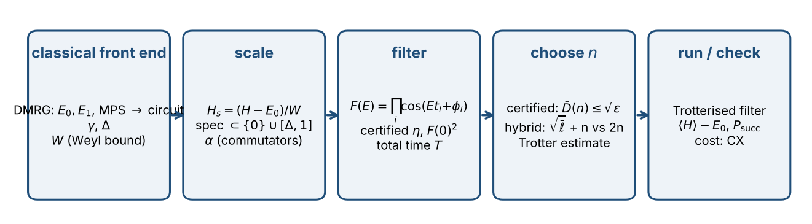
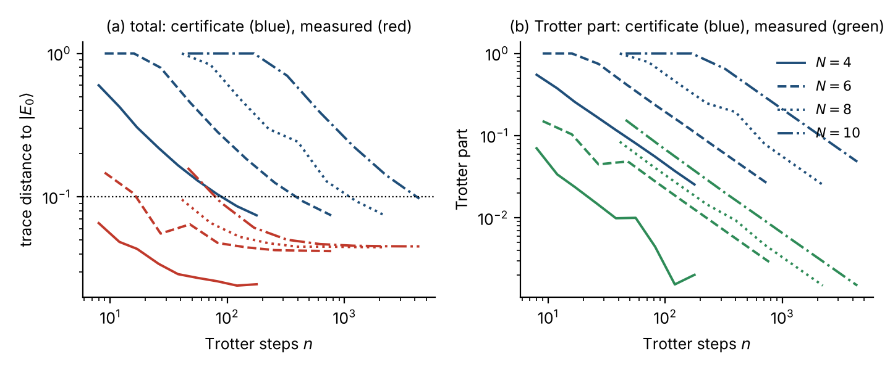
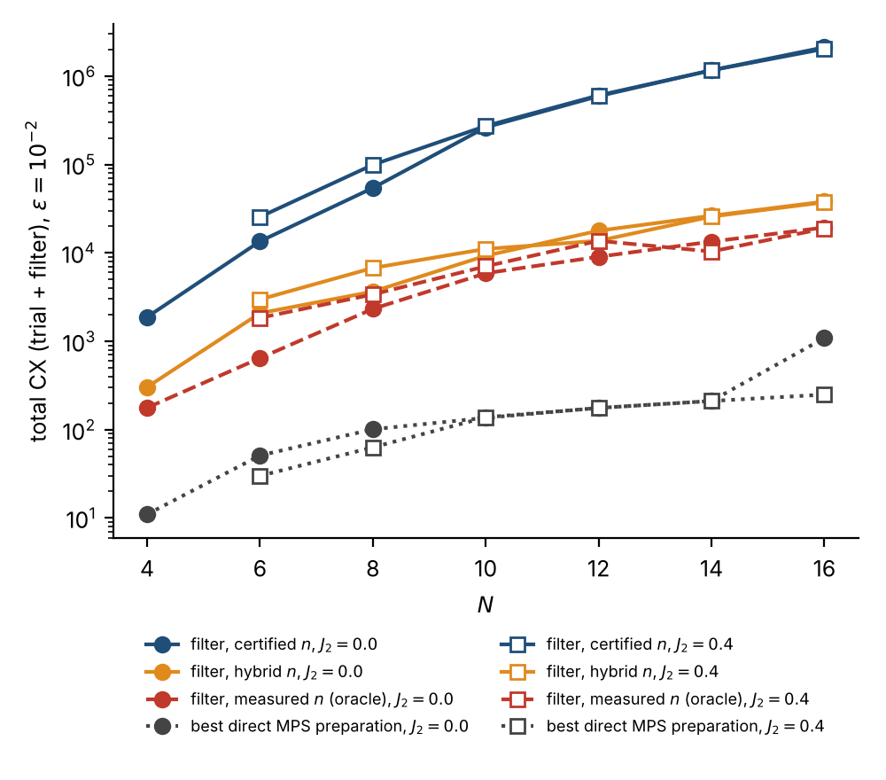

## Abstract

Density-matrix renormalisation group (DMRG) gives a matrix-product state and the low-lying energies of a spin chain classically, but a compact trial circuit built from them keeps some excited-state weight. The projection filter of Stetcu, Baroni and Carlson removes it on a quantum computer using one ancilla, controlled time evolution and post-selection. We give a complete workflow around this filter, from the DMRG front end to a verified state, and evaluate it on the open $J_1$–$J_2$ spin-½ chain: $N=4$–$16$ with exact statevector simulation and real DMRG trial states compiled to circuits, and $N$ up to 32 in a DMRG/MPS-only regime where circuits are counted. The front end is accurate to 3.7e-13 against exact diagonalisation ($N\le20$) and reproducible to 1.2e-13 between independent runs ($N\le32$); the excited state is the lowest state of any symmetry, as required across the Berezinskii–Kosterlitz–Thouless point of the chain, and the bandwidth is certified by Weyl's inequality without a DMRG value for the top of the spectrum. The paper is organised around three questions. **(1) Can the filter be certified without knowing the exact ground state?** Yes, conditionally: an a-priori bound on the trace distance to the ground state, $D\le\sqrt{\bar\ell}+\epsilon_T/\sqrt{p_g}$, needs only DMRG-derived inputs and held on all 99 simulated points. It is a *conditional certificate*: it assumes the DMRG shift, gap and ground-state weight are right, which DMRG cannot certify, and we state exactly how it changes when they are off by given amounts. It fails if the weight $\gamma$ or the gap $\Delta$ is over-estimated (a gap $25\%$ too large already breaks it). **(2) How conservative is the certificate?** Its leakage term is reasonably tight (1.1–2.7$\times$); its worst-case Trotter term is extremely conservative (9–77$\times$, growing with $N$), so the certified step count is 11–168$\times$ what is empirically sufficient. **(3) Can the practical cost be recovered without the exact ground state?** A hybrid rule, certified leakage plus a measured $n$-versus-$2n$ Trotter estimate, met every target (25 of 25) with 6–66$\times$ fewer steps than the certificate, but it is empirical, not rigorous. In gates, the hybrid filter costs $3\times10^{2}$–$4\times10^{4}$ CX including the trial circuit for $N\le16$, growing as roughly $N^{2.5}$–$N^{3.1}$, which is 28–150$\times$ the cost of preparing the state directly from the MPS at the same fidelity; the certified filter for $N=16$–$32$ needs $2.8\times10^{6}$–$9.6\times10^{7}$ CX and $3.6\times10^{6}$–$1.2\times10^{8}$ non-Clifford rotations. The workflow is a conditionally certified, reproducible way to use the filter and a calibrated account of its cost, not a resource advantage on these chains.

## 1. Introduction

A standard hybrid route to a ground state is to run DMRG, compile the resulting matrix-product state (MPS) into a shallow circuit, and repair the circuit's residual error with a quantum projection step. The Stetcu–Baroni–Carlson (SBC) projection [1], related to the rodeo algorithm [2], multiplies the trial state's energy components by a filter $F(E)=\prod_i\cos(Et_i+\phi_i)$ realised with pulses of controlled time evolution on a single ancilla. It sits among a family of ground-state projectors that use polynomial or Fourier filters of the Hamiltonian: phase-estimation-based preparation [3], quantum-eigenvalue-transformation filters [4,5] and, more generally, quantum singular value transformation. The SBC filter trades the optimal $\log(1/\varepsilon)$ scaling of those methods for a measurement-based, single-ancilla circuit whose filter can be designed and certified classically.

The practical difficulty is that the guarantee one would like, a bound on how far the prepared state is from the ground state, seems to need the ground state. This paper builds a workflow that avoids that, and asks three questions about it:

| | Question | Short answer | Where |
|---|---|---|---|
| **Q1** | Can SBC filtering be certified without knowing the exact ground state? | **Yes, conditionally** on conservative bounds for the ground-state weight $\gamma$ and the gap $\Delta$. A certificate built from DMRG-derived inputs was never violated, and it fails if $\gamma$ or $\Delta$ is over-estimated. | Section 4 |
| **Q2** | How conservative is that certificate? | **Leakage is reasonably tight; worst-case Trotter error is extremely conservative** (and more so as $N$ grows). | Section 5 |
| **Q3** | Can we recover the practical cost without the exact ground state? | **Largely, with the $n$-versus-$2n$ hybrid rule**, which met every target, but it is empirical rather than rigorous. | Section 6 |

Section 2 specifies the workflow and the certificate (including exactly which inputs are rigorous and which are assumed), Section 3 the experiments, and Section 7 the remaining practical questions: which trial state to use, how sensitive the result is to design choices, what the whole thing costs in CX gates, including against preparing the state directly from the MPS, and what it costs for chains up to $N=32$ where only DMRG and counted circuits are possible. Section 8 states the limitations. We do not claim a resource advantage; Section 7 shows there is none at these sizes.

## 2. The workflow

{width=100%}

**Stage 1 — classical front end (DMRG).** From a Hamiltonian $H=\sum_gH_g$ (here the bonds of the chain) run two-site DMRG for the ground-state energy $E_0$ and a high-bond-dimension reference MPS $\psi_0$, and again for the first excitation $E_1$ with the penalty $H+\lambda|\psi_0\rangle\langle\psi_0|$, $\lambda=1.1W$. The projector is applied as a rank-one term $\lambda|w\rangle\langle w|$ in every two-site local problem, where $w$ is $\psi_0$ contracted with the current environments; this is the same penalty as adding the projector as an MPO (whose bond dimension is $\chi^2$ and which ran out of memory beyond $N=14$ at the tolerances used here) at $O(\chi^3)$ cost. It returns the lowest state of *any* symmetry orthogonal to $\psi_0$, which matters because the first excitation of the $J_1$–$J_2$ chain is a triplet below the Berezinskii–Kosterlitz–Thouless point $J_2^c\approx0.2411$ [12,13] but can be a singlet in the dimerised phase. The bandwidth is certified without DMRG: by Weyl's inequality $\lambda_{\max}(\sum_bh_b)\le\sum_b\lambda_{\max}(h_b)$, and a bond $J\,\mathbf S\!\cdot\!\mathbf S$ has $\lambda_{\max}=J/4$ for $J\ge0$, so
$$W=\sum_b\lambda_{\max}(h_b)-E_0=\tfrac{N-1}{4}J_1+\tfrac{N-2}{4}J_2-E_0\ \ (J_1,J_2\ge0)$$
is an upper bound on $E_{\mathrm{top}}-E_0$, attained by the fully polarised state, so it equals $E_{\mathrm{top}}-E_0$. DMRG on $-H$ would be variational from the wrong side ($E_{\mathrm{top}}^{\mathrm{DMRG}}\le E_{\mathrm{top}}$) and is used only as a cross-check. Set $H_s=(H-E_0)/W$, so that $\operatorname{spec}H_s\subset\{0\}\cup[\Delta,1]$ with $\Delta=(E_1-E_0)/W$. Because $\alpha_{\mathrm{scaled}}=\alpha/W^2$ and $T_{\mathrm{scaled}}=x\pi W/g$ ($g=E_1-E_0$), the step count $n\propto\alpha T^2$ and the physical time $x\pi/g$ do not depend on $W$; a looser $W$ only widens the suppression window $[\Delta,1]$.

**Stage 2 — trial state.** Run DMRG at a small maximum bond dimension $\chi$ and compile the MPS to a circuit (here exactly, by sequential isometries with `mps-to-circuit`; an approximate brickwork compilation is also tested). Estimate the ground-state weight $\gamma=\|\Pi_0\psi\|^2$ (the weight in the whole ground space; a single nondegenerate vector in the cases studied) as the overlap with the reference MPS, by contraction when $N$ is too large for a statevector. If $1-\gamma\le\varepsilon$ for the target $\varepsilon$, stop: the trial state already suffices.

**Stage 3 — filter.** One pulse $(t,\phi)$ applies $\mathsf H_{\mathrm{a}}\,e^{-itH_s\otimes Z_{\mathrm{a}}}\,\mathrm{Rz}_{\mathrm{a}}(2\phi)\,\mathsf H_{\mathrm{a}}$; its ancilla-$|0\rangle$ block is $\cos(H_st+\phi)$. Keeping outcome $0$ after $m$ pulses applies $F(E)=\prod_{i=1}^m\cos(Et_i+\phi_i)$, with total time $T=\sum_it_i$ and $F(0)=\prod_i\cos\phi_i$. Two numbers characterise the filter: $\eta=\sup_{E\in[\Delta,1]}|F(E)|/|F(0)|$ (suppression of excited states relative to the ground state) and $p_g=\gamma F(0)^2$ (a lower bound on the success probability). We design $(t_i,\phi_i)$ with `floor.py`, which maximises $F(0)^2$ subject to a *certified* bound on $\eta$ (interval bisection using $|F'|\le\sum|t_i|$ and $|F''|\le(\sum|t_i|)^2$), for a leakage budget $\varepsilon_\ell=\varepsilon/4$.

**Stage 4 — Trotterisation and the choice of $n$.** Each controlled evolution is $k_i$ first-order Lie–Trotter steps over the bonds, $n=\sum_ik_i$, $t_i=k_i\,dt$. The Trotter error is governed by the commutator constant $\alpha=\sum_g\big\|[H_g,\sum_{g'>g}H_{g'}]\big\|$ (the larger of the two product orders; the ancilla does not change it). It is evaluated exactly, with no further inequality: for Pauli strings $[P_g,P_{g'}]=2P_gP_{g'}$ when they anticommute and $0$ otherwise, so each term is $2|c_g|\,\|\sum_{g'>g,\ \text{anticomm.}}c_{g'}P_{g'}\|$, a tiny dense eigenvalue problem on the few qubits near term $g$, with cost linear in the number of terms for any $N$. Three rules choose $n$:

* **Certified.** The smallest $n$ with $\bar D(n)\le\sqrt\varepsilon$, where the *certificate* is
$$\boxed{\;D\le\bar D:=\sqrt{\bar\ell}+\frac{\alpha T^2}{2n\sqrt{\gamma F(0)^2}},\qquad\bar\ell=\frac{(1-\gamma)\eta^2}{\gamma+(1-\gamma)\eta^2}\;}$$
$D$ is the trace distance between the implemented and the exact ground state. The first term is **leakage** (what an exact filter would leave) and depends only on $\gamma$ and $\eta$; the second is the **Trotter** term. Equivalently, infidelity $\le\bar D^2$ and energy error $\langle H\rangle-E_0\le W\bar D^2$. The proof (Appendix A) is the triangle inequality for the trace distance plus a leakage lemma and a first-order Trotter lemma.
* **Hybrid.** Keep the rigorous leakage term but replace the worst-case Trotter term by a measured one. For each candidate $n$ on a geometric grid, run the same filter at $n$ and $2n$ steps; because the first-order error scales as $1/n$, the Trotter distance is $\approx2D(\tilde\varphi_n,\tilde\varphi_{2n})$. Accept the smallest $n$ such that $\sqrt{\bar\ell}+2D(\tilde\varphi_n,\tilde\varphi_{2n})\le\sqrt\varepsilon$ at that grid point and the next. This uses no ground state and is *not* a theorem (it assumes the $1/n$ regime), but it is what a practitioner can actually evaluate.
* **Measured (oracle).** The smallest $n$ whose measured $D$ meets the target. It needs the exact ground state, so it is a reference, not a rule.

**The certificate is conditional on the DMRG inputs, and this can be made explicit.** Let $E_s=E_0^{\mathrm{DMRG}}$ be the shift, $\varepsilon_0=E_s-E_0\ge0$ (DMRG is variational), $\mu_0=\min_{\varphi\perp\psi_0}\langle\varphi|H|\varphi\rangle$ and $\varepsilon_1=E_1^{\mathrm{DMRG}}-\mu_0$, the optimisation error of the excited-state solve. Assume user-supplied bounds $\varepsilon_0\le\bar\varepsilon_0$, $\varepsilon_1\le\bar\varepsilon_1$ (neither is computable from DMRG alone). Courant–Fischer gives $E_0\le\mu_0\le E_1$ for *every* reference $\psi_0$ (Appendix A.2), so with $\delta_i=\bar\varepsilon_i/W$ the scaled spectrum obeys: ground space in $[-\delta_0,0]$, everything else in $[\Delta_*,1]$ with $\Delta_*=\Delta_{\mathrm{D}}-\delta_1$. The weight of $\psi_0$ outside the ground space is at most $s^2=\bar\varepsilon_0/(W\Delta_*)$, and with $\theta_1=\arcsin s$, $\theta_2=\arccos|\langle\psi_0|\psi\rangle|$, the trial state has ground-space weight $\gamma\ge\gamma_*=\cos^2(\theta_1+\theta_2)$. The theorem is then: *designing with $\eta_*=\sup_{[\Delta_*,1]}|F|/(F(0)-L\delta_0)$ ($L=\sum|t_i|$), $p_g=\gamma_*(F(0)-L\delta_0)^2$ and $\gamma_*$ in place of $\gamma$, the certificate above bounds the weight of the output outside the ground space.* The experiments set $\bar\varepsilon_0=\bar\varepsilon_1=0$ and take $\gamma$ as the overlap with the DMRG state, so every certified number below is the theorem evaluated at zero reference error, i.e. **conditional on the DMRG shift, gap and reference state being exact**, not unconditional.

**Stage 5 — run and check.** Execute the filter; check the post-selection rate, which is at least $p_g$, and, where the energy is measurable, $\langle H\rangle-E_0\le W\bar D^2$. If the device is noisy and prepares a mixed state $\tilde\rho$, the triangle inequality adds a noise term: $D(\tilde\rho,g)\le D(\tilde\rho,\tilde\varphi)+\bar D$.

**What is rigorous and what is assumed.**

| Quantity | Source | Status |
|---|---|---|
| $E_0$ | DMRG | variational ($\varepsilon_0\ge0$); accurate to $\sim10^{-13}$ here; enters the theorem through $\bar\varepsilon_0$ |
| $W$ | Weyl bound on the bonds | **rigorous**; equals $E_{\mathrm{top}}-E_0$ for $J_1,J_2\ge0$; no DMRG value of $E_{\mathrm{top}}$ needed |
| $E_1$, $\Delta$ | DMRG, orthogonality penalty | $\Delta_{\mathrm{true}}\ge\Delta_{\mathrm{D}}-\varepsilon_1/W$ by interlacing, so conditional on $\bar\varepsilon_1$ (zero in the runs) |
| $\gamma$ | overlap with a high-$\chi$ reference MPS | $\gamma\ge\gamma_*$ by the purity lemma, conditional on $\bar\varepsilon_0,\bar\varepsilon_1$ (zero in the runs) |
| $\eta$, $F(0)$ | interval certificate | rigorous in real arithmetic given $\Delta$; evaluated in double precision, **no interval arithmetic** (rounding $\lesssim10^{-14}\ll$ the pruning tolerance) |
| $\alpha$ | exact commutator sum | rigorous |
| ground-state degeneracy | — | the target is the ground space $\Pi_0$ and $\gamma$ its total weight; the chains studied have a nondegenerate singlet ground state (a degenerate space would show up as $\Delta\approx0$) |
| leakage and Trotter terms | Lemmas 1 and 2 | rigorous *given* the inputs above |

The certificate is therefore as trustworthy as $\Delta$ and $\gamma$; Section 4.3 quantifies what happens when they are wrong.

## 3. Experiments

* **System.** Open spin-½ $J_1$–$J_2$ chain, $J_1=1$, $J_2\in\{0,0.4\}$, $N\in\{4,6,\dots,16\}$. Bonds are ordered: nearest-neighbour bonds with even then odd left site, then next-nearest-neighbour bonds likewise.
* **Front end.** Two-site DMRG (`quimb` [14]) with the repository's `get_energies.py`: SVD cutoff $10^{-14}$, energy tolerance $10^{-12}$, inner Lanczos tolerance $10^{-10}$, bond dimensions up to 256 (the cutoff, not the cap, limits the bond dimension reached: $\chi\le114$ at $N\le32$), $E_1$ by the rank-one orthogonality penalty of Section 2. The workflow sees only DMRG quantities; the bandwidth is the Weyl bound. Exact diagonalisation is used afterwards to validate (true ground state, gap, overlap) and to measure distances.
* **Trial state.** DMRG at maximum bond dimension $\chi=2$ (main experiments), compiled exactly. $\chi\in\{1,2,4,8\}$ and $L$-layer approximate circuits are compared at $N=8$.
* **Targets.** $\varepsilon=10^{-1},10^{-2}$ ($N\le16$) and $10^{-3}$ ($N\le8$), i.e. $D\le0.32,0.1,0.032$.
* **Simulation.** Exact statevector simulation of the Trotterised filter, the ideal filter, and the ground state. A run is simulated only if $n\times\text{bonds}\times2\times2^N\le1.5\times10^{10}$; the $N=16$, $\varepsilon=10^{-2}$ certified circuits are not simulated, and their step counts and CX are reported from the certificate.
* **Larger chains ($N\le32$, Section 7.4).** The pipeline in `j1j2_filter/` runs DMRG and the circuits without any statevector or dense operator above $N=14$: $\gamma$ is the overlap of the DMRG MPS with the trial circuit simulated as an MPS (Aer), the trial state is an $L=1$ brickwork `mps-to-circuit` compilation, $J_2\in\{0,0.2411,0.4\}$, $\varepsilon\in\{10^{-1},10^{-2}\}$, and the circuits are *counted, not simulated* (per-step transpile times $n$, validated against a full transpile at $n=48$). Trotter terms are the individual Pauli rotations ($\alpha$ at Pauli level), so its step counts are not directly comparable with the bond-gate counts of Sections 4–7.3.
* **Cost.** One Trotter step of one pulse (for each bond, the $XX,YY,ZZ$ rotations tensored with $Z$ on the ancilla) is transpiled once with qiskit (level 3) to $\{\mathrm{CX},\mathrm{Rz},\mathrm{H},\mathrm{S}\}$; total CX is trial CX plus $n\times$ CX per step. The fault-tolerant metric reported for the larger chains is the number of *non-Clifford* $R_z$ rotations (angles not a multiple of $\pi/2$); no $T$-count is reported, because it depends on the synthesis method and its constants. All-to-all connectivity unless stated. The trial circuit is the exact `mps-to-circuit` compilation, transpiled the same way.
* **Direct-preparation baseline.** Preparing the state directly from the MPS: `mps-to-circuit` sequential (exact) circuits for the reference MPS truncated to $\chi\in\{1,2,4,8,16\}$, $L$-layer approximate circuits ($L\le8$), and generic state preparation of the exact ground state ($N\le12$). Each is measured against the exact ground state; the baseline for a target $\varepsilon$ is the cheapest with infidelity $\le\varepsilon$.

## 4. Q1: Can the filter be certified without knowing the exact ground state?

**Short answer: yes, conditionally.** Every quantity in the certificate, $\gamma$, $\Delta$, $W$, $\eta$, $F(0)$, $\alpha$ and $T$, can be computed from DMRG output and the circuit, with no access to the exact ground state. The certificate is then a theorem *given* $\gamma$ and $\Delta$ (Appendix A), and it is only as safe as those two inputs.

### 4.1 The classical front end supplies the inputs

| $N$ | $J_2$ | $\chi_{\mathrm{ref}}$ | $|E_0^{\mathrm{DMRG}}-E_0|$ | $|E_1^{\mathrm{DMRG}}-E_1|$ | $|\Delta^{\mathrm{DMRG}}-\Delta|/\Delta$ | $\gamma$ (DMRG-ref.) | $\gamma$ (exact) | trial CX | $\alpha$ |
|---|---|---|---|---|---|---|---|---|---|
| 4 | 0.0 | 4 | 0.0e+0 | 7.8e-16 | 1.2e-15 | 0.9543 | 0.9543 | 9 | 0.155 |
| 6 | 0.0 | 8 | 1.3e-15 | 8.9e-16 | 8.5e-16 | 0.8823 | 0.8823 | 15 | 0.124 |
| 8 | 0.0 | 16 | 2.7e-15 | 1.3e-15 | 1.0e-14 | 0.7748 | 0.7748 | 21 | 0.099 |
| 10 | 0.0 | 32 | 8.0e-15 | 6.7e-15 | 4.0e-15 | 0.6713 | 0.6713 | 27 | 0.082 |
| 12 | 0.0 | 40 | 3.2e-14 | 4.2e-14 | 3.5e-14 | 0.5911 | 0.5911 | 33 | 0.070 |
| 14 | 0.0 | 48 | 1.5e-13 | 8.1e-14 | 2.9e-13 | 0.5274 | 0.5274 | 39 | 0.060 |
| 16 | 0.0 | 62 | 1.6e-13 | 1.2e-13 | 2.0e-13 | 0.4750 | 0.4750 | 45 | 0.053 |
| 4 | 0.4 | 4 | 1.1e-15 | 7.8e-16 | 6.1e-16 | 0.9957 | 0.9957 | 9 | 0.201 |
| 6 | 0.4 | 8 | 2.7e-15 | 8.9e-16 | 3.5e-15 | 0.9873 | 0.9873 | 15 | 0.184 |
| 8 | 0.4 | 16 | 2.2e-15 | 2.7e-15 | 1.1e-15 | 0.9755 | 0.9755 | 21 | 0.153 |
| 10 | 0.4 | 26 | 8.0e-15 | 1.7e-14 | 2.6e-14 | 0.9613 | 0.9613 | 27 | 0.129 |
| 12 | 0.4 | 46 | 1.1e-13 | 8.7e-14 | 6.3e-14 | 0.9455 | 0.9455 | 33 | 0.111 |
| 14 | 0.4 | 56 | 1.2e-13 | 8.8e-14 | 1.2e-13 | 0.9286 | 0.9286 | 39 | 0.097 |
| 16 | 0.4 | 62 | 3.0e-13 | 2.7e-13 | 1.5e-13 | 0.9110 | 0.9110 | 45 | 0.086 |

*Table 1.* DMRG-derived inputs against exact diagonalisation. $\chi_{\mathrm{ref}}$ is the bond dimension the reference MPS used.

DMRG reproduces $E_0$, $E_1$ and the gap to better than 3e-13 (absolute) and 3e-13 (relative), and the estimated $\gamma$ differs from the exact overlap by at most 4e-10 ($\gamma$ is first order in the state error, so it is the least accurate of the inputs). At these sizes the certificate computed from DMRG inputs is therefore indistinguishable from the one computed from exact inputs. The accuracy depends on the DMRG settings: with a looser SVD cutoff ($10^{-10}$) and sweep tolerance ($10^{-10}$), and quimb's default inner-solver tolerance ($10^{-3}$), the same calculation is limited to about $10^{-9}$, which propagates into $\Delta$ and $\gamma$ and so into the uncertified columns; the settings of Section 3 remove that.

Beyond $N=16$ the same front end was validated in two ways. Against exact diagonalisation (sparse Lanczos, used for testing only) for $N=16$–$20$:

| $N$ | $J_2$ | $|E_0-E_0^{\mathrm{ED}}|$ | $|E_1-E_1^{\mathrm{ED}}|$ | $|E_{\mathrm{top}}-E_{\mathrm{top}}^{\mathrm{ED}}|$ | $1-|\langle\psi_0|\psi_0^{\mathrm{ED}}\rangle|^2$ |
|---|---|---|---|---|---|
| 16 | 0 | 2.4e-13 | 2.1e-13 | 1.4e-14 | 4.4e-14 |
| 18 | 0 | 1.9e-13 | 2.7e-13 | 8.9e-16 | 6.0e-14 |
| 20 | 0 | 3.5e-13 | 3.3e-13 | 2.7e-14 | 8.1e-14 |
| 16 | 0.2411 | 1.6e-13 | 2.4e-13 | 6.2e-15 | 5.1e-14 |
| 18 | 0.2411 | 2.2e-13 | 2.6e-13 | 1.3e-13 | 5.4e-14 |
| 20 | 0.2411 | 2.9e-13 | 3.4e-13 | 3.6e-15 | 6.3e-14 |
| 16 | 0.4 | 3.0e-13 | 2.8e-13 | 8.0e-15 | 6.8e-14 |
| 18 | 0.4 | 3.7e-13 | 2.4e-13 | 8.9e-16 | 7.9e-14 |
| 20 | 0.4 | 3.7e-13 | 2.9e-13 | 5.3e-15 | 6.8e-14 |

*Table 1b.* DMRG against exact diagonalisation, $N=16$–$20$. All errors are at most 3.7e-13.

and, with no exact reference for $N=24$–$32$, by two independent runs from different random starts, plus the energy variance $\langle H^2\rangle-\langle H\rangle^2$ of each state (a state with variance $s^2$ has an eigenvalue within $s$ of its energy):

| $N$ | $J_2$ | run-to-run $|\Delta E_0|$ | $|\Delta E_1|$ | $|\Delta E_{\mathrm{top}}|$ | $1-|\langle\psi_0|\psi_0'\rangle|^2$ | variance of $\psi_0$ | variance of $\psi_1$ |
|---|---|---|---|---|---|---|---|
| 24 | 0 | 3.0e-14 | 3.6e-15 | 2.9e-14 | 4.7e-14 | 3.2e-12 | 2.4e-12 |
| 28 | 0 | 1.4e-14 | 3.0e-14 | 8.8e-14 | 1.8e-14 | 3.2e-12 | 2.9e-12 |
| 32 | 0 | 3.2e-14 | 1.6e-14 | 1.2e-13 | 2.4e-14 | 6.3e-12 | 3.4e-12 |
| 24 | 0.2411 | 7.1e-15 | 2.3e-14 | 1.5e-14 | 5.2e-14 | 2.4e-12 | 2.4e-12 |
| 28 | 0.2411 | 2.5e-14 | 4.4e-14 | 2.8e-14 | 3.5e-14 | 2.2e-12 | 3.3e-12 |
| 32 | 0.2411 | 4.6e-14 | 1.8e-14 | 7.3e-14 | 3.0e-14 | 5.2e-12 | 3.6e-12 |
| 24 | 0.4 | 2.0e-14 | 2.7e-14 | 3.6e-14 | 2.3e-14 | 3.0e-12 | 2.3e-12 |
| 28 | 0.4 | 2.0e-14 | 7.1e-15 | 6.2e-14 | 4.3e-14 | 4.0e-12 | 3.0e-12 |
| 32 | 0.4 | 5.7e-14 | 7.1e-15 | 9.2e-14 | 5.2e-14 | 5.5e-12 | 3.3e-12 |

*Table 1c.* Run-to-run agreement of DMRG at $N=24$–$32$. Energies agree to 1.2e-13 or better and the variances are at most 6.3e-12. The trial-state overlap $\gamma$ computed by MPS contraction agrees with the dense overlap with the exact ground state to 2.5e-9 ($N=16$, $18$).

Run-to-run agreement shows that the solves are converged and reproducible; it does not prove that they sit at the true minimum, which is why Section 2 states the certificate as conditional. This is an empirical statement about well-behaved chains: DMRG does not certify these numbers.

### 4.2 The certificate computed from DMRG inputs was never violated

Across 99 simulated points (every case at the certified step count plus the $n$-sweeps of Section 5), with the certificate computed from DMRG inputs only, the total certificate, its leakage term, its Trotter term, the triangle inequality, the energy bound $\langle H\rangle-E_0\le W\bar D^2$ and the success-rate bound $P_{\mathrm{succ}}\ge\gamma F(0)^2$ each held 99 out of 99 times. The exact ground state was used only afterwards, to measure $D$. This checks the derivation and the code; the proofs are in Appendix A.

### 4.3 What happens when the inputs are wrong

The condition in the short answer is not a formality. We design and certify with deliberately wrong values and measure the true distance ($N=8$ and $12$, $J_2=0$, $\varepsilon=10^{-2}$):

| $N$ | input error | $n_{\mathrm{bound}}$ | claimed $\bar D$ | $\bar D$ with true inputs | measured $D$ | claim violated? | target $\sqrt\varepsilon$ missed? |
|---|---|---|---|---|---|---|---|
| 8 | gap -20\% | 1,734 | 0.100 | 0.100 | 0.022 | no | no |
| 8 | gap +0\% | 1,108 | 0.100 | 0.100 | 0.045 | no | no |
| 8 | gap +10\% | 910 | 0.100 | 0.130 | 0.069 | no | no |
| 8 | gap +25\% | 711 | 0.099 | 0.171 | 0.103 | yes | yes |
| 8 | gap +50\% | 488 | 0.100 | 0.229 | 0.151 | yes | yes |
| 8 | gap +100\% | 261 | 0.100 | 0.311 | 0.221 | yes | yes |
| 8 | $\gamma$ over-estimated (0.831 vs 0.775) | 1,009 | 0.099 | 0.111 | 0.053 | no | no |
| 8 | $\gamma$ over-estimated (0.887 vs 0.775) | 910 | 0.100 | 0.128 | 0.067 | no | no |
| 8 | $\gamma$ over-estimated (0.944 vs 0.775) | 800 | 0.100 | 0.164 | 0.100 | yes | yes |
| 12 | gap -20\% | 11,951 | 0.100 | 0.100 | 0.033 | no | no |
| 12 | gap +0\% | 7,712 | 0.099 | 0.099 | 0.046 | no | no |
| 12 | gap +10\% | 6,760 | 0.100 | 0.145 | 0.085 | no | no |
| 12 | gap +25\% | 4,881 | 0.100 | 0.224 | 0.155 | yes | yes |
| 12 | gap +50\% | 3,386 | 0.100 | 0.326 | 0.248 | yes | yes |
| 12 | gap +100\% | 1,902 | 0.100 | 0.456 | 0.368 | yes | yes |
| 12 | $\gamma$ over-estimated (0.693 vs 0.591) | 7,070 | 0.100 | 0.116 | 0.056 | no | no |
| 12 | $\gamma$ over-estimated (0.796 vs 0.591) | 3,570 | 0.100 | 0.139 | 0.075 | no | no |
| 12 | $\gamma$ over-estimated (0.898 vs 0.591) | 2,934 | 0.099 | 0.182 | 0.114 | yes | yes |

*Table 2.* "Claimed" is the certificate computed from the (wrong) inputs; "with true inputs" recomputes it with the true gap and overlap; "measured" is the actual distance.

* **Under-estimating the gap is safe**: the filter is designed for a wider window and costs more steps.
* **Over-estimating the gap is not.** At $+10\%$ the claimed bound still holds, but the bound recomputed with the true gap is already $30$–$45\%$ above the claim; at $+25\%$ the claim is violated and the target missed at both sizes.
* **Over-estimating $\gamma$** behaves the same way, with a threshold that depends on how much excited weight is hidden.
* **Practical rule.** By interlacing (Section 2), the penalised solve targets $\mu_0\le E_1$, so the DMRG gap can overestimate the true gap only by the solve's own optimisation error $\varepsilon_1$; DMRG's $E_0$ is above the true one, which also works in the safe direction. $\varepsilon_1$ is not computable, but here it was at most 3e-13, so a gap error of $10$–$25\%$ is far outside what the front end produces. The workflow should still design with a deliberately *reduced* gap $\Delta_*=\Delta_{\mathrm{D}}-\bar\varepsilon_1/W$, or with a relative margin: a $20\%$ reduction was safe and cost 1.55–1.56$\times$ more steps at both sizes.

**Answer to Q1.** Yes: the certificate needs no ground state, and it held on every point when built from DMRG inputs. It is conditional on $\gamma$ and $\Delta$ not being optimistic. The workflow bounds the error of those two numbers in terms of the DMRG errors $\bar\varepsilon_0,\bar\varepsilon_1$ (Section 2) but cannot compute those errors; the experiments quantify the cost of getting $\gamma$ and $\Delta$ wrong.

## 5. Q2: How conservative is the certificate?

**Short answer: the leakage term is reasonably tight, the worst-case Trotter term is extremely conservative.**

| $N$ | $J_2$ | $\gamma$ | $\Delta$ | $n_{\mathrm{bound}}$ | $n_{\mathrm{hyb}}$ | $n_{\mathrm{meas}}$ | bound $\bar D$ | $D$ at $n_{\mathrm{bound}}$ | leakage: bound / meas. | Trotter: bound / meas. |
|---|---|---|---|---|---|---|---|---|---|---|
| 4 | 0.0 | 0.954 | 0.278 | 89 | 14 | 8 | 0.099 | 0.026 | 2.0$\times$ | 12$\times$ |
| 6 | 0.0 | 0.882 | 0.131 | 386 | 59 | 18 | 0.100 | 0.042 | 1.2$\times$ | 9$\times$ |
| 8 | 0.0 | 0.775 | 0.077 | 1,108 | 74 | 47 | 0.100 | 0.045 | 1.1$\times$ | 17$\times$ |
| 10 | 0.0 | 0.671 | 0.050 | 4,182 | 147 | 93 | 0.099 | 0.045 | 1.1$\times$ | 32$\times$ |
| 12 | 0.0 | 0.591 | 0.036 | 7,712 | 231 | 117 | 0.099 | 0.046 | 1.1$\times$ | 41$\times$ |
| 14 | 0.0 | 0.527 | 0.027 | 12,807 | 289 | 147 | 0.100 | 0.045 | 1.1$\times$ | 52$\times$ |
| 16 | 0.0 | 0.475 | 0.021 | 20,198 | 362 | 184 | 0.100 | not simulated | – | – |
| 4 | 0.4 | 0.996 | 0.274 | – | – | – | – | 0.065$^\dagger$ | – | – |
| 6 | 0.4 | 0.987 | 0.128 | 405 | 47 | 29 | 0.100 | 0.023 | 2.4$\times$ | 10$\times$ |
| 8 | 0.4 | 0.976 | 0.075 | 1,091 | 74 | 37 | 0.100 | 0.020 | 2.7$\times$ | 20$\times$ |
| 10 | 0.4 | 0.961 | 0.050 | 2,292 | 93 | 59 | 0.100 | 0.021 | 2.4$\times$ | 30$\times$ |
| 12 | 0.4 | 0.945 | 0.036 | 4,121 | 93 | 93 | 0.100 | 0.026 | 1.9$\times$ | 39$\times$ |
| 14 | 0.4 | 0.929 | 0.027 | 6,656 | 147 | 59 | 0.100 | 0.022 | 2.2$\times$ | 77$\times$ |
| 16 | 0.4 | 0.911 | 0.021 | 10,026 | 184 | 93 | 0.100 | not simulated | – | – |

*Table 3.* $\varepsilon=10^{-2}$, $\chi=2$. $^\dagger$$1-\gamma\le\varepsilon$: no filter needed, and the entry is the trial state's own distance. $D$ is the measured distance at $n_{\mathrm{bound}}$. The last two columns compare the certificate with the measurement, term by term. $n_{\mathrm{hyb}}$ is discussed in Section 6.

* **Close in total.** At $n_{\mathrm{bound}}$ the certificate exceeds the measured $D$ by 2.2–5.1$\times$ (median 3.8$\times$).
* **Leakage is reasonably tight.** The leakage term is within 1.1–2.7$\times$ of the measured leakage distance. The only slack is that every excited component is charged the worst-case filter value $\eta F(0)$.
* **Trotter is extremely conservative.** The Trotter term is 9–77$\times$ too large and the discrepancy grows with $N$ (from $9\times$ at $N=6$ to $52$–$77\times$ at $N=14$), because $\alpha$ is a worst case over all states. The measured $D$ at $n_{\mathrm{bound}}$ is dominated by leakage (0.018–0.046, against a Trotter part of at most 0.006).
* **Consequence for step counts.** The certified step count is 11–168$\times$ (median 34$\times$) the smallest count that empirically meets the target.
* **Scaling in $n$ is right, the constant is not.** The Trotter certificate and the measured Trotter distance both fall as $1/n$ (fitted log–log slopes -1.01 to -0.99 and -1.17 to -0.87), so the certificate has the right scaling and is off by a roughly constant factor at each $N$ (Figure 2). The measured total saturates at the leakage floor.
* **Other observables.** The energy bound $W\bar D^2$ holds but is 17–293$\times$ above the measured energy error. The success rate matches the lower bound $\gamma F(0)^2$ to 0.35% or better, so $1/(\gamma F(0)^2)$ is an accurate estimate of the repetition overhead.

{width=100%}

Step counts also scale with the target roughly as first-order theory predicts for the certificate ($n\propto\varepsilon^{-1/2}$ at a fixed filter; the observed ratios $n(10^{-3})/n(10^{-2})$ of $4$–$7$ include the tightening of the filter itself):

| $N$ | $J_2$ | $n_{\mathrm{bound}}$ ($\varepsilon=10^{-1}$) | ($10^{-2}$) | ($10^{-3}$) | ratio $10^{-3}/10^{-2}$ | $n_{\mathrm{hyb}}$ ($10^{-2}$ / $10^{-3}$) | $n_{\mathrm{meas}}$ ($10^{-2}$ / $10^{-3}$) |
|---|---|---|---|---|---|---|---|
| 4 | 0.0 | – | 89 | 375 | 4.2 | 14 / 29 | 8 / 11 |
| 6 | 0.0 | 87 | 386 | 2,651 | 6.9 | 59 / 184 | 18 / 117 |
| 8 | 0.0 | 247 | 1,108 | 7,577 | 6.8 | 74 / 567 | 47 / 567 |
| 6 | 0.4 | – | 405 | 1,790 | 4.4 | 47 / 74 | 29 / 47 |
| 8 | 0.4 | – | 1,091 | 4,881 | 4.5 | 74 / 74 | 37 / 29 |

*Table 4.* Certified step counts at three targets, and hybrid and measured counts at $10^{-2}$ and $10^{-3}$.

**Answer to Q2.** The certificate is within a factor of about 3.8 in distance, because leakage dominates the error and is bounded tightly. The price of a worst-case proof is in the Trotter term: it is one to two orders of magnitude too large, increasingly so with $N$, which turns directly into an order-of-magnitude excess in circuit length (Section 7).

## 6. Q3: Can the practical cost be recovered without the exact ground state?

**Short answer: largely, with the $n$-versus-$2n$ hybrid rule, which is empirical rather than rigorous.** The hybrid rule keeps the rigorous leakage term and replaces the worst-case Trotter term by a measured one (Section 2, Stage 4). It never uses the ground state.

| $N$ | $J_2$ | $\varepsilon$ | $n_{\mathrm{bound}}$ | $n_{\mathrm{hyb}}$ | $n_{\mathrm{meas}}$ | $D$ at $n_{\mathrm{hyb}}$ | $\sqrt\varepsilon$ | steps saved vs. certified |
|---|---|---|---|---|---|---|---|---|
| 4 | 0.0 | 0.01 | 89 | 14 | 8 | 0.056 | 0.100 | 6$\times$ |
| 4 | 0.0 | 0.001 | 375 | 29 | 11 | 0.008 | 0.032 | 13$\times$ |
| 6 | 0.0 | 0.01 | 386 | 59 | 18 | 0.058 | 0.100 | 7$\times$ |
| 6 | 0.0 | 0.001 | 2,651 | 184 | 117 | 0.021 | 0.032 | 14$\times$ |
| 8 | 0.0 | 0.01 | 1,108 | 74 | 47 | 0.065 | 0.100 | 15$\times$ |
| 8 | 0.0 | 0.001 | 7,577 | 567 | 567 | 0.018 | 0.032 | 13$\times$ |
| 10 | 0.0 | 0.01 | 4,182 | 147 | 93 | 0.065 | 0.100 | 28$\times$ |
| 12 | 0.0 | 0.01 | 7,712 | 231 | 117 | 0.063 | 0.100 | 33$\times$ |
| 14 | 0.0 | 0.01 | 12,807 | 289 | 147 | 0.064 | 0.100 | 44$\times$ |
| 16 | 0.0 | 0.01 | 20,198 | 362 | 184 | 0.063 | 0.100 | 56$\times$ |
| 4 | 0.4 | 0.001 | 363 | 37 | 18 | 0.012 | 0.032 | 10$\times$ |
| 6 | 0.4 | 0.01 | 405 | 47 | 29 | 0.059 | 0.100 | 9$\times$ |
| 6 | 0.4 | 0.001 | 1,790 | 74 | 47 | 0.009 | 0.032 | 24$\times$ |
| 8 | 0.4 | 0.01 | 1,091 | 74 | 37 | 0.050 | 0.100 | 15$\times$ |
| 8 | 0.4 | 0.001 | 4,881 | 74 | 29 | 0.012 | 0.032 | 66$\times$ |
| 10 | 0.4 | 0.01 | 2,292 | 93 | 59 | 0.056 | 0.100 | 25$\times$ |
| 12 | 0.4 | 0.01 | 4,121 | 93 | 93 | 0.037 | 0.100 | 44$\times$ |
| 14 | 0.4 | 0.01 | 6,656 | 147 | 59 | 0.032 | 0.100 | 45$\times$ |
| 16 | 0.4 | 0.01 | 10,026 | 184 | 93 | 0.037 | 0.100 | 54$\times$ |

*Table 5.* The hybrid rule against the certificate and the oracle. $D$ is measured at $n_{\mathrm{hyb}}$ against the exact ground state, which the rule itself never uses.

* **It met the target** in 25 of 25 cases, with a margin $\sqrt\varepsilon/D$ of 1.5–4.1$\times$.
* **It is close to the oracle.** It uses 6–66$\times$ (median 15$\times$) fewer steps than the certificate and only 1.0–3.3$\times$ (median 1.8$\times$) more than the oracle. The gap to the oracle is mostly the coarse geometric grid and the requirement of confirmation at the next grid point.
* **The Trotter estimate is accurate.** The $n$-versus-$2n$ estimate of the Trotter distance matched the measured one to within [1.000, 1.061] over 62 sweep points with $n\ge n_{\mathrm{meas}}$.
* **It is not a theorem.** It assumes the $1/n$ error regime, which held in every run here (Section 5), and it inherits the assumptions on $\gamma$ and $\Delta$ through its leakage term, so Section 4.3 applies to it unchanged. The evidence is 25 cases on one chain.

**Answer to Q3.** Yes, to a good approximation: the hybrid rule recovers all but a factor of about 1.8 of the empirically sufficient cost with no ground state, and met every target. What it gives up is the proof: its Trotter part is a measurement under an assumed scaling, not a bound.

## 7. Using the workflow: trial state, design choices and cost

### 7.1 The choice of trial state

At $N=8$, $\varepsilon=10^{-2}$:

| $J_2$ | trial state | $\gamma$ | trial CX | $n_{\mathrm{bound}}$ | total CX, certified | total CX, hybrid |
|---|---|---|---|---|---|---|
| 0.0 | DMRG $\chi=1$ | 0.1336 | 0 | 8,519 | 417,431 | 5,733 |
| 0.0 | DMRG $\chi=2$ | 0.7748 | 21 | 1,108 | 54,313 | 3,647 |
| 0.0 | DMRG $\chi=4$ | 0.9986 | 101 | no filter needed | 101 | 101 |
| 0.0 | DMRG $\chi=8$ | 1.0000 | 329 | no filter needed | 329 | 329 |
| 0.0 | approx. circuit $L=1$ | 0.8371 | 21 | 992 | 48,629 | 3,647 |
| 0.0 | approx. circuit $L=2$ | 0.9139 | 42 | 864 | 42,378 | 2,933 |
| 0.0 | approx. circuit $L=3$ | 0.9314 | 63 | 838 | 41,125 | 3,689 |
| 0.4 | DMRG $\chi=1$ | 0.0361 | 0 | 33,636 | 3,060,876 | 21,021 |
| 0.4 | DMRG $\chi=2$ | 0.9755 | 21 | 1,091 | 99,302 | 6,755 |
| 0.4 | DMRG $\chi=4$ | 0.9999 | 99 | no filter needed | 99 | 99 |
| 0.4 | DMRG $\chi=8$ | 1.0000 | 329 | no filter needed | 329 | 329 |
| 0.4 | approx. circuit $L=1$ | 0.9770 | 21 | 1,075 | 97,846 | 6,755 |
| 0.4 | approx. circuit $L=2$ | 0.9843 | 42 | 1,009 | 91,861 | 6,776 |
| 0.4 | approx. circuit $L=3$ | 0.9925 | 63 | no filter needed | 63 | 63 |

*Table 6.* Trial state against total CX (trial plus filter). "Approx." is the $L$-layer `mps-to-circuit` brickwork compilation of the reference MPS.

A better trial state needs a much shorter filter: going from $\chi=1$ ($\gamma=0.13$ at $J_2=0$) to $\chi=2$ cuts the certified step count by $7.7\times$ ($31\times$ at $J_2=0.4$, where $\chi=1$ gives $\gamma=0.04$). For $\chi=4$ the DMRG state already meets the target and no filter is needed. A trial state produced by approximate compilation behaves like a DMRG state of the same $\gamma$: the filter only sees $\gamma$.

### 7.2 Sensitivity to design choices

At $N=8$, $J_2=0$, $\varepsilon=10^{-2}$, certified $n$ against the leakage share $\varepsilon_\ell/\varepsilon$ and the number of pulses $m$ (the solver searched $x=T\Delta/\pi\in\{0.6,1,1.5,2\}$):

| leakage share $\varepsilon_\ell/\varepsilon$ | $m=4$ | $m=6$ | $m=8$ |
|---|---|---|---|
| 0.05 | infeasible | 1,398 (6 pulses) | 1,398 (8 pulses) |
| 0.1 | infeasible | 1,511 (6 pulses) | 1,511 (8 pulses) |
| 0.25 | infeasible | 1,108 (6 pulses) | 1,124 (8 pulses) |
| 0.5 | infeasible | 1,651 (6 pulses) | 1,651 (8 pulses) |
| 0.75 | infeasible | 3,216 (6 pulses) | 3,216 (8 pulses) |

*Table 7.* Certified step count against design choices. Four pulses are infeasible for this trial state.

The certified $n$ varies by $3\times$ (1,108–3,216) over the shares tried, with a minimum near the $1/4$ used elsewhere; six and eight pulses are equivalent. The leakage share is the one design parameter worth tuning.

### 7.3 Gate cost

| $N$ | $J_2$ | trial CX | CX / step | filter CX: certified | filter CX: hybrid | filter CX: measured | total, certified | total, hybrid | best direct MPS prep. |
|---|---|---|---|---|---|---|---|---|---|
| 4 | 0.0 | 9 | 21 | 1,869 | 294 | 168 | 1,878 | 303 | 11 (generic) |
| 6 | 0.0 | 15 | 35 | 13,510 | 2,065 | 630 | 13,525 | 2,080 | 51 (generic) |
| 8 | 0.0 | 21 | 49 | 54,292 | 3,626 | 2,303 | 54,313 | 3,647 | 101 (sequential MPS, $\chi=4$) |
| 10 | 0.0 | 27 | 63 | 263,466 | 9,261 | 5,859 | 263,493 | 9,288 | 136 (sequential MPS, $\chi=4$) |
| 12 | 0.0 | 33 | 77 | 593,824 | 17,787 | 9,009 | 593,857 | 17,820 | 176 (sequential MPS, $\chi=4$) |
| 14 | 0.0 | 39 | 91 | 1,165,437 | 26,299 | 13,377 | 1,165,476 | 26,338 | 211 (sequential MPS, $\chi=4$) |
| 16 | 0.0 | 45 | 105 | 2,120,790 | 38,010 | 19,320 | 2,120,835 | 38,055 | 1,089 (sequential MPS, $\chi=8$) |
| 6 | 0.4 | 15 | 63 | 25,515 | 2,961 | 1,827 | 25,530 | 2,976 | 30 (approx. circuit, $L=2$) |
| 8 | 0.4 | 21 | 91 | 99,281 | 6,734 | 3,367 | 99,302 | 6,755 | 63 (approx. circuit, $L=3$) |
| 10 | 0.4 | 27 | 119 | 272,748 | 11,067 | 7,021 | 272,775 | 11,094 | 138 (sequential MPS, $\chi=4$) |
| 12 | 0.4 | 33 | 147 | 605,787 | 13,671 | 13,671 | 605,820 | 13,704 | 176 (sequential MPS, $\chi=4$) |
| 14 | 0.4 | 39 | 175 | 1,164,800 | 25,725 | 10,325 | 1,164,839 | 25,764 | 211 (sequential MPS, $\chi=4$) |
| 16 | 0.4 | 45 | 203 | 2,035,278 | 37,352 | 18,879 | 2,035,323 | 37,397 | 249 (sequential MPS, $\chi=4$) |

*Table 8.* $\varepsilon=10^{-2}$, $\chi=2$, all-to-all connectivity. Filter CX is $n\times$ CX per step; totals add the trial circuit. The last column is the cheapest direct preparation of the state at infidelity $\le\varepsilon$ (Section 3).

{width=65%}

* **Per step**, CX grows about linearly with the number of bonds ($N^{1.1}$ at $J_2=0$); $J_2=0.4$ costs about $1.9\times$ more because it has about twice as many bonds. A line with the ancilla at the end costs 1.4–3.0$\times$ more than all-to-all.
* **Scaling.** Over $N=6$–$16$, filter CX grows as $N^{5.3}$ (certified), $N^{3.1}$ (hybrid) and $N^{3.4}$ (measured) at $J_2=0$, and as $N^{4.5}$, $N^{2.5}$, $N^{2.4}$ at $J_2=0.4$. These are fits to at most six points. The steps themselves scale as $N^{4.1}$ (certified) and $N^{2.3}$ (measured), driven by $T^2\propto\Delta^{-2}$: the scaled gap falls from $0.28$ to $0.02$ over $N=4$–$16$.
* **Certified versus hybrid.** The certificate costs 6–56$\times$ (median 28$\times$) the hybrid circuit; the hybrid circuit is 1.0–3.3$\times$ the oracle.
* **Trial circuit.** For $\chi=2$ it costs $3(N-1)$ CX, negligible next to the filter.
* **Against direct preparation.** Directly compiling the MPS reaches the same infidelity with $11$–$250$ CX at every size except $N=16$, $J_2=0$ (a sequential $\chi=4$ circuit suffices at most sizes; there the required $\chi$ rises to $8$ and the cost to $1{,}089$ CX). The certified filter costs 171–8,174$\times$ more, the hybrid filter 28–150$\times$ more, and even the oracle filter 13–78$\times$ more. The ratio for the hybrid filter drops where the direct method must double its bond dimension (from about $125\times$ at $N=14$ to $35\times$ at $N=16$, $J_2=0$), because the filter's cost depends on $1/\Delta^2$ and $\alpha$ and not on entanglement; but at these sizes it never crosses.

The direct-preparation baselines for each size:

| $N$ | $J_2$ | MPS $\chi=2$ | MPS $\chi=4$ | MPS $\chi=8$ | approx. $L=1$ | approx. $L=3$ | generic |
|---|---|---|---|---|---|---|---|
| 4 | 0.0 | 7 (4.5e-2) | 24 (1.0e-16) | 24 (1.0e-16) | 9 (4.5e-2) | 27 (3.0e-4) | 11 |
| 4 | 0.4 | 9 (4.1e-3) | 25 (1.0e-16) | 25 (1.0e-16) | 9 (4.1e-3) | 18 (4.0e-4) | 11 |
| 6 | 0.0 | 15 (1.0e-1) | 63 (3.5e-4) | 139 (1.0e-16) | 15 (1.0e-1) | 45 (3.0e-2) | 51 |
| 6 | 0.4 | 13 (1.2e-2) | 63 (4.5e-5) | 139 (1.0e-16) | 15 (1.2e-2) | 45 (2.3e-3) | 57 |
| 8 | 0.0 | 21 (1.6e-1) | 101 (1.2e-3) | 329 (7.2e-7) | 21 (1.6e-1) | 63 (5.8e-2) | 247 |
| 8 | 0.4 | 21 (2.3e-2) | 101 (1.3e-4) | 329 (1.7e-7) | 21 (2.3e-2) | 63 (6.3e-3) | 247 |
| 10 | 0.0 | 27 (2.2e-1) | 136 (2.7e-3) | 519 (4.6e-6) | 27 (2.2e-1) | 81 (1.1e-1) | 1013 |
| 10 | 0.4 | 27 (3.6e-2) | 138 (2.6e-4) | 519 (1.6e-6) | 27 (3.6e-2) | 81 (1.6e-2) | 1013 |
| 12 | 0.0 | 33 (2.8e-1) | 176 (4.8e-3) | 709 (1.6e-5) | 33 (2.8e-1) | 99 (1.5e-1) | 4083 |
| 12 | 0.4 | 33 (5.1e-2) | 176 (4.5e-4) | 709 (6.9e-6) | 33 (5.1e-2) | 99 (2.5e-2) | 4083 |
| 14 | 0.0 | 39 (3.4e-1) | 211 (7.5e-3) | 899 (3.9e-5) | 39 (3.4e-1) | 117 (1.7e-1) | – |
| 14 | 0.4 | 39 (6.7e-2) | 211 (7.1e-4) | 899 (1.7e-5) | 39 (6.7e-2) | 117 (4.1e-2) | – |
| 16 | 0.0 | 45 (3.9e-1) | 248 (1.1e-2) | 1089 (7.9e-5) | 45 (4.0e-1) | 135 (2.5e-1) | – |
| 16 | 0.4 | 45 (8.3e-2) | 249 (1.0e-3) | 1089 (3.0e-5) | 45 (8.3e-2) | 135 (5.0e-2) | – |

*Table 9.* Direct preparation CX (infidelity to the exact ground state in parentheses), at $\chi=2,4,8$, $L=1,3$ approximate layers, and generic preparation ($N\le12$).

### 7.4 Larger chains: the DMRG/MPS-only regime ($N\le32$)

Above $N=14$ the workflow needs no statevector: DMRG supplies $E_0,E_1$ and the reference MPS, the trial circuit is simulated as an MPS to get $\gamma$, the filter is designed and certified from $(\gamma,\Delta,\alpha)$, and the circuits are counted. Guaranteed designs at $\varepsilon=10^{-2}$ (pipeline of `j1j2_filter/`, $L=1$ trial circuit, Pauli-level Trotter terms; $J_2=0.2411$ is the BKT point):

| $N$ | $J_2$ | $\gamma$ | $\Delta$ | $\alpha$ | pulses | $n$ (guaranteed) | $T$ (phys.) | CX total | non-Clifford Rz | $P_{\mathrm{succ}}\ge$ |
|---|---|---|---|---|---|---|---|---|---|---|
| 14 | 0 | 0.661 | 0.0265 | 0.1046 | 8 | 16,975 | 12.8 | 1.54e+06 | 2.02e+06 | 0.595 |
| 16 | 0 | 0.605 | 0.0206 | 0.0924 | 8 | 26,578 | 14.3 | 2.79e+06 | 3.64e+06 | 0.526 |
| 18 | 0 | 0.555 | 0.0164 | 0.0827 | 8 | 42,194 | 15.9 | 5.02e+06 | 6.54e+06 | 0.454 |
| 20 | 0 | 0.514 | 0.0134 | 0.0748 | 8 | 60,428 | 17.4 | 8.04e+06 | 1.05e+07 | 0.407 |
| 24 | 0 | 0.432 | 0.0094 | 0.0628 | 8 | 168,243 | 20.5 | 2.71e+07 | 3.52e+07 | 0.332 |
| 28 | 0 | 0.365 | 0.0070 | 0.0542 | – | not achievable | – | – | – | – |
| 32 | 0 | 0.308 | 0.0054 | 0.0476 | – | not achievable | – | – | – | – |
| 14 | 0.2411 | 0.781 | 0.0249 | 0.1651 | 8 | 22,902 | 13.3 | 4.01e+06 | 5.20e+06 | 0.694 |
| 16 | 0.2411 | 0.736 | 0.0192 | 0.1461 | 8 | 37,598 | 15.0 | 7.63e+06 | 9.89e+06 | 0.629 |
| 18 | 0.2411 | 0.694 | 0.0153 | 0.1310 | 8 | 56,486 | 16.7 | 1.30e+07 | 1.69e+07 | 0.562 |
| 20 | 0.2411 | 0.653 | 0.0124 | 0.1186 | 8 | 89,033 | 18.4 | 2.31e+07 | 2.98e+07 | 0.583 |
| 24 | 0.2411 | 0.576 | 0.0087 | 0.0998 | 8 | 174,959 | 16.3 | 5.51e+07 | 7.12e+07 | 0.313 |
| 28 | 0.2411 | 0.505 | 0.0064 | 0.0861 | – | not achievable | – | – | – | – |
| 32 | 0.2411 | 0.442 | 0.0049 | 0.0757 | – | not achievable | – | – | – | – |
| 14 | 0.4 | 0.933 | 0.0269 | 0.2008 | 6 | 10,571 | 7.2 | 1.85e+06 | 2.40e+06 | 0.689 |
| 16 | 0.4 | 0.917 | 0.0211 | 0.1778 | 6 | 17,333 | 7.9 | 3.52e+06 | 4.56e+06 | 0.587 |
| 18 | 0.4 | 0.900 | 0.0171 | 0.1595 | 8 | 28,325 | 10.9 | 6.54e+06 | 8.47e+06 | 0.602 |
| 20 | 0.4 | 0.883 | 0.0142 | 0.1446 | 8 | 42,215 | 11.8 | 1.09e+07 | 1.41e+07 | 0.717 |
| 24 | 0.4 | 0.849 | 0.0102 | 0.1217 | 8 | 73,076 | 13.5 | 2.30e+07 | 2.97e+07 | 0.619 |
| 28 | 0.4 | 0.815 | 0.0078 | 0.1051 | 8 | 115,832 | 15.1 | 4.30e+07 | 5.55e+07 | 0.544 |
| 32 | 0.4 | 0.782 | 0.0062 | 0.0924 | 8 | 224,514 | 16.6 | 9.59e+07 | 1.24e+08 | 0.625 |

*Table 10.* Guaranteed designs, $\varepsilon=10^{-2}$, all-to-all connectivity; $T$ in units of $1/J_1$; totals include the trial circuit and are counted from the per-step transpile. $^\ddagger$: the floor solver found no feasible filter and the generic minimax builder was used. "Not achievable": no certified design within at most 8 pulses.

* **Reach.** The guaranteed circuits for $N=16$–$32$ need 17,333–224,514 Trotter steps, $2.8\times10^{6}$–$9.6\times10^{7}$ CX and $3.6\times10^{6}$–$1.2\times10^{8}$ non-Clifford $R_z$, with a physical evolution time of 7.9–20.5 (units of $1/J_1$).
* **Scaling.** Total CX grows as $N^{5.1}$ ($J_2=0$, fit over $N=6\text{--}24$), $N^{5.2}$ ($J_2=0.2411$) and $N^{4.9}$ ($J_2=0.4$, $N=6\text{--}32$); the steps themselves as $N^{4.0}$–$N^{4.1}$. This is the certified count with a worst-case Trotter term; Section 5 shows that term is one to two orders of magnitude pessimistic.
* **Where the certificate runs out.** For $N=28$ and $32$ at $J_2=0$ and $0.2411$ the $L=1$ trial circuit has only $\gamma=0.31$–$0.51$, and no filter with at most 8 pulses reaches $\varepsilon=10^{-2}$ ($\eta_{\mathrm{target}}\approx0.07$–$0.10$ would be needed): at $\varepsilon=10^{-1}$ the same cases are feasible. This is a limit of the trial circuit, not of the filter; a deeper brickwork circuit raises $\gamma$.
* **The bandwidth does not matter for cost.** Replacing the earlier Pauli-$\ell_1$ bandwidth (1.6–1.9$\times$ larger than $E_{\mathrm{top}}-E_0$) by the Weyl bandwidth changed $n$ by a factor of 0.63–1.14 (median 0.99) and the physical time by 0.67–1.50 over 59 matching designs; the spread is the discreteness of the design search, not a systematic effect, as expected from $n\propto\alpha/g^2$.

## 8. Discussion

**The three answers together.** The filter can be certified without the exact ground state, as long as $\gamma$ and $\Delta$ are not optimistic (Q1); the certificate is accurate where it matters for the distance, because leakage dominates and is tight, but its Trotter half is one to two orders of magnitude too large (Q2); and a measured $n$-versus-$2n$ Trotter estimate recovers nearly all of the practical cost without the ground state, at the price of being empirical (Q3). The recommended practice is therefore: certify $\gamma$, $\Delta$ and the leakage rigorously, choose $n$ by the hybrid rule, and report the certified count as the conservative fallback.

**What it costs.** At $\varepsilon=10^{-2}$ the hybrid circuit costs $2\times10^{3}$–$4\times10^{4}$ CX at $N=6$–$16$ against $30$–$1{,}100$ for direct MPS preparation, and the certified circuit for $N=16$–$32$ costs $2.8\times10^{6}$–$9.6\times10^{7}$ CX. The filter is not competitive on these chains.

**When it could matter.** The filter's cost is set by the gap and the commutator constant, not by the state's entanglement; direct preparation's cost steps up each time the bond dimension must double. The data show the ratio narrowing at one such step ($N=16$, $J_2=0$) but not crossing. A genuine crossover would need systems where the required MPS bond dimension grows quickly with size (critical systems at larger $N$, or two dimensions) and where the filter can be run without paying for dense simulation. Neither is tested here.

**Limitations.**

* *Inputs.* The certificate needs $\gamma$ and $\Delta$, which come from DMRG. They are validated against exact diagonalisation to $N=20$ (errors $\lesssim4\times10^{-13}$) and by run-to-run agreement to $N=32$, but nothing certifies them: a rigorous lower bound on the gap is not available from DMRG (a variational run cannot bound $E_1$ from below; interlacing bounds the *direction* of the error, not its size), and Section 4.3 shows the certificate breaks if the gap is optimistic. The results are therefore *conditional certificates* (Section 2). Obtaining a lower bound on $\mu_0$ or on the gap independently is the main open point.
* *Models.* Three couplings of one chain ($J_2=0$, $0.2411$, $0.4$) at larger $N$, two at $N\le16$. The ground state is a nondegenerate singlet; the theorem is stated for a ground space, but a degenerate target is not tested.
* *Interval arithmetic.* The bound on $\eta$ is computed in double precision without outward rounding; its rounding error ($\lesssim10^{-14}$) is far below the pruning tolerance, but it is not a machine-checked proof.
* *Trotter order.* First order only; higher-order formulas would shrink the Trotter term but need a different constant.
* *Noise.* Not simulated; the triangle inequality gives an additive noise term.
* *Cost model.* Gate counts of an ideal circuit: CX (all-to-all; a line costs about $2$–$3\times$ more) and, for the larger chains, non-Clifford $R_z$; no $T$-count and no synthesis error. The expected repetition count $1/p_g$ assumes independent attempts. Ancilla measurement and reset, classical feed-forward for the early abort, the native implementation of controlled Pauli rotations on a real connectivity, and any error-mitigation or error-correction overhead are not included. CX counts come from a heuristic compiler and are not minimal.
* *Simulation.* Dense statevectors to $N=16$; for $N=18$–$32$ the circuits are counted, not simulated, so only the certified bound is reported there and the hybrid and measured step counts are not available.
* *Hybrid rule.* An empirical rule that assumed the $1/n$ regime and had 25 test cases.

**Reproducibility.** Code is in `simple_paper/` and `j1j2_filter/`. For $N\le16$ (Sections 4–7.3): `dmrg_inputs.py` (DMRG front end, Weyl bandwidth, trial circuits), `workflow.py` (Hamiltonian, pulses, certificate), `run_experiments.py` (main grid), `run_extras.py` (trial states, wrong inputs, design choices, direct-preparation baseline), `resources.py` (CX counts), `pinsker_check.py`, `make_report.py`, `make_large.py`, `build_paper.py`; filter design is `j1j2_filter/floor.py` and the DMRG is `get_energies.py` (class `OrthoDMRG2` for the orthogonality penalty). For $N\le32$ (Section 7.4): `j1j2_filter/scripts/run_results.py` (the grid), `validate_dmrg.py` (DMRG against exact diagonalisation, run-to-run consistency, $\gamma$ check) and `build_results.py`; `j1j2_filter/CERTIFICATION.tex` derives every chosen value. They run in a Python 3.12 environment with `numpy`, `scipy`, `quimb`, `qiskit`, `qiskit-aer` and `mps-to-circuit`; set `OMP_NUM_THREADS=1` when running processes in parallel. The $N\le16$ set runs in one to two hours on four cores; the $N\le32$ grid in a few hours. Seeds are fixed, including the Lanczos start vector used for the exact ground state at $N\ge12$ (a $\chi=2$ cut passes through degenerate Schmidt values, so $\gamma$ is otherwise only reproducible to the third digit).

## References

1. I. Stetcu, A. Baroni, J. Carlson, "Projection algorithm for state preparation on quantum computers," *Phys. Rev. C* **108**, L031306 (2023), arXiv:2211.10545.
2. K. Choi, D. Lee, J. Bonitati, Z. Qian, J. Watkins, "Rodeo algorithm for quantum computing," *Phys. Rev. Lett.* **127**, 040505 (2021).
3. D. Poulin, P. Wocjan, "Preparing ground states of quantum many-body systems on a quantum computer," *Phys. Rev. Lett.* **102**, 130503 (2009).
4. L. Lin, Y. Tong, "Near-optimal ground state preparation," *Quantum* **4**, 372 (2020).
5. Y. Dong, L. Lin, Y. Tong, "Ground-state preparation and energy estimation on early fault-tolerant quantum computers via quantum eigenvalue transformation of unitary matrices," *PRX Quantum* **3**, 040305 (2022).
6. A. M. Childs, Y. Su, M. C. Tran, N. Wiebe, S. Zhu, "Theory of Trotter error with commutator scaling," *Phys. Rev. X* **11**, 011020 (2021).
7. C. Schön, E. Solano, F. Verstraete, J. I. Cirac, M. M. Wolf, "Sequential generation of entangled multiqubit states," *Phys. Rev. Lett.* **95**, 110503 (2005).
8. S.-J. Ran, "Encoding of matrix product states into quantum circuits of one- and two-qubit gates," *Phys. Rev. A* **101**, 032310 (2020).
9. S. R. White, "Density matrix formulation for quantum renormalization groups," *Phys. Rev. Lett.* **69**, 2863 (1992); U. Schollwöck, "The density-matrix renormalization group in the age of matrix product states," *Ann. Phys.* **326**, 96 (2011).
10. M. A. Nielsen, I. L. Chuang, *Quantum Computation and Quantum Information* (Cambridge University Press, 2000), Ch. 9.
11. T. M. Cover, J. A. Thomas, *Elements of Information Theory* (Wiley, 2006), Lemma 11.6.1.
12. K. Okamoto, K. Nomura, "Fluid-dimer critical point in $S=\tfrac12$ antiferromagnetic Heisenberg chain with next nearest neighbor interactions," *Phys. Lett. A* **169**, 433 (1992).
13. S. Eggert, "Numerical evidence for multiplicative logarithmic corrections from marginal operators," *Phys. Rev. B* **54**, R9612 (1996), arXiv:cond-mat/9602026 (reports $J_2^c=0.241167\pm0.000005$).
14. J. Gray, "quimb: a python package for quantum information and many-body calculations," *J. Open Source Softw.* **3**, 819 (2018).
15. R. A. Horn, C. R. Johnson, *Matrix Analysis*, 2nd ed. (Cambridge University Press, 2013), Thm. 4.2.6 (Courant–Fischer) and Thm. 4.3.1 (Weyl).

## Appendix A. Proof of the certificate

### A.1 The certificate

Write $D(\rho,\sigma)=\tfrac12\|\rho-\sigma\|_1$. For pure states $D=\sqrt{1-|\langle a|b\rangle|^2}=\sin\theta_{ab}$, with $\theta_{ab}$ the angle between the rays. $D$ obeys the triangle inequality. For any state $\rho$ and pure $g$, $1-\langle g|\rho|g\rangle\le D(\rho,g)\le\sqrt{1-\langle g|\rho|g\rangle}$; for pure $\rho$ the right side is an equality, so infidelity is $D^2$. Let $\varphi=F(H_s)\psi/\|F(H_s)\psi\|$ be the ideal filtered state and $\tilde\varphi$ the implemented one. The certificate follows from $D(\tilde\varphi,g)\le D(\tilde\varphi,\varphi)+D(\varphi,g)$ and two lemmas.

**Lemma 1 (leakage).** $D(\varphi,g)^2=\ell\le\bar\ell$.
*Proof.* The ground state sits at $E=0$, so $|\langle g|\varphi\rangle|^2=\gamma F(0)^2/(\gamma F(0)^2+y)$ with $y=\sum_{k\ge1}|c_k|^2F(E_k)^2$. All $E_k$, $k\ge1$, lie in $[\Delta,1]$, so $F(E_k)^2\le\eta^2F(0)^2$ and $y\le(1-\gamma)\eta^2F(0)^2$. Since $\ell=y/(\gamma F(0)^2+y)$ is increasing in $y$, the bound follows. $\square$

**Lemma 2 (Trotter).** $D(\tilde\varphi,\varphi)\le\min\{1,\epsilon_T/\sqrt{p_g}\}$ with $\epsilon_T=\sum_i\alpha t_i^2/(2k_i)=\alpha T^2/(2n)$.
*Proof.* Let $A_i=\langle0_{\mathrm{a}}|\mathcal W_i|0_{\mathrm{a}}\rangle$ and $\tilde A_i$ the Trotterised block; $a=A_m\cdots A_1\psi$, $b=\tilde A_m\cdots\tilde A_1\psi$. The first-order product-formula bound (below) gives $\|\mathcal W_i-\widetilde{\mathcal W}_i\|\le\alpha t_i^2/(2k_i)$; the blocks are compressions, so $\|A_i-\tilde A_i\|$ is no larger, and all blocks have norm $\le1$. Telescoping, $a-b=\sum_i(A_m\cdots A_{i+1})(A_i-\tilde A_i)(\tilde A_{i-1}\cdots\tilde A_1\psi)$, so $\|a-b\|\le\epsilon_T$. The rays of $a,b$ are $\varphi,\tilde\varphi$, so $D=\sin\angle(a,b)=\mathrm{dist}(a,\mathrm{span}\,b)/\|a\|\le\|a-b\|/\|a\|$, and $\|a\|^2=P_{\mathrm{succ}}\ge p_g$. $\square$

**Corollaries.** Infidelity $=D^2\le\bar D^2$. Energy: with $\tilde c_k$ the components of $\tilde\varphi$, $\langle H\rangle-E_0=\sum_{k\ge1}|\tilde c_k|^2(E_k-E_0)\le W(1-|\tilde c_0|^2)=WD^2$. Step count: for $\bar\ell\le\varepsilon/4$, $\bar D\le\sqrt\varepsilon$ holds if $n\ge\alpha T^2/\sqrt{\gamma F(0)^2\varepsilon}$; with $T=x\pi/\Delta$ the certified cost scales as $\alpha/\Delta^2$.

**First-order Trotter bound.** For Hermitian $A,B$, $U(s)=e^{-is(A+B)}$, $V(s)=e^{-isA}e^{-isB}$: $\frac{d}{ds}[U(\delta-s)V(s)]=iU(\delta-s)(B-e^{-isA}Be^{isA})V(s)$, so $U(\delta)-V(\delta)=-i\int_0^\delta U(\delta-s)(B-e^{-isA}Be^{isA})V(s)\,ds$. Since $\|B-e^{-isA}Be^{isA}\|\le s\|[A,B]\|$ and $U,V$ are unitary, $\|U(\delta)-V(\delta)\|\le\tfrac{\delta^2}2\|[A,B]\|$. For many terms apply this with $A=H_1$, $B=\sum_{g>1}H_g$ and recurse, giving $\frac{\delta^2}{2}\alpha$ per step; with $k$ steps of size $t/k$ the error is $\alpha t^2/(2k)$ [6]. The reversed product order gives the reversed sum, hence the maximum over orders. For $H_s\otimes Z$: $[H_gZ,H_{g'}Z]=[H_g,H_{g'}]\otimes\mathbb 1$, so $\alpha$ is unchanged; the constant shift commutes with everything and is applied exactly.

### A.2 The bandwidth, the spectral window and the purity of the reference

**Bandwidth (Weyl).** For Hermitian $A,B$ and any unit $v$, $\langle v|(A+B)|v\rangle=\langle v|A|v\rangle+\langle v|B|v\rangle\le\lambda_{\max}(A)+\lambda_{\max}(B)$; maximising over $v$ gives $\lambda_{\max}(A+B)\le\lambda_{\max}(A)+\lambda_{\max}(B)$ [15]. A bond $J\,\mathbf S\!\cdot\!\mathbf S$ is $J/4$ on the triplet and $-3J/4$ on the singlet, so for $J\ge0$ its largest eigenvalue is $J/4$; the fully polarised state has $\mathbf S_i\!\cdot\!\mathbf S_j=1/4$ on every pair and attains the sum.

**Interlacing.** For any unit $\psi_0$ let $\mu_0=\min_{\varphi\perp\psi_0}\langle\varphi|H|\varphi\rangle$. Then $E_0\le\mu_0$ trivially and $E_1=\max_v\min_{\varphi\perp v}\langle\varphi|H|\varphi\rangle\ge\mu_0$ (Courant–Fischer), so $E_0\le\mu_0\le E_1$ for every $\psi_0$, accurate or not. The solve returns $E_1^{\mathrm{DMRG}}=\mu_0+\varepsilon_1$, hence $E_1-E_0\ge\mu_0-E_0=(E_1^{\mathrm{DMRG}}-E_s)-\varepsilon_1+\varepsilon_0\ge(E_1^{\mathrm{DMRG}}-E_s)-\varepsilon_1$, with $E_s=E_0^{\mathrm{DMRG}}=E_0+\varepsilon_0$. (The penalty is finite and the returned state has a residual overlap with $\psi_0$ of order $10^{-14}$; that difference is absorbed in $\varepsilon_1$, which is only required to be bounded above.)

**Window lemma.** With $H_s=(H-E_s)/W$ and $W=\sum_b\lambda_{\max}(h_b)-E_s$: the ground space sits at $-\varepsilon_0/W\in[-\delta_0,0]$; all other eigenvalues are $\ge(\mu_0-E_s)/W\ge\Delta_{\mathrm{D}}-\varepsilon_1/W\ge\Delta_*$ and $\le(E_{\mathrm{top}}-E_s)/W\le1$.

**Purity lemma.** Let $w_k$ be the weight of $\psi_0$ on level $E_k$. Then $\varepsilon_0=\sum_kw_k(E_k-E_0)\ge(E_1-E_0)(1-w_0)\ge W\Delta_*(1-w_0)$, so $\sin^2\theta(\psi_0,\Pi_0)\le s^2=\bar\varepsilon_0/(W\Delta_*)$. The angle $\theta(a,b)=\arccos|\langle a|b\rangle|$ is a metric on rays (Fubini–Study) and $\theta(\psi,\Pi_0)=\min_{v\in\Pi_0}\theta(\psi,v)$, so $\theta(\psi,\Pi_0)\le\theta(\psi,\psi_0)+\theta(\psi_0,\Pi_0)\le\theta_2+\theta_1$ and $\gamma=\cos^2\theta(\psi,\Pi_0)\ge\cos^2(\theta_1+\theta_2)=\gamma_*$ when $\theta_1+\theta_2\le\pi/2$.

**Theorem.** The proof of Appendix A.1 goes through with the window of the lemma: $|F(e_g)|\ge F(0)-L\delta_0$ for $e_g\in[-\delta_0,0]$ by $|F'|\le L$, every excited component obeys $|F|\le\sup_{[\Delta_*,1]}|F|$, and $\gamma\ge\gamma_*$, each entering the bounds monotonically. For a degenerate ground space, $g$ in Lemma 1 is the normalised $\Pi_0\varphi$ and the weight in $\Pi_0$ replaces the overlap with one vector; all ground components share the eigenvalue $e_g$.

**Floating point.** The interval bound $|F(E)|\le|F(\mu)|+|F'(\mu)|d+\tfrac12L^2d^2$ holds exactly in real arithmetic. In double precision each evaluation of $F$ and $F'$ carries a relative rounding error of order $m\,u$ ($u\approx1.1\times10^{-16}$, $\lesssim10^{-14}$ for $m\le12$), far below the pruning tolerance ($0.5$–$2\%$); a formal claim would need interval arithmetic with outward rounding, which is not implemented.

## Appendix B. Where Pinsker's inequality applies

For the target $|g\rangle\langle g|$ the relative entropy $S(\rho\|\,|g\rangle\langle g|)$ is infinite unless $\rho=|g\rangle\langle g|$, so $D\le\sqrt{S/2}$ gives nothing here, which is why the certificate uses the triangle inequality and fidelity instead. Pinsker does apply to the energy-resolved distributions $p_k=|c_k|^2$ (trial) and $q_k=p_kF(E_k)^2/P_{\mathrm{succ}}$ (filtered): $\mathrm{KL}(q\|p)=\sum_kq_k\ln(F(E_k)^2/P_{\mathrm{succ}})\le\ln(1/P_{\mathrm{succ}})$, and $\mathrm{TV}(p,q)\ge q_0-p_0=1-\ell-\gamma$, so with $\mathrm{TV}\le\sqrt{\mathrm{KL}/2}$,
$$P_{\mathrm{succ}}\le\exp\!\big(-2(1-\ell-\gamma)^2\big).$$
This is a necessary condition on the post-selection cost, not an error bound. We checked it on the 5 $\varepsilon=10^{-2}$ cases with $N\le8$ that need a filter: every inequality held, but the cap (0.91–1.00) is far above the actual $P_{\mathrm{succ}}$ (0.29–0.93), so it is uninformative for these trial states.
